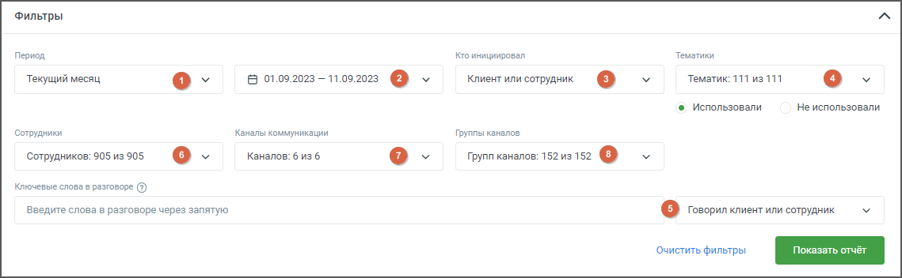
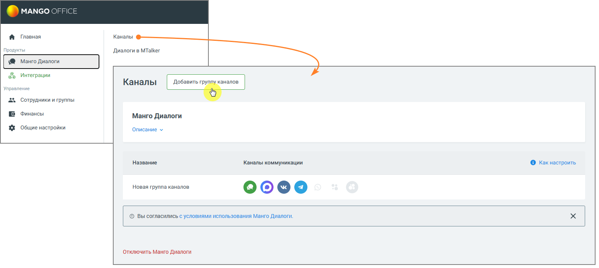
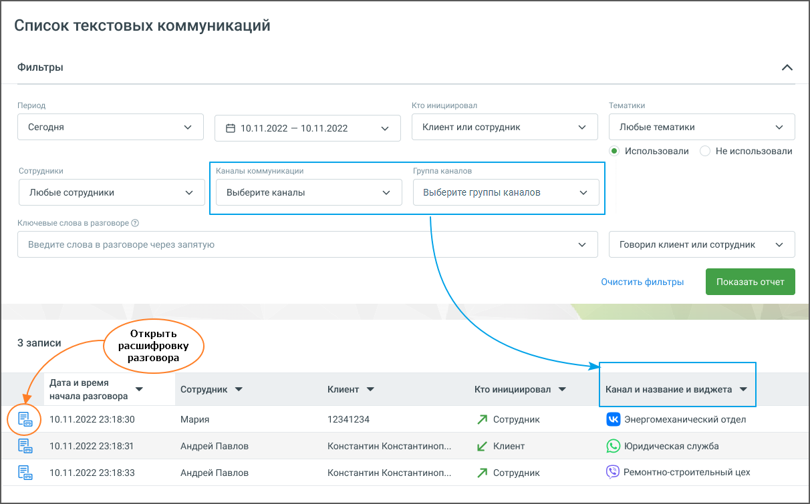
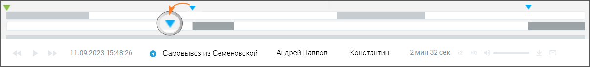
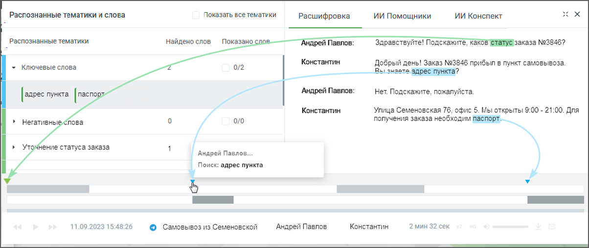
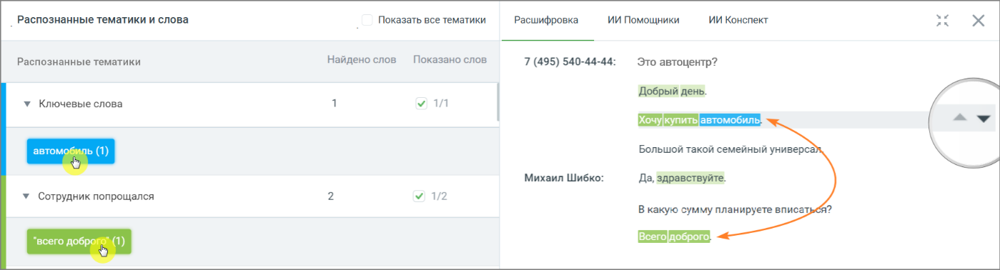

# 16.6. Текстовые коммуникации

> Трассировка: PDF §16.6 · сквозные стр. 512-516 · источники: ч.2 `kb/sources/mango-cc-manual/CC_manual_1.26.42-296-590.pdf` с.217-221.

Раздел Текстовые коммуникации предоставляет инструменты для анализа текстового взаимодействия сотрудников с клиентами через различные каналы связи. В этом разделе пользователи могут задать период диалогов, выбрать инициаторов, указать ключевые слова для поиска и применить тематики для фильтрации. Результаты поиска отображаются в виде списка разговоров, где для каждого диалога можно просмотреть текстовую расшифровку и осциллограмму с метками ключевых слов и тематик. Далее рассмотрим функции каждого подраздела, которые обеспечивают гибкость в настройке и просмотре текстовых коммуникаций. Список текстовых коммуникаций Метки на осциллограмме диалога

### 16.6.1. Список текстовых коммуникаций

При переходе на страницу «Текстовые коммуникации» отображается панель фильтров. На панели присутствуют:

> **Иллюстрация CC-86-1** · стр. 513 · раздел «16.6.1. Список текстовых коммуникаций» · снимок экрана интерфейса, 1139×352 px.
> Иллюстрирует текст руководства: «При переходе на страницу «Текстовые коммуникации» отображается панель фильтров. На панели присутствуют:»
> Следующий за иллюстрацией текст: « Период – в какой период состоялись диалоги, которые должны войти в отчет. Выпадающее меню, с вариантами периода: произвольный, текущий день, текущая неделя, текущий месяц, с прошлого месяца, с …»

 Период – в какой период состоялись диалоги, которые должны войти в отчет. Выпадающее меню, с вариантами периода: произвольный, текущий день, текущая неделя, текущий месяц, с прошлого месяца, с позапрошлого месяца, текущий год, весь период;  Календарь – для указания временного промежутка, когда были осуществлены диалоги, которые должны войти в отчет. После выбора дат, нужно подтвердить выбор кнопкой Выбрать;  Выпадающий список "Кто инициировал диалог" – канал поиска. Варианты: клиент, сотрудник, клиент или сотрудник.  Тематики – поиск проводится как по всем распознанным текстовым сообщениям, так и по сообщениям определенной тематики. Для поиска по тематикам в выпадающем списке выберите необходимый вариант. При вводе поискового запроса производится проверка на наличие каждого слова в словаре распознавания (с учетом словоформ). Возможен выбор как включенных, так и исключенных из поиска тематик. Если выбрано Использовали, то в списке выводятся диалоги, на которые проставилась хотя бы одна из выбранных тематик. Если выбрано Не использовали, в списке будут только те диалоги, на которые не проставилась ни одна из выбранных тематик.  ИИ тематики – дополнительный фильтр для поиска чатов по тематикам, распознанным с помощью ИИ Тегирования. Выбранная в фильтре ИИ тематика передаётся в плеер вместе с открытой перепиской.  Строка для ввода ключевых слов – терм. Подробнее о том, как формулировать поисковые запросы, узнайте здесь. В выпадающем списке доступен выбор канала, по которому будет вестись поиск. Варианты: Клиент, Сотрудник, Клиент или сотрудник.  Сотрудники – выпадающий список всех сотрудников, сгруппированный по группам. Имеется строка поиска по ФИО сотрудника и кнопка Выбрать все/Сбросить все.  Каналы коммуникации – выбор из выпадающего списка каналов коммуникации, доступных в разделе МангоДиалоги → Каналы. Варианты: Чат на сайте, ВКонтакте, Telegram, Max, WhatsApp, Авито.  Группы каналов – выбор из выпадающего списка групп каналов коммуникации, созданных в разделе МангоДиалоги → Каналы.

> **Иллюстрация CC-86-2** · стр. 514 · раздел «16.6.1. Список текстовых коммуникаций» · снимок экрана интерфейса, 1555×696 px.
> Иллюстрирует текст руководства: « Период – в какой период состоялись диалоги, которые должны войти в отчет. Выпадающее меню, с вариантами периода: произвольный, текущий день, текущая неделя, текущий месяц, с прошлого месяца, с позапрошлого месяца, текущий год, весь период;  Календарь – для указания временного промежутка, когда …»
> Следующий за иллюстрацией текст: «После настройки необходимых фильтров и добавления ключевых слов нажмите кнопку Показать отчет. Отобразится список разговоров, удовлетворяющих заданным условиям поиска.»

После настройки необходимых фильтров и добавления ключевых слов нажмите кнопку Показать отчет. Отобразится список разговоров, удовлетворяющих заданным условиям поиска.

> **Иллюстрация CC-86-3** · стр. 514 · раздел «16.6.1. Список текстовых коммуникаций» · снимок экрана интерфейса, 1212×755 px.
> Иллюстрирует текст руководства: «После настройки необходимых фильтров и добавления ключевых слов нажмите кнопку Показать отчет. Отобразится список разговоров, удовлетворяющих заданным условиям поиска.»
> Следующий за иллюстрацией текст: «После нажатия на кнопку Открыть расшифровку разговора, отображается текст разговора с осциллограммой.»

После нажатия на кнопку Открыть расшифровку разговора, отображается текст разговора с осциллограммой.

Если пользователь имеет ограниченные права доступа на просмотр текстовых разговоров, то в результатах поиска, по ключевым словам, будут только доступные ему разговоры.

### 16.6.2. Конспекты чатов

Если в настройках Речевой аналитики включена услуга ИИ Конспекты, в списке текстовых коммуникаций появляется отдельная колонка с отметкой наличия конспекта: если конспект не формировался — колонка остаётся пустой; если конспект в процессе формирования — отображается индикатор ожидания; если конспект готов — отображается соответствующая метка. В списке можно выбрать один или несколько чатов и отправить их на конспектирование одновременно. Отправка на конспектирование (единичная и групповая) доступна пользователям с доступом «Настройки распознавания, конспектов и агентов по сотрудникам и номерам» и фиксируется в Журнале действий.

### 16.6.3. Метки на осциллограмме диалога

Для отображения результатов поиска в текстовых сообщениях используется осциллограмма диалога, с выделенными фрагментами диалога.

> **Иллюстрация CC-86-4** · стр. 515 · раздел «16.6.3. Метки на осциллограмме диалога» · снимок экрана интерфейса, 1207×138 px.
> Иллюстрирует текст руководства: «Для отображения результатов поиска в текстовых сообщениях используется осциллограмма диалога, с выделенными фрагментами диалога.»
> Следующий за иллюстрацией текст: «При наведении курсора в область осциллограммы на тех участках диалога, где были вхождения терм, отображаются:»

При наведении курсора в область осциллограммы на тех участках диалога, где были вхождения терм, отображаются:

> **Иллюстрация CC-86-5** · стр. 515 · раздел «16.6.3. Метки на осциллограмме диалога» · значок (элемент интерфейса), встроенный в текст, 19×19 px.
> Поясняющий текст руководства (рядом с элементом): « метка для терм, найденных из строки ввода ключевых слов;»
> Предшествующий контекст: «При наведении курсора в область осциллограммы на тех участках диалога, где были вхождения терм, отображаются:»

 метка для терм, найденных из строки ввода ключевых слов;

> **Иллюстрация CC-86-6** · стр. 515 · раздел «16.6.3. Метки на осциллограмме диалога» · значок (элемент интерфейса), встроенный в текст, 18×18 px.
> Поясняющий текст руководства (рядом с элементом): « метка для терм из тематик.»
> Предшествующий контекст: « метка для терм, найденных из строки ввода ключевых слов;»

 метка для терм из тематик.

> **Иллюстрация CC-86-7** · стр. 515 · раздел «16.6.3. Метки на осциллограмме диалога» · значок (элемент интерфейса), встроенный в текст, 18×18 px.
> Поясняющий текст руководства (рядом с элементом): «При наведении курсора на метки и осциллограммы отображается всплывающее окно с указанием канала, в рамках которого была распознана терма, а также сама терма. Поиск по текстовым сообщениям может осуществляться:  по ключевым словам, в строке поиска;  с учетом выбранных в фильтре тематик. …»
> Предшествующий контекст: « метка для терм из тематик.»

> **Иллюстрация CC-86-8** · стр. 515 · раздел «16.6.3. Метки на осциллограмме диалога» · значок (элемент интерфейса), встроенный в текст, 19×19 px.
> Поясняющий текст руководства (рядом с элементом): «При наведении курсора на метки и осциллограммы отображается всплывающее окно с указанием канала, в рамках которого была распознана терма, а также сама терма. Поиск по текстовым сообщениям может осуществляться:  по ключевым словам, в строке поиска;  с учетом выбранных в фильтре тематик. …»
> Предшествующий контекст: « метка для терм из тематик.»

При наведении курсора на метки и осциллограммы отображается всплывающее окно с указанием канала, в рамках которого была распознана терма, а также сама терма. Поиск по текстовым сообщениям может осуществляться:  по ключевым словам, в строке поиска;  с учетом выбранных в фильтре тематик. Соответственно будут различаться метки на осциллограмме диалога.

> **Иллюстрация CC-86-9** · стр. 515 · раздел «16.6.3. Метки на осциллограмме диалога» · снимок экрана интерфейса, 1204×508 px.
> Иллюстрирует текст руководства: «При наведении курсора на метки и осциллограммы отображается всплывающее окно с указанием канала, в рамках которого была распознана терма, а также сама терма. Поиск по текстовым сообщениям может осуществляться:  по ключевым словам, в строке поиска;  с учетом выбранных в фильтре тематик. …»
> Следующий за иллюстрацией текст: « Если во всплывающем окне осциллограммы в списке тематик выбрать какую-либо тематику, то на осциллограмме будут отображены метки, принадлежащие только этой тематике, и не будут отображены метки, …»

 Если во всплывающем окне осциллограммы в списке тематик выбрать какую-либо тематику, то на осциллограмме будут отображены метки, принадлежащие только этой тематике, и не будут отображены метки, принадлежащие другим тематикам из списка.  Если во всплывающем окне осциллограммы в списке ключевых слов выбрать какое- либо ключевое слово, то на осциллограмме будут отображены метки, принадлежащие только этому ключевому слову, и не будут отображены метки, принадлежащие другим ключевым словам из списка. Выбор термы или ключевого слова в блоке «Распознанные словари и слова» выделяет

> **Иллюстрация CC-86-10** · стр. 516 · раздел «16.6.3. Метки на осциллограмме диалога» · значок (элемент интерфейса), встроенный в текст, 46×15 px.
> Поясняющий текст руководства (рядом с элементом): «фрагмент диалога, с этой термой/ключевым словом. Пиктограммы позволяют быстро переключаться между фрагментами, содержащими выбранные термы/ключевые слова.»
> Предшествующий контекст: « Если во всплывающем окне осциллограммы в списке тематик выбрать какую-либо тематику, то на осциллограмме будут отображены метки, принадлежащие только этой тематике, и не будут отображены метки, …»

фрагмент диалога, с этой термой/ключевым словом. Пиктограммы позволяют быстро переключаться между фрагментами, содержащими выбранные термы/ключевые слова.

> **Иллюстрация CC-86-11** · стр. 516 · раздел «16.6.3. Метки на осциллограмме диалога» · снимок экрана интерфейса, 1399×378 px.
> Иллюстрирует текст руководства: «фрагмент диалога, с этой термой/ключевым словом. Пиктограммы позволяют быстро переключаться между фрагментами, содержащими выбранные термы/ключевые слова.»
> Следующий за иллюстрацией текст: «Клик по пиктограмме сворачивает окно диалога в компактный формат. Для отображения»

> **Иллюстрация CC-86-12** · стр. 516 · раздел «16.6.3. Метки на осциллограмме диалога» · значок (элемент интерфейса), встроенный в текст, 16×16 px.
> Поясняющий текст руководства (рядом с элементом): «Клик по пиктограмме сворачивает окно диалога в компактный формат. Для отображения»
> Предшествующий контекст: «фрагмент диалога, с этой термой/ключевым словом. Пиктограммы позволяют быстро переключаться между фрагментами, содержащими выбранные термы/ключевые слова.»

Клик по пиктограмме сворачивает окно диалога в компактный формат. Для отображения

> **Иллюстрация CC-86-13** · стр. 516 · раздел «16.6.3. Метки на осциллограмме диалога» · значок (элемент интерфейса), встроенный в текст, 16×16 px.
> Поясняющий текст руководства (рядом с элементом): «окна в полной форме следует нажать на пиктограмму ..»
> Предшествующий контекст: «Клик по пиктограмме сворачивает окно диалога в компактный формат. Для отображения»

окна в полной форме следует нажать на пиктограмму ..

### 16.6.4. Плеер чата

Правая часть плеера с расшифровкой чата устроена аналогично плееру для звонков и содержит три вкладки: Расшифровка, Конспект и ИИ Помощник. Если у чата ещё нет конспекта, во вкладке Конспект отображается кнопка Конспектировать. Нажатие на кнопку отправляет переписку на обработку выбранным промптом — стандартным от MANGO OFFICE или пользовательским, — после чего в этой же вкладке формируется краткое содержание переписки. Во вкладке ИИ Помощник отображаются результаты анализа чата всеми активными ИИ Помощниками, настроенными для обработки текстовых коммуникаций.
