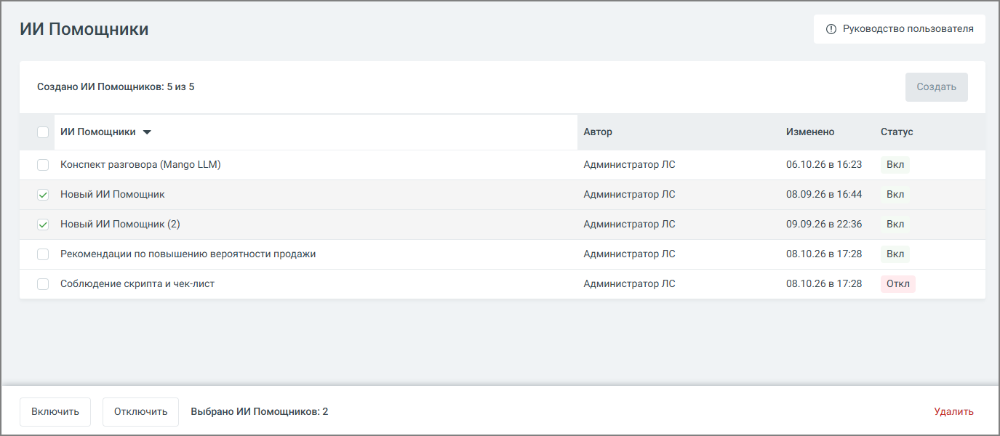
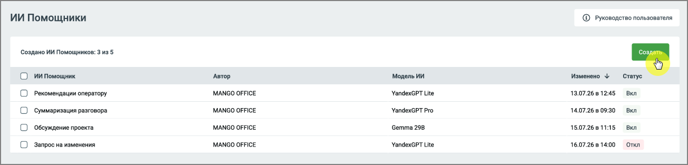
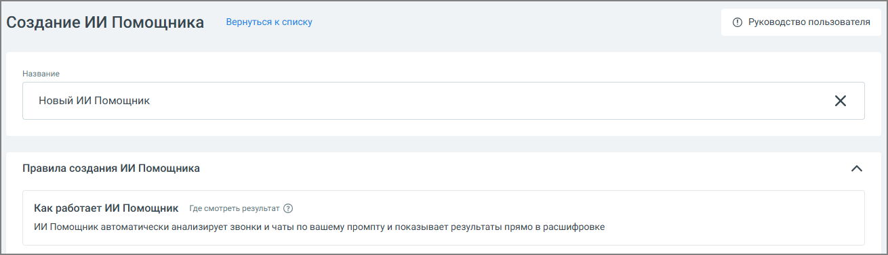
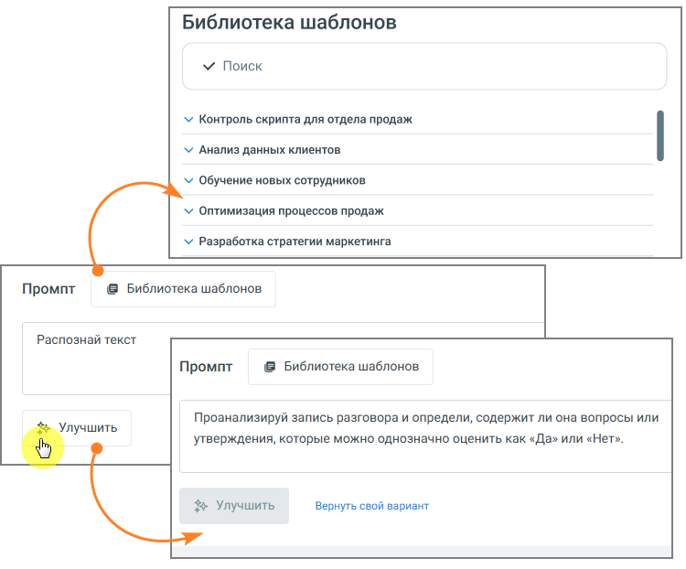
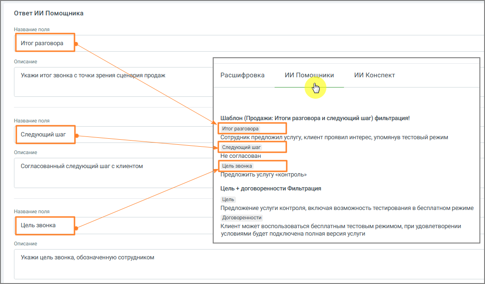
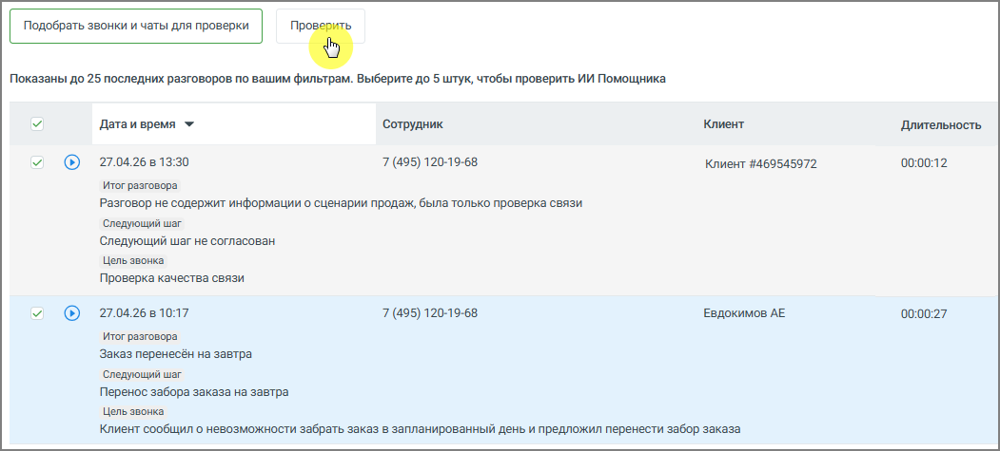
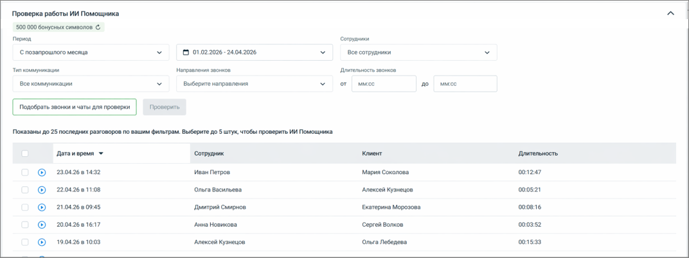
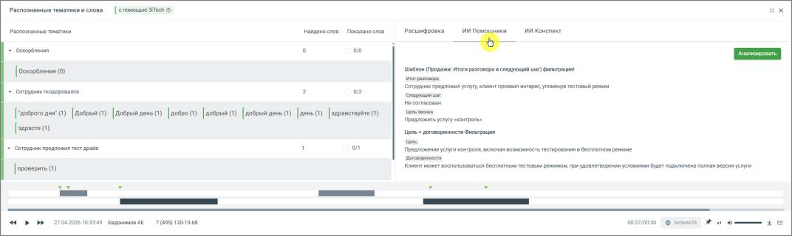

# 16.7. ИИ Помощники

> Трассировка: PDF §16.7 · сквозные стр. 516-523 · источники: ч.2 `kb/sources/mango-cc-manual/CC_manual_1.26.42-296-590.pdf` с.221-228.

ИИ Помощники – это инструмент, который позволяет автоматически анализировать разговоры по заданным вами правилам и получать не только краткое содержание, но и полезные выводы и рекомендации. Чтобы включить, отключить или удалить сразу несколько ИИ Помощников, отметьте их чекбоксы в таблице. Панель групповых действий появляется внизу страницы только после того, как отмечен хотя бы один чекбокс. На панели отображается количество выбранных помощников и кнопки Включить, Отключить и Удалить. Чекбокс в заголовке таблицы отмечает всех помощников сразу.

> **Иллюстрация CC-87-1** · стр. 517 · раздел «16.7. ИИ Помощники» · снимок экрана интерфейса, 1375×600 px.
> Иллюстрирует текст руководства: «ИИ Помощники – это инструмент, который позволяет автоматически анализировать разговоры по заданным вами правилам и получать не только краткое содержание, но и полезные выводы и рекомендации. Чтобы включить, отключить или удалить сразу несколько ИИ Помощников, отметьте их чекбоксы в таблице. Панель …»
> Следующий за иллюстрацией текст: «В отличие от стандартных ИИ Конспектов, ИИ Помощники можно настраивать под конкретные задачи бизнеса. Вы сами определяете, что именно нужно искать и как интерпретировать разговор. С помощью ИИ …»

В отличие от стандартных ИИ Конспектов, ИИ Помощники можно настраивать под конкретные задачи бизнеса. Вы сами определяете, что именно нужно искать и как интерпретировать разговор. С помощью ИИ Помощников вы можете:  контролировать соблюдение скриптов  выявлять проблемы в диалогах с клиентами  получать рекомендации по улучшению работы сотрудников  анализировать разговоры с разных точек зрения одновременно Один и тот же разговор может быть обработан несколькими помощниками, и каждый из них даст свой результат. Настройки ИИ Помощника доступны и в том случае, если услуга «Распознавание разговоров» не подключена, — например, если планируется анализировать только чаты. Для новых пользователей раздел дополнен карточками онбординга, которые помогают быстрее разобраться с настройкой. В Настройках, в блоке ИИ Помощники, отображается остаток бесплатных символов. Когда лимит исчерпан, вместо остатка отображается цена «от _ руб. за 1 000 символов». Оплачиваются только символы промпта и ответа ИИ, длина самого разговора не тарифицируется. Списание происходит каждую ночь, стоимость зависит от выбранной модели LLM.

Как создать ИИ Помощника

1. Перейдите в раздел ИИ Помощники

2. Нажмите кнопку Создать

> **Иллюстрация CC-87-2** · стр. 517 · раздел «16.7. ИИ Помощники» · снимок экрана интерфейса, 1304×313 px.
> Иллюстрирует текст руководства: «2. Нажмите кнопку Создать»
> Следующий за иллюстрацией текст: «3. Откроется форма создания нового ИИ Помощника»

3. Откроется форма создания нового ИИ Помощника

> **Иллюстрация CC-87-3** · стр. 518 · раздел «16.7. ИИ Помощники» · снимок экрана интерфейса, 1310×377 px.
> Иллюстрирует текст руководства: «3. Откроется форма создания нового ИИ Помощника»
> Следующий за иллюстрацией текст: «Настройка ИИ Помощника»

Настройка ИИ Помощника

1. Название – введите название помощника. Рекомендуется указывать название по задаче, например:  контроль скрипта  анализ жалоб  проверка качества общения Модель ИИ – выберите модель, на которой будет работать помощник. По умолчанию используется YandexGPT Lite. Если на аккаунте доступна модель MANGO GPT, ее также можно выбрать. Рядом с полем отображается подсказка с ценой за 1 000 символов. Если поменять модель у сохраненного помощника, новая цена применяется только к новым диалогам.

2. Промпт – определяет, какой именно результат будет получать пользователь. По сути, это описание задачи для анализа разговора. Чтобы результат был полезным:  формулируйте задачу конкретно  указывайте, что именно нужно определить или сформулировать  задавайте формат ответа (например, кратко, с примерами, с оценкой и т.д.) Один и тот же разговор может анализироваться по-разному в зависимости от промпта, поэтому рекомендуется создавать отдельные ИИ Помощники под разные задачи.  введите текст задания для анализа разговора  при необходимости нажмите Улучшить, чтобы система помогла уточнить формулировку  можно использовать Библиотеку шаблонов и выбрать нужный промт

> **Иллюстрация CC-87-4** · стр. 519 · раздел «16.7. ИИ Помощники» · снимок экрана интерфейса, 750×622 px.
> Иллюстрирует текст руководства: «2. Промпт – определяет, какой именно результат будет получать пользователь. По сути, это описание задачи для анализа разговора. Чтобы результат был полезным:  формулируйте задачу конкретно  указывайте, что именно нужно определить или сформулировать  задавайте формат ответа (например, кратко, с …»
> Следующий за иллюстрацией текст: «Примеры промта:  «Проанализируй диалог сотрудника с клиентом. Определи цель звонка, итог разговора, был ли согласован следующий шаг (какой именно) и на какую дату/время, а также наличие отказа и его …»

Примеры промта:  «Проанализируй диалог сотрудника с клиентом. Определи цель звонка, итог разговора, был ли согласован следующий шаг (какой именно) и на какую дату/время, а также наличие отказа и его причины словами клиента.»  «Ты оцениваешь диалог сотрудника контактного центра и клиента. В данном диалоге сотрудник пытался продать товар или услугу. Проанализируй диалог и дай свои рекомендации – что сотрудник мог бы улучшить в работе для повышения вероятности продажи. Отвечай емко и по существу. К каждой рекомендации делай отсылку к элементу диалога где обнаружена зона роста с указанием времени. Сделай максимум 5 ключевых рекомендаций не больше чем на 300 слов.»

3. Ответ ИИ Помощника – результат работы ИИ Помощника можно настроить под нужный уровень детализации. Возможны два подхода:  единый общий вывод по разговору  структурированный ответ, разбитый на несколько частей Разделение на части удобно, если требуется анализ по нескольким аспектам - например, в плеере отдельно выделить содержание разговора, принятые решения и последующие действия. На примере ниже показан вариант настроек структурированного ответа в блоке настроек, а также итоговое отображение ответа в плеере звонка.

> **Иллюстрация CC-87-5** · стр. 520 · раздел «16.7. ИИ Помощники» · снимок экрана интерфейса, 1042×610 px.
> Иллюстрирует текст руководства: «3. Ответ ИИ Помощника – результат работы ИИ Помощника можно настроить под нужный уровень детализации. Возможны два подхода:  единый общий вывод по разговору  структурированный ответ, разбитый на несколько частей Разделение на части удобно, если требуется анализ по нескольким аспектам - например, …»
> Следующий за иллюстрацией текст: «4. Звонки и чаты для анализа – здесь задаётся, какие разговоры будет анализировать помощник. Можно указать:  сотрудников или группы  номера  тип коммуникации (звонки, чаты)  направление звонков  …»

4. Звонки и чаты для анализа – здесь задаётся, какие разговоры будет анализировать помощник. Можно указать:  сотрудников или группы  номера  тип коммуникации (звонки, чаты)  направление звонков  длительность разговора Это позволяет применять помощника только к нужным диалогам.

Проверка работы ИИ Помощника Перед использованием рекомендуется проверить работу:

1. Выберите период и фильтры

2. Нажмите Подобрать звонки и чаты для проверки

3. Выберите до 5 разговоров

4. Нажмите Проверить Вы увидите, как помощник анализирует реальные диалоги. Если бесплатные символы еще доступны, в окне проверки отображается плашка с их остатком, обновить значение можно кнопкой рядом. Если лимит исчерпан, отображается предупреждение «Бесплатный лимит символов исчерпан. Тестирование будет тарифицироваться по цене выбранной модели». Проверка выполняется на модели, выбранной в форме в момент запуска, и оплачивается независимо от того, будет ли помощник сохранен.

> **Иллюстрация CC-87-6** · стр. 521 · раздел «16.7. ИИ Помощники» · снимок экрана интерфейса, 1051×475 px.
> Иллюстрирует текст руководства: «4. Нажмите Проверить Вы увидите, как помощник анализирует реальные диалоги. Если бесплатные символы еще доступны, в окне проверки отображается плашка с их остатком, обновить значение можно кнопкой рядом. Если лимит исчерпан, отображается предупреждение «Бесплатный лимит символов исчерпан. …»
> Следующий за иллюстрацией текст: «Тестирование позволяет заранее проверить, как ИИ Помощник будет анализировать реальные разговоры, до его сохранения и включения в работу. Это даёт пользователю следующие преимущества:  позволяет …»

Тестирование позволяет заранее проверить, как ИИ Помощник будет анализировать реальные разговоры, до его сохранения и включения в работу. Это даёт пользователю следующие преимущества:  позволяет убедиться, что помощник правильно понимает задачу  помогает выявить неточности или ошибки в формулировке промпта  даёт возможность сравнить результат на нескольких разговорах  снижает риск получения некорректных или бесполезных выводов после запуска  экономит время, исключая необходимость последующей переработки настроек В результате пользователь получает более точный и предсказуемый анализ разговоров сразу после включения помощника. Для сохранения данных нажмите кнопку Создать. После этого помощник начнёт автоматически анализировать подходящие разговоры.

Где смотреть результаты

Чтобы посмотреть результат анализа:

1. Настройте фильтры

> **Иллюстрация CC-87-7** · стр. 521 · раздел «16.7. ИИ Помощники» · снимок экрана интерфейса, 1072×403 px.
> Иллюстрирует текст руководства: «1. Настройте фильтры»
> Следующий за иллюстрацией текст: «2. Откройте запись разговора»

2. Откройте запись разговора

3. Нажмите кнопку прослушивания

4. В плеере перейдите во вкладку ИИ Помощники

> **Иллюстрация CC-87-8** · стр. 522 · раздел «16.7. ИИ Помощники» · снимок экрана интерфейса, 1072×321 px.
> Иллюстрирует текст руководства: «4. В плеере перейдите во вкладку ИИ Помощники»
> Следующий за иллюстрацией текст: «Здесь отображаются:  ответы всех активных помощников  результаты анализа по каждому из них Один разговор может содержать несколько ответов - по числу активных помощников. Особенности работы  …»

Здесь отображаются:  ответы всех активных помощников  результаты анализа по каждому из них Один разговор может содержать несколько ответов - по числу активных помощников. Особенности работы  каждый помощник работает независимо  один разговор может содержать несколько ответов - по числу активных ИИ Помощников  по умолчанию обрабатываются разговоры от 20 секунд, если иная длительность не задана в фильтре; система не позволяет задать в фильтре длительность менее 20 секунд  результаты отображаются вместе с расшифровкой, ИИ Конспектом и тематиками из любых отчетов  помощники анализируют разговоры автоматически после их расшифровки  список созданных ИИ Помощников можно отсортировать по столбцу «Наименование» Рекомендации  создавайте отдельных помощников под разные задачи  формулируйте промпт максимально конкретно  проверяйте результат на тестовых звонках перед использованием  при необходимости используйте кнопку Улучшить для доработки запроса
