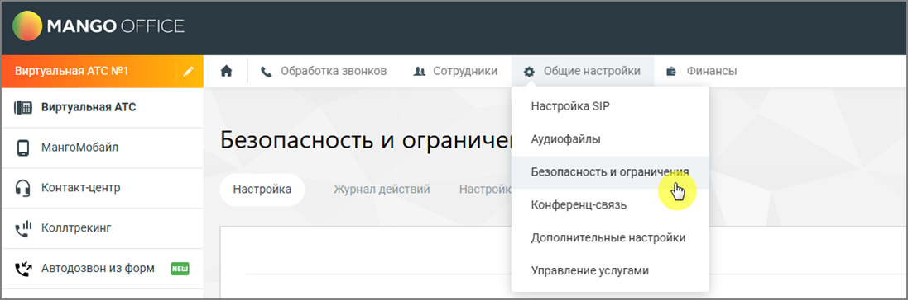
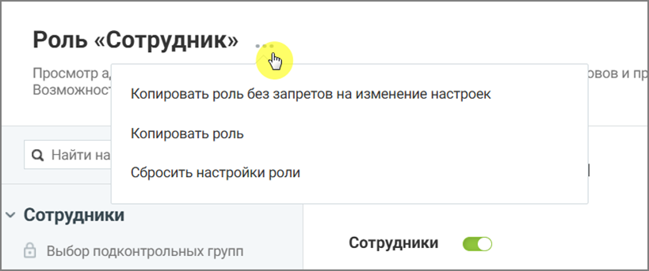
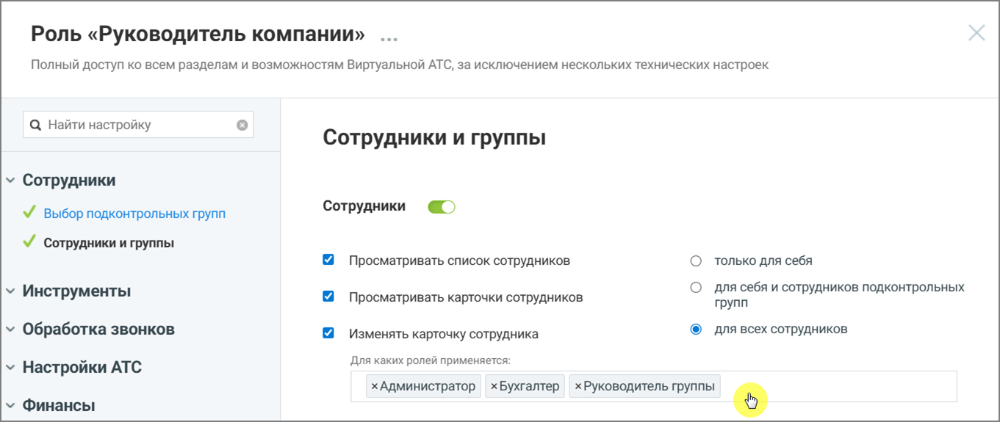
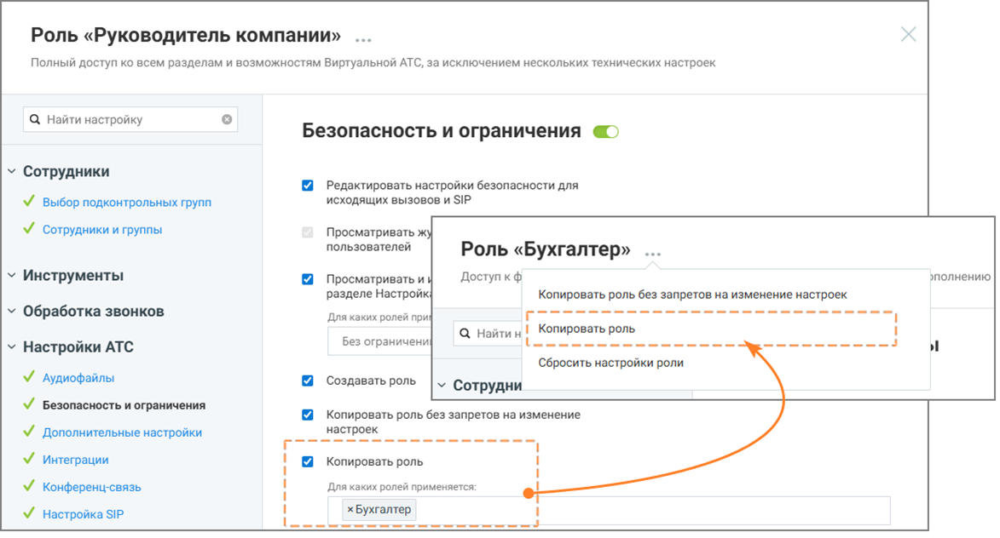
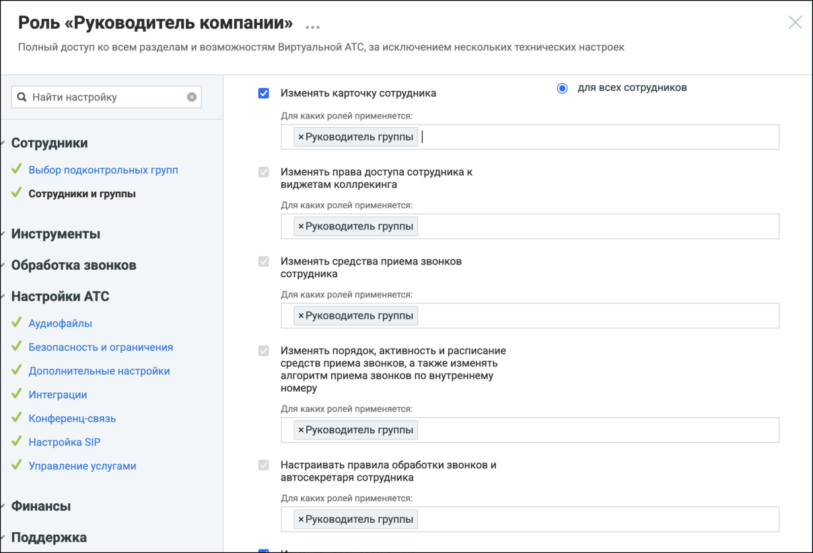
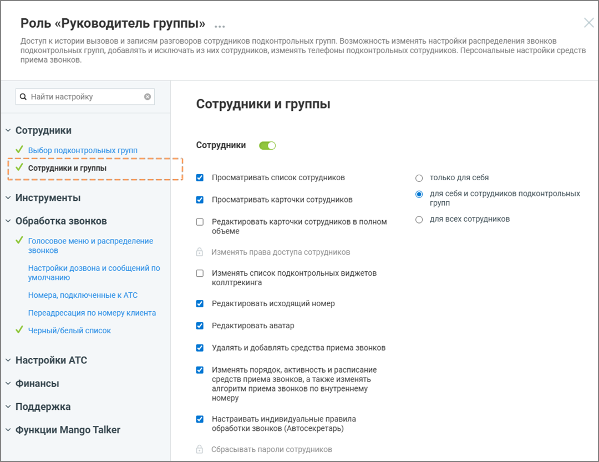

# 17. Приложение 1. Управление правами доступа

> Трассировка: PDF §17 · сквозные стр. 523-528 · источники: ч.2 `kb/sources/mango-cc-manual/CC_manual_1.26.42-296-590.pdf` с.228-233.

В данном приложении приведено сводное описание параметров доступности, разрешений (прав) и функциональных возможностей Личного кабинета ВАТС MANGO OFFICE в зависимости от выбранной роли, установленных по умолчанию.

Права доступа для роли в ЛК ВАТС не являются статичными параметрами. Система предоставляет возможность пользователю менять (включать и отключать) большинство прав доступа для ролей, в зависимости от потребностей бизнеса.

1. Управление ролями Управление ролями выполняется в разделе: Настройки АТС → Безопасность и ограничения → Настройка доступа

> **Иллюстрация CC-88-1** · стр. 523 · раздел «17. Приложение 1. Управление правами доступа» · снимок экрана интерфейса, 1097×364 px.
> Иллюстрирует текст руководства: «1. Управление ролями Управление ролями выполняется в разделе: Настройки АТС → Безопасность и ограничения → Настройка доступа»
> Следующий за иллюстрацией текст: «В этом разделе можно просматривать роли, создавать новые роли, изменять права доступа ролей и удалять пользовательские роли. Роль представляет собой набор прав доступа. Назначение роли пользователю …»

В этом разделе можно просматривать роли, создавать новые роли, изменять права доступа ролей и удалять пользовательские роли. Роль представляет собой набор прав доступа. Назначение роли пользователю определяет, какие функции системы будут ему доступны.

Создавать роли могут только пользователи, обладающие правом доступа «Создать роль».

2. Создание роли Создание роли позволяет определить новый набор прав доступа для пользователей системы. Создать пользовательскую роль можно с помощью кнопки «Создать роль». Этот способ используется, если требуется создать роль с полностью уникальным набором прав.

Роль, созданная таким образом, изначально не имеет никаких прав доступа. После создания необходимо включить нужные права, чтобы пользователи могли выполнять свои задачи.

> **Иллюстрация CC-88-2** · стр. 524 · раздел «17. Приложение 1. Управление правами доступа» · снимок экрана интерфейса, 1488×632 px.
> Иллюстрирует текст руководства: «Роль, созданная таким образом, изначально не имеет никаких прав доступа. После создания необходимо включить нужные права, чтобы пользователи могли выполнять свои задачи.»
> Следующий за иллюстрацией текст: «Чтобы создать роль: откройте раздел Настройки АТС → Безопасность и ограничения   нажмите кнопку Создать роль  укажите название роли  при необходимости укажите описание роли  настройте права …»

Чтобы создать роль: откройте раздел Настройки АТС → Безопасность и ограничения   нажмите кнопку Создать роль  укажите название роли  при необходимости укажите описание роли  настройте права доступа роли  нажмите Сохранить

3. Создание роли путем копирования Новую роль можно создать на основе существующей роли. В этом случае права доступа исходной роли копируются в новую роль.

> **Иллюстрация CC-88-3** · стр. 524 · раздел «17. Приложение 1. Управление правами доступа» · снимок экрана интерфейса, 819×343 px.
> Иллюстрирует текст руководства: «3. Создание роли путем копирования Новую роль можно создать на основе существующей роли. В этом случае права доступа исходной роли копируются в новую роль.»
> Следующий за иллюстрацией текст: «Данная строка меню доступна для нажатия если у пользователя активировано право доступа Настройка АТС → Безопасность и ограничения → Копировать роль без запретов на»

Данная строка меню доступна для нажатия если у пользователя активировано право доступа Настройка АТС → Безопасность и ограничения → Копировать роль без запретов на

изменение настроек.

Важно понимать: копия роли наследует от источника только перечень доступных разделов. Если раздел был закрыт/открыт для исходной роли, после создания копии он останется аналогично закрытым/открытым, с возможностью последующего изменения доступа.

Также внутри каждого унаследованного раздела копия получает возможность подключения полного набора всех возможных прав, даже если у источника они были отключены. После создания роли-копии обязательно отключите ненужные права, чтобы избежать избыточных разрешений.

Чтобы создать роль на основе существующей, без запретов на изменение настроек: откройте раздел Настройки АТС → Безопасность и ограничения   выберите системную роль, на основе которой будет создаваться пользовательская

> **Иллюстрация CC-88-4** · стр. 525 · раздел «17. Приложение 1. Управление правами доступа» · значок (элемент интерфейса), встроенный в текст, 54×37 px.
> Поясняющий текст руководства (рядом с элементом): « нажмите иконку контекстного меню и в выпадающем окне выберите вариант «Копировать роль без запретов на изменение настроек»  нажмите кнопку Создать роль  укажите название роли  при необходимости укажите описание роли  настройте права доступа роли  нажмите Сохранить»
> Предшествующий контекст: «Чтобы создать роль на основе существующей, без запретов на изменение настроек: откройте раздел Настройки АТС → Безопасность и ограничения   выберите системную роль, на основе которой будет …»

 нажмите иконку контекстного меню и в выпадающем окне выберите вариант «Копировать роль без запретов на изменение настроек»  нажмите кнопку Создать роль  укажите название роли  при необходимости укажите описание роли  настройте права доступа роли  нажмите Сохранить

4. Гибкая настройка прав с учетом ролей В ЛК ВАТС существует возможность тонкой настройки для ряда существующих опций. При активации некоторых разрешений можно ограничить их действие не только уровнем влияния (на себя, подчиненных или всех), но и конкретным списком ролей. Как это работает: вы включаете настройку (например, «Изменять карточку сотрудника») и выбираете уровень влияния «Для всех сотрудников». Дополнительно вы можете указать, для сотрудников с какими ролями будет доступно это действие. При настройке вам доступны следующие варианты:  Без ограничений — настройка активна для всех сотрудников, независимо от их роли (работает так же, как и раньше).  Выбор одной или нескольких ролей из списка — в этом случае действие будет разрешено только в том случае, если целевой сотрудник имеет одну из выбранных ролей.

> **Иллюстрация CC-88-5** · стр. 525 · раздел «17. Приложение 1. Управление правами доступа» · снимок экрана интерфейса, 1361×575 px.
> Иллюстрирует текст руководства: «4. Гибкая настройка прав с учетом ролей В ЛК ВАТС существует возможность тонкой настройки для ряда существующих опций. При активации некоторых разрешений можно ограничить их действие не только уровнем влияния (на себя, подчиненных или всех), но и конкретным списком ролей. Как это работает: вы …»
> Следующий за иллюстрацией текст: «Рисунок 1. Роль «Руководитель компании», настройка «Изменять карточку сотрудника» На рис.1 пользователю с ролью Руководитель компании предоставлено разрешение на изменение карточки сотрудника только …»

Рисунок 1. Роль «Руководитель компании», настройка «Изменять карточку сотрудника» На рис.1 пользователю с ролью Руководитель компании предоставлено разрешение на изменение карточки сотрудника только для ролей Администратор, Бухгалтер, Руководитель группы.

> **Иллюстрация CC-88-6** · стр. 526 · раздел «17. Приложение 1. Управление правами доступа» · снимок экрана интерфейса, 1173×632 px.
> Иллюстрирует текст руководства: «Рисунок 1. Роль «Руководитель компании», настройка «Изменять карточку сотрудника» На рис.1 пользователю с ролью Руководитель компании предоставлено разрешение на изменение карточки сотрудника только для ролей Администратор, Бухгалтер, Руководитель группы.»
> Следующий за иллюстрацией текст: «Рисунок 2. Роль «Руководитель компании», настройка «Копировать роль» На рис.2 показан пример настройки роли Руководитель компании. У этой роли есть полный доступ ко всем разделам системы, а в блоке …»

Рисунок 2. Роль «Руководитель компании», настройка «Копировать роль» На рис.2 показан пример настройки роли Руководитель компании. У этой роли есть полный доступ ко всем разделам системы, а в блоке настроек «Копировать роль» задано ограничение: руководитель может копировать только роль Бухгалтер. Это означает, что сотрудник с ролью Руководитель компании:  сможет создать копию роли Бухгалтер (кнопка копирования будет активна);  не сможет скопировать никакие другие роли — при попытке это сделать система покажет уведомление об отсутствии прав.

> **Иллюстрация CC-88-7** · стр. 526 · раздел «17. Приложение 1. Управление правами доступа» · снимок экрана интерфейса, 1208×822 px.
> Иллюстрирует текст руководства: «Рисунок 2. Роль «Руководитель компании», настройка «Копировать роль» На рис.2 показан пример настройки роли Руководитель компании. У этой роли есть полный доступ ко всем разделам системы, а в блоке настроек «Копировать роль» задано ограничение: руководитель может копировать только роль Бухгалтер. …»
> Следующий за иллюстрацией текст: «Рисунок 3. Роль «Руководитель компании», настройки.»

Рисунок 3. Роль «Руководитель компании», настройки.

На рис.3 пользователь с ролью Руководитель кампании имеет доступ к редактированию карточки сотрудника пользователям только с ролью Руководитель группы. Это позволяет строить более сложные и безопасные сценарии разграничения доступа, когда возможность совершить действие зависит от того, на какую роль оно нацелено.

5. Права доступа Права доступа роли определяют, какие действия доступны пользователям с этой ролью и к каким разделам системы они могут получить доступ. Каждое право доступа связано с определённой функцией системы. Если право включено, пользователю доступна соответствующая функция. Если право отключено, выполнение этой функции недоступно. Настройка прав доступа выполняется при создании роли или при редактировании существующей роли. Чтобы изменить права доступа роли:  откройте раздел Настройки АТС → Безопасность и ограничения → Настройка доступа

 выберите роль, права доступа которой необходимо изменить  включите или отключите необходимые права доступа и ограничения  нажмите Сохранить.

> **Иллюстрация CC-88-8** · стр. 527 · раздел «17. Приложение 1. Управление правами доступа» · снимок экрана интерфейса, 1080×833 px.
> Иллюстрирует текст руководства: « выберите роль, права доступа которой необходимо изменить  включите или отключите необходимые права доступа и ограничения  нажмите Сохранить.»
> Следующий за иллюстрацией текст: «Некоторые права доступа могут зависеть от других прав. В этом случае изменение одного права может автоматически изменить состояние другого права. При редактировании прав в интерфейсе Личного кабинета …»

Некоторые права доступа могут зависеть от других прав. В этом случае изменение одного права может автоматически изменить состояние другого права. При редактировании прав в интерфейсе Личного кабинета ВАТС в таких случаях отображаются подсказки. Также часть прав может быть недоступна для изменения и отображаться в режиме только чтения. Такие права устанавливаются системой и не могут быть изменены вручную. Статусы прав доступа в разрезе возможностей подключения:

> **Иллюстрация CC-88-9** · стр. 528 · раздел «17. Приложение 1. Управление правами доступа» · значок (элемент интерфейса), встроенный в текст, 15×16 px.
> Поясняющий текст руководства (рядом с элементом): «- право доступно, но не подключено»
> Предшествующий контекст: «Некоторые права доступа могут зависеть от других прав. В этом случае изменение одного права может автоматически изменить состояние другого права. При редактировании прав в интерфейсе Личного кабинета …»

- право доступно, но не подключено

> **Иллюстрация CC-88-10** · стр. 528 · раздел «17. Приложение 1. Управление правами доступа» · значок (элемент интерфейса), встроенный в текст, 15×14 px.
> Поясняющий текст руководства (рядом с элементом): «- право доступно и подключено»
> Предшествующий контекст: «- право доступно, но не подключено»

- право доступно и подключено

> **Иллюстрация CC-88-11** · стр. 528 · раздел «17. Приложение 1. Управление правами доступа» · значок (элемент интерфейса), встроенный в текст, 15×15 px.
> Поясняющий текст руководства (рядом с элементом): «- возможность подключения зависит от активности какого-либо из предыдущих прав доступа»
> Предшествующий контекст: «- право доступно и подключено»

- возможность подключения зависит от активности какого-либо из предыдущих прав доступа

> **Иллюстрация CC-88-12** · стр. 528 · раздел «17. Приложение 1. Управление правами доступа» · значок (элемент интерфейса), встроенный в текст, 14×18 px.
> Поясняющий текст руководства (рядом с элементом): «- право недоступно для подключения»
> Предшествующий контекст: «- возможность подключения зависит от активности какого-либо из предыдущих прав доступа»

- право недоступно для подключения

> **Иллюстрация CC-88-13** · стр. 528 · раздел «17. Приложение 1. Управление правами доступа» · значок (элемент интерфейса), встроенный в текст, 15×14 px.
> Поясняющий текст руководства (рядом с элементом): «- право подключено и недоступно для отключения»
> Предшествующий контекст: «- право недоступно для подключения»

- право подключено и недоступно для отключения

> **Иллюстрация CC-88-14** · стр. 528 · раздел «17. Приложение 1. Управление правами доступа» · значок (элемент интерфейса), встроенный в текст, 25×25 px.
> Поясняющий текст руководства (рядом с элементом): «Иконка рядом с названием раздела означает, что для роли включена возможность доступа хотя бы к одной функции этого раздела. Если иконка отсутствует, доступ к функциям раздела для данной роли не предоставлен. Переключатель состояния прав доступа раздела может иметь следующий вид:»
> Предшествующий контекст: «- право подключено и недоступно для отключения»

Иконка рядом с названием раздела означает, что для роли включена возможность доступа хотя бы к одной функции этого раздела. Если иконка отсутствует, доступ к функциям раздела для данной роли не предоставлен. Переключатель состояния прав доступа раздела может иметь следующий вид:

> **Иллюстрация CC-88-15** · стр. 528 · раздел «17. Приложение 1. Управление правами доступа» · значок (элемент интерфейса), встроенный в текст, 38×18 px.
> Поясняющий текст руководства (рядом с элементом): «— все права доступа к разделу для данной роли отключены»
> Предшествующий контекст: «Иконка рядом с названием раздела означает, что для роли включена возможность доступа хотя бы к одной функции этого раздела. Если иконка отсутствует, доступ к функциям раздела для данной роли не …»

— все права доступа к разделу для данной роли отключены

> **Иллюстрация CC-88-16** · стр. 528 · раздел «17. Приложение 1. Управление правами доступа» · значок (элемент интерфейса), встроенный в текст, 37×18 px.
> Поясняющий текст руководства (рядом с элементом): «— права доступа доступны для подключения»
> Предшествующий контекст: «— все права доступа к разделу для данной роли отключены»

— права доступа доступны для подключения

> **Иллюстрация CC-88-17** · стр. 528 · раздел «17. Приложение 1. Управление правами доступа» · значок (элемент интерфейса), встроенный в текст, 37×18 px.
> Поясняющий текст руководства (рядом с элементом): «— все права доступа отключены и недоступны для подключения»
> Предшествующий контекст: «— права доступа доступны для подключения»

— все права доступа отключены и недоступны для подключения

> **Иллюстрация CC-88-18** · стр. 528 · раздел «17. Приложение 1. Управление правами доступа» · значок (элемент интерфейса), встроенный в текст, 37×18 px.
> Поясняющий текст руководства (рядом с элементом): «— все права доступа включены и недоступны для отключения»
> Предшествующий контекст: «— все права доступа отключены и недоступны для подключения»

— все права доступа включены и недоступны для отключения
