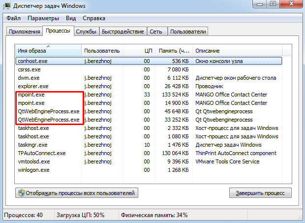

# 21. Приложение 5: Блокировка Контакт-центра

> Трассировка: PDF §21 · сквозные стр. 577-578 · источники: ч.2 `kb/sources/mango-cc-manual/CC_manual_1.26.42-296-590.pdf` с.282-283.

Для того, чтобы основные и дочерние процессы Контакт-центра MANGO OFFICE не блокировались службами безопасности вашей компании, в диспетчере задач Windows следующие процессы приложения следует добавить в исключения:

> **Иллюстрация CC-99-1** · стр. 577 · раздел «21. Приложение 5: Блокировка Контакт-центра» · снимок экрана интерфейса, 620×453 px.
> Иллюстрирует текст руководства: «Для того, чтобы основные и дочерние процессы Контакт-центра MANGO OFFICE не блокировались службами безопасности вашей компании, в диспетчере задач Windows следующие процессы приложения следует добавить в исключения:»
> Следующий за иллюстрацией текст: « mpoint (корневой) – главное приложение;  mpoint (дочерний) – проигрыватель mp3 записей;  QtWebEngineProcess.exe – браузер для отображения Web-содержимого в клиентском приложении (количество …»

 mpoint (корневой) – главное приложение;  mpoint (дочерний) – проигрыватель mp3 записей;  QtWebEngineProcess.exe – браузер для отображения Web-содержимого в клиентском приложении (количество процессов определяется количеством загруженных страниц и их содержимого);  u.mpoint – установщик обновлений (запускается только при автоматическом обновлении).
