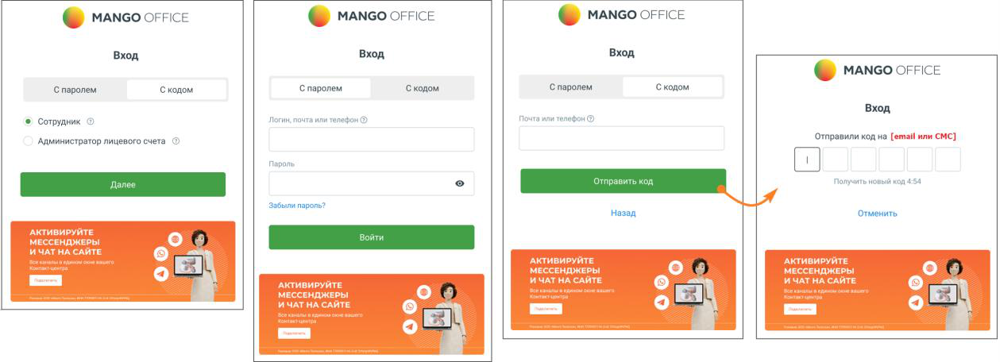
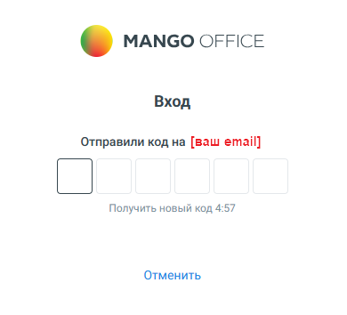
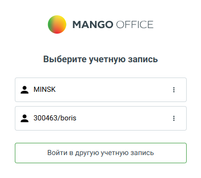

## 1.1. Вход в личный кабинет

> Трассировка: PDF §1.1 · сквозные стр. 6-8 · источники: ч.1 `kb/sources/mango-lk-manual/LK_manual_v-125-1-280.pdf` с.6-8.

На странице входа в систему предусмотрено два способа авторизации для сотрудников и Администраторов:

 С паролем — классический вариант входа по логину (e-mail или номер телефона) и постоянному паролю.  С кодом — упрощённый способ входа без пароля, при котором используется одноразовый код подтверждения. Код отправляется на указанный email или номер телефона, заданные в Личном кабинете.

Для переключения между способами используется вкладка в верхней части формы авторизации.

> **Описание иллюстрации LK-§1.1-1** (к §1.1 «Вход в личный кабинет», стр. 6; 1259×456 px). Снимок экрана / схема Личного кабинета.
> Относится к тексту руководства: «…Для переключения между способами используется вкладка в верхней части формы авторизации.».
> Текст на изображении (OCR, требует сверки): @ manco orrice; © manco orrice; © Manco orice; Вход; С паролем; Скодом; ‘С паролем; ‘Скодом; Спаролем; © сотрудник ©; Администратор лицевого счета; `Отправили код на [email или CMC]; ный кода; ‘aun пароль?; Назад; Отменить; АКТИВИРУЙТЕ; МЕССЕНДЖЕРЫ; ИЧАТНА САЙТЕ; НЫ; ИЧАТ НА САЙТЕ; cs); THA САЙТЕ

В качестве логина используются:

 Номер лицевого счета — для доступа к учетной записи администратора Лицевого счета. Номер лицевого счета указывается в договоре об оказании услуг связи;

 Логин сотрудника, e-mail, номер телефона — для доступа к учетной записи сотрудника. Данные указываются в карточке сотрудника.

Если для учетной записи активирована двухфакторная аутентификация, дополнительно также отобразится окно для ввода кода верификации:

> **Описание иллюстрации LK-§1.1-2** (к §1.1 «Вход в личный кабинет», стр. 7; 390×354 px). Снимок экрана / схема Личного кабинета.
> Относится к тексту руководства: «…Если для учетной записи активирована двухфакторная аутентификация, дополнительно также отобразится окно для ввода кода верификации:».
> Текст на изображении (OCR, требует сверки): © MANGO OFFICE; Вход; Отправили код на [ваш email]; Получить новый код 4:57; Отменить

При наличии нескольких учетных записей имеется возможность выбора между ними.

> **Описание иллюстрации LK-§1.1-3** (к §1.1 «Вход в личный кабинет», стр. 7; 393×349 px). Снимок экрана / схема Личного кабинета.
> Относится к тексту руководства: «…При наличии нескольких учетных записей имеется возможность выбора между ними.».
> Текст на изображении (OCR, требует сверки): © MANGO OFFICE; Выберите учетную запись; & MINSK; & 300463/boris; Войти в другую учетную запись

ВАЖНО

При авторизации проверяется статус в реестре ЕГРЮЛ (для юридических лиц), актуальность паспорта (для физических лиц). О необходимости перезаключить договор или предоставить актуальные данные паспорта напоминает системное уведомление.

внимание

После создания/восстановления пароля с указанием e-mail или номера телефона повторная возможность восстановления пароля для указанных e- mail или номера телефона блокируется на 1 час.

Скачайте приложения Google Play и App Store, и используйте мобильную версию Личного кабинета.

> **Описание иллюстрации LK-§1.1-4** (к §1.1 «Вход в личный кабинет», стр. 8; 692×126 px). Снимок экрана / схема Личного кабинета.
> Относится к тексту руководства: «…Скачайте приложения Google Play и App Store, и используйте мобильную версию Личного кабинета.».
> Текст на изображении (OCR, требует сверки): pp Store; Мобильное приложение; Контроль баланса, история BEI3; BO!; в, записи разговороЕ и; ногое другое в; новом мобильном; риложении; "Личный кабинет Mango Office"
