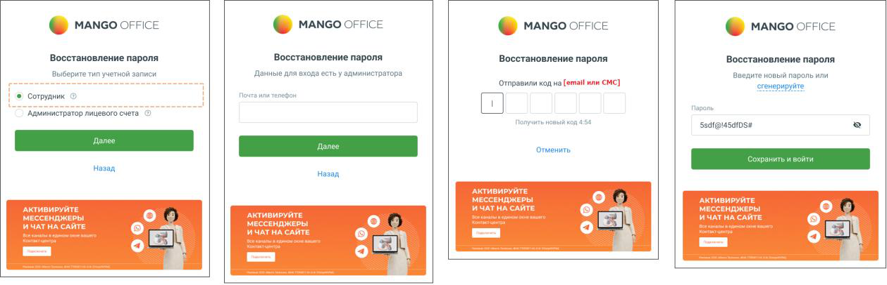
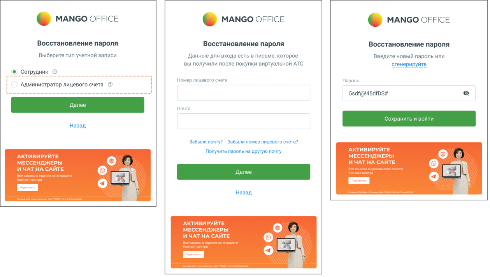

## 1.2. Восстановление пароля

> Трассировка: PDF §1.2 · сквозные стр. 8-10 · источники: ч.1 `kb/sources/mango-lk-manual/LK_manual_v-125-1-280.pdf` с.8-10.

Если утерян пароль к аккаунту сотрудника или Администратора Лицевого счета, воспользуйтесь функцией автоматического восстановления.

Для этого нажмите на ссылку «Забыли пароль?».

На экране восстановления пароля сначала нужно выбрать тип учетной записи:

 Сотрудник Указать e-mail или телефон → Получить код → Ввести код → Задать новый пароль → Войти.

> **Описание иллюстрации LK-§1.2-1** (к §1.2 «Восстановление пароля», стр. 8; 1259×406 px). Снимок экрана / схема Личного кабинета.
> Относится к тексту руководства: «… Сотрудник Указать e-mail или телефон → Получить код → Ввести код → Задать новый пароль → Войти.».
> Текст на изображении (OCR, требует сверки): MANGO OFF:; MANGO OFFICE; (© manco orrice; Восстановление пароля; Выберите тип учетной записи; Данные для входа ects у администратора; Введите новый пароль или; отправили код wa fe; стенерируйте; © сотрудник; Администратор лицевого счета; Sedf@l4sdrDsit; отменить; Назад; Eq}

 Администратор лицевого счёта Указать номер лицевого счёта и e-mail → Получить письмо с инструкцией → Перейти по ссылке → Задать новый пароль.

> **Описание иллюстрации LK-§1.2-2** (к §1.2 «Восстановление пароля», стр. 9; 1259×714 px). Снимок экрана / схема Личного кабинета.
> Относится к тексту руководства: «… Администратор лицевого счёта Указать номер лицевого счёта и e-mail → Получить письмо с инструкцией → Перейти по ссылке → Задать новый пароль.».
> Текст на изображении (OCR, требует сверки): © Manco orrice; © manco oFFice; Восстановление пароля; Выберите тип учетной записи; Данные для входа есть в письме, которое; введите новый пароль или; вы получили после покупки виртуальной АТС; сгенерируйте; © Сотрудник; Номер лицевого счета; Пароль; Администратор лицевого счета; Ssdf@l45dfDS#; Почта; ‘ранить и во!; Назад; Забыли почту? Забыли номер лицевого счета?; Получить пароль на другую почту; АКТИВИРУЙТЕ; МЕССЕНДЖЕРЫ; И ЧАТ НА САЙТЕ; ыы; Назад.

совет

Номер лицевого счета и зарегистрированный адрес указаны в договоре об оказании услуг связи. Если вы не смогли найти документы, напишите на mango@mango.ru или позвоните 8 800 555-55-22.

При этом выполняется проверка на наличие указанного e-mail либо номера телефона в карточке сотрудника ВАТС. Проверка осуществляется по всем продуктам ВАТС кроме заблокированных и архивных.

В случае, когда e-mail указан в карточках двух и более сотрудников, следует указать номер телефона. Аналогичный способ используется при обнаружении телефона в карточках нескольких сотрудников. Если вход по указанным e-mail и номеру телефона недоступен, следует обратиться к администратору ВАТС.

При корректном вводе данных на указанный e-mail или номер телефона будет выслано текстовое или СМС-сообщение соответственно, содержащее код подтверждения.

Код подтверждения следует указать в течение пяти минут. По истечению этого времени следует повторно указать e-mail или номер телефона для получения нового кода подтверждения.

После ввода корректного кода подтверждения следует ввести новый пароль. Пароль должен содержать от 12 символов, включать цифры, заглавные и строчные латинские буквы и специальные символы.

После ввода корректного пароля и нажатия кнопки Сохранить и войти пользователь получает доступ к Личному кабинету. Указанный пароль сохраняется в карточке сотрудника и отображается на закладке «Карточка» в одноименном поле.

Если данные указанные верно, на указанный E-mail отправляется письмо с уникальной одноразовой ссылкой для восстановления пароля и инструкцией.

Ссылка действительна в течение 24 часов. Пароль по ссылке можно поменять только один раз. При щелчке по ссылке в браузере будет открыта страница с формой установки нового пароля.

Укажите новый пароль, соблюдая указанные критерии надежности. После заполнения полей нажмите Сохранить.
