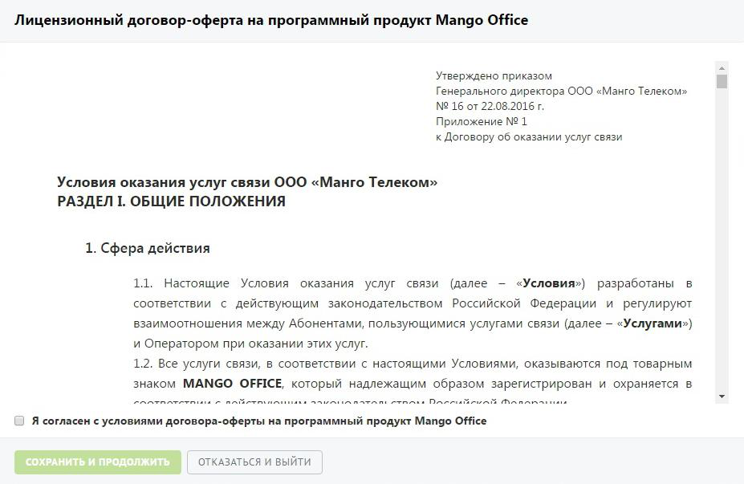

## 1.3. Договор оферты

> Трассировка: PDF §1.3 · сквозные стр. 10-11 · источники: ч.1 `kb/sources/mango-lk-manual/LK_manual_v-125-1-280.pdf` с.10-11.

При первом входе в Личный кабинет пользователя с ролью "Администратор лицевого счета" на экране отображается форма, содержащая текст договора оферты. При этом интерфейс Личного кабинета заблокирован.

> **Описание иллюстрации LK-§1.3-1** (к §1.3 «Договор оферты», стр. 10; 927×603 px). Снимок экрана / схема Личного кабинета.
> Относится к тексту руководства: «…ователя с ролью "Администратор лицевого счета" на экране отображается форма, содержащая текст договора оферты. При этом интерфейс Личного кабинета заблокирован.».
> Текст на изображении (OCR, требует сверки): Лицензионный договор-оферта на программный продукт Mango Office; Утверждено приказом; Генерального директора OOO «Манго Телеком»; № 16 of 22.08.2016 г.; Приложение № 1; к Договору об оказании услуг связи; Условия оказания услуг связи ООО «Манго Телеком»; РАЗДЕЛ 1. ОБЩИЕ ПОЛОЖЕНИЯ; 1. Сфера действия; 11. Настоящие Условия оказания услуг связи (далее - «Условия»); разработаны; соответствии с действующим законодательством Российской Федерации и регулируют; взаимоотношения между Абонентами, пользующимися услугами связи (далее — «Услугами»); и Оператором при оказании этих услуг.; 12. Все услуги свя…

Для продолжения работы ознакомьтесь с текстом договора оферты установите флаг «Я согласен с условиями…» и нажмите кнопку Сохранить и продолжить.

При нажатии кнопки Отказаться и выйти выполняется выход из Личного кабинета и переход на страницу авторизации.

Далее при входе в Личный кабинет пользователя с ролью "Администратор лицевого счета" или с ролью, у которой включен чек-бокс «Акцептировать оферты и другие юридические документы» на экране могут отображаться списки договоров и бланк- заказов по данному лицевому счету, требующих подтверждения.

Для продолжения работы ознакомьтесь с текстом договора-оферты и нажмите кнопку Принять.

При нажатии кнопки Не сейчас некоторые возможности Личного кабинета будут недоступны.
