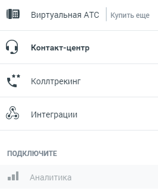

## 1.7. Панель продуктов

> Трассировка: PDF §1.7 · сквозные стр. 12-13 · источники: ч.1 `kb/sources/mango-lk-manual/LK_manual_v-125-1-280.pdf` с.12-13.

Панель продуктов размещается в левой части окна в вертикальном меню. На панели отображаются продукты MANGO OFFICE, как подключенные, так и доступные для подключения.

> **Описание иллюстрации LK-§1.7-1** (к §1.7 «Панель продуктов», стр. 13; 266×327 px). Снимок экрана / схема Личного кабинета.
> Относится к тексту руководства: «…ь продуктов размещается в левой части окна в вертикальном меню. На панели отображаются продукты MANGO OFFICE, как подключенные, так и доступные для подключения.».
> Текст на изображении (OCR, требует сверки): Виртуальная АТС; Купить еще; Контакт-центр; Коллтрекинг; Интеграции; ПОДКЛЮЧИТЕ; all; Аналитика

 Виртуальная АТС – переход на страницу, содержащую полный функционал ВАТС;

 Контакт-центр – информации о состоянии и версии продукта Контакт-Центр;

 Коллтрекинг – раздел отчетов и аналитики. Отображается для пользователей с правом доступа к разделу Динамический коллтрекинг;

 Интеграции – список ресурсов, доступных для подключения и интеграции;

 Аналитика – быстрые отчеты по группам отчетов «Продажи» или «Обслуживание».

 Иные модули ЛК ВАТС, подключенные и доступные для подключения
