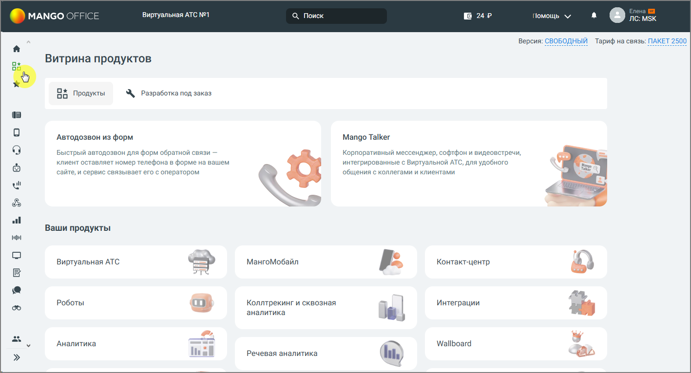

### 1.7.1. Витрина продуктов

> Трассировка: PDF §1.7.1 · сквозные стр. 13-14 · источники: ч.1 `kb/sources/mango-lk-manual/LK_manual_v-125-1-280.pdf` с.13-14.

Витрина продуктов открывается нажатием на соответствующий значок в левом вертикальном меню. На витрине собраны продукты и услуги MANGO OFFICE — как подключенные, так и доступные для подключения.

> **Описание иллюстрации LK-§1.7.1-1** (к §1.7.1 «Витрина продуктов», стр. 14; 1418×766 px). Снимок экрана / схема Личного кабинета.
> Относится к тексту руководства: «…тием на соответствующий значок в левом вертикальном меню. На витрине собраны продукты и услуги MANGO OFFICE — как подключенные, так и доступные для подключения.».
> Текст на изображении (OCR, требует сверки): Виртуальная АТС №1; MANGO OFFIC.; Q Поиск; Bue; помощь v; Версия: СВОБОДНЫЙ Тариф на связь: ПАКЕТ 2500; ох; Витрина продуктов; oo; Продукты; \, разработка под заказ; ia; Автодозвон из форм; Mango Talker; Быстрый автодозвон для форм обратной связи —; Корпоративный мессенджер, софтфон и видеовстречи,; клиент оставляет номер телефона в форме на вашем; интегрированные с Виртуальной АТС, для удобного; ‘сайте, и сервис связывает ero с оператором; ‘общения с коллегами и клиентами; my; wl; Ваши продукты; МангоМобайл; Виртуальная АТС; Контакт-центр; да,; Роботы; Коллтрекинг и сквозная; Интеграции; анал…

Витрина содержит вкладки Продукты и Разработка под заказ.

На вкладке Продукты отображаются:

 в верхнем блоке – карточки продуктов и услуг, доступных для подключения. Нажатие на карточку открывает страницу продукта или услуги;

 в блоке Ваши продукты – карточки подключенных продуктов. Нажатие на карточку открывает страницу продукта.

Карточка ИИ Помощники – личные ассистенты для анализа диалогов: находят инсайты, составляют рекомендации, проверяют по чек-листу и помогают быстро понять бизнес- контекст диалога.

внимание

Если продукт закрыт (переведен в архив), он не отображается в левом меню. На витрине карточка такого продукта остается в блоке «Ваши продукты» с отметкой «Продукт закрыт».
