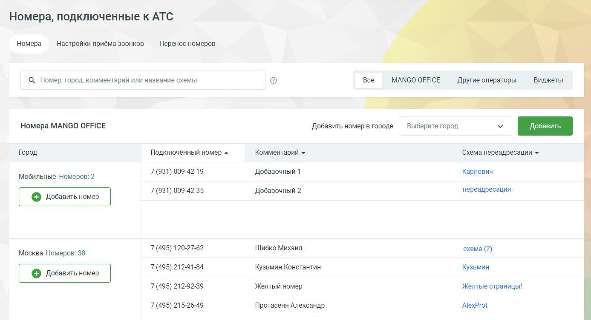
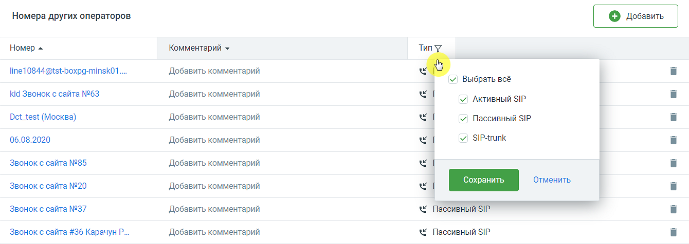
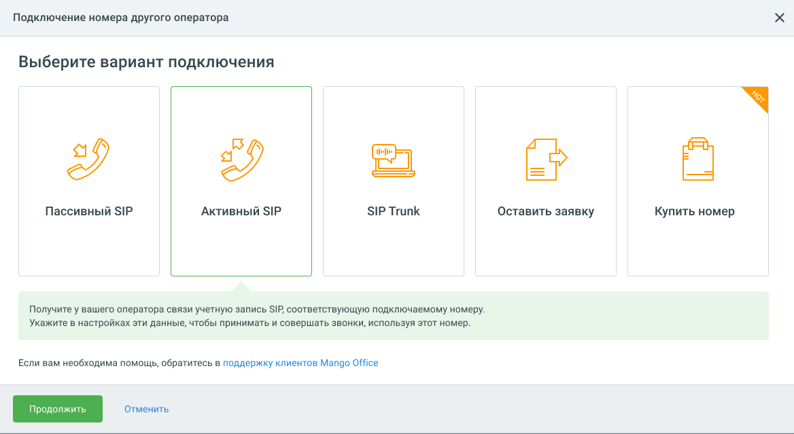

#### 4.4.1.1. Закладка «Номера»

> Трассировка: PDF §4.4.1.1 · сквозные стр. 100-102 · источники: ч.1 `kb/sources/mango-lk-manual/LK_manual_v-125-1-280.pdf` с.100-102.

Номера MANGO OFFICE

В этом блоке можно получить информацию об используемых с текущей Виртуальной АТС многоканальных номерах (телефонных линиях) MANGO OFFICE.

> **Описание иллюстрации LK-§4.4.1.1-1** (к §4.4.1.1 «Закладка «Номера»», стр. 100; 1387×753 px). Снимок экрана / схема Личного кабинета.
> Относится к тексту руководства: «…В этом блоке можно получить информацию об используемых с текущей Виртуальной АТС многоканальных номерах (телефонных линиях) MANGO OFFICE.».
> Текст на изображении (OCR, требует сверки): Номера, подключенные к АТС; Номера; Настройки приёма звонков; Перенос номеров; Q Номер, город, комментарий или название схемы; Все; MANGO OFFICE; Apyrue операторы; Виджеты; Номера MANGO OFFICE; Добавить номер в городе; Выберите город; Город; Подключённый номер =; Комментарий ~; Схема переадресации ~; (931) 009-42-19; Добавочный-1; Карпович; Мобильные Номеров: 2; (931) 009-42-35; Добавочный-2; переадресация |; (495) 120-27-62; Шибко Михаил; схема (2); Москва Номеров: 38; (495) 212-91-84; Кузьмин Константин; Кузьмин; (495) 212-92-39; Желтый номер; Желтые страницы!; 7 (495) 215-26-49; Протасеня А…

Чтобы приобрести новый многоканальный номер, выберите город в выпадающем списке и нажмите кнопку Добавить. В зависимости от настроек браузера в новой странице или вкладке откроется сайт интернет-магазина «Манго Телеком».

Город список городов , в которых имеются подключенные номера.

Подключенный номер – номера, относящиеся к данному городу. При клике на кнопку отображается полный список номеров, подключенных для данного города.

Комментарий – в поле указывается комментарий в виде краткого текстового сообщения для номеров MANGO OFFICE и для номеров сторонних операторов. Комментарий отображается в выпадающем списке при выборе входящей линии в истории вызовов. Также комментарий указывается вместо номера при входящем звонке в Контакт-центр.

Схема распределения – название схемы распределения, подключенной на данном номере. При клике по названию открывается раздел "Распределение звонков, приветствие, голосовое меню", на вкладке "Настройки для входящих линий" и отображается соответствующая схема.

Если из конкретных городов на ВАТС поступило не менее 30-ти входящих звонков за последние 7 дней, при этом общая доля звонков не более 1%, система рекомендует пользователю приобрести номера телефонов в этих городах, с целью экономии средств на телефонию.

Номера других операторов

В этом блоке можно получить информацию об используемых с этой Виртуальной АТС номерах других операторов и внешних SIP-линий. Для изменения номера нажмите на него. Не забудьте сохранить преобразования. Если нажать «Отменить», кнопку Esc на клавиатуре или кликнуть за пределами формы, изменения не будут внесены.

> **Описание иллюстрации LK-§4.4.1.1-2** (к §4.4.1.1 «Закладка «Номера»», стр. 101; 1340×477 px). Снимок экрана / схема Личного кабинета.
> Относится к тексту руководства: «…ите на него. Не забудьте сохранить преобразования. Если нажать «Отменить», кнопку Esc на клавиатуре или кликнуть за пределами формы, изменения не будут внесены.».
> Текст на изображении (OCR, требует сверки): Номера других операторов; Номер =; Комментарий ~; Тип; line10844@tst-boxpg-minsk01....; Добавить комментарий; VY) Выбрать всё; kid Звонок с сайта №63; vy) Активный УР.; vy Пассивный $Р.; Det_test (Москва); 06.08.2020; vy) SIP-trunk; Звонок с сайта №85; Звонок с сайта №20; Звонок с сайта №37; Пассивный SIP; звонок с сайта #36 Карачун Р..

Клик по пиктограмме «воронка» открывает всплывающее окно фильтрации данных по типу номеров: активный SIP, пассивный SIP, SIP Trunk.

Для подключения номера другого оператора нажмите на кнопку Добавить.

> **Описание иллюстрации LK-§4.4.1.1-3** (к §4.4.1.1 «Закладка «Номера»», стр. 101; 1168×639 px). Снимок экрана / схема Личного кабинета.
> Относится к тексту руководства: «…Для подключения номера другого оператора нажмите на кнопку Добавить.».
> Текст на изображении (OCR, требует сверки): Подключение номера другого оператора; Выберите вариант подключения; imal; Пассивный SIP; Активный SIP; SIP Trunk; ‘Оставить заявку; Купить номер.; Получите у вашего оператора связи учетную запись SIP, соответствующую подключаемому номеру.; Укажите в настройках эти данные, чтобы принимать и совершать звонки, используя этот номер.; Если вам необходима помощь, обратитесь в поддержку клиентов Mango Office

Выберите один из вариантов подключения:

 Пассивный SIP

 Активный SIP

 SIP Trunk

 Оставить заявку

 Купить номер

Для удаления номера другого оператора нажмите иконку «корзина» и подтвердите операцию. Все настройки и статистика для данного номера также будут стерты. Для добавления номера воспользуйтесь кнопкой Добавить номер. При удалении проверяется - используется ли номер или SIP-линия в качестве исходящего номера абонента, хотя бы в одном виджете или кампании исходящего обзвона для данной ВАТС. О невозможности удаления пользователь уведомляется системным сообщением.

«Виджеты для сайта»

В этом блоке отображается информация о настроенных для этой Виртуальной АТС виджетах. Такие виджеты размещаются на любой странице сайта.

Нажмите кнопку Добавить виджет, чтобы создать новый интерактивный элемент «Звонок с сайта», «Заказ обратного звонка» или «МангоДиалоги».
