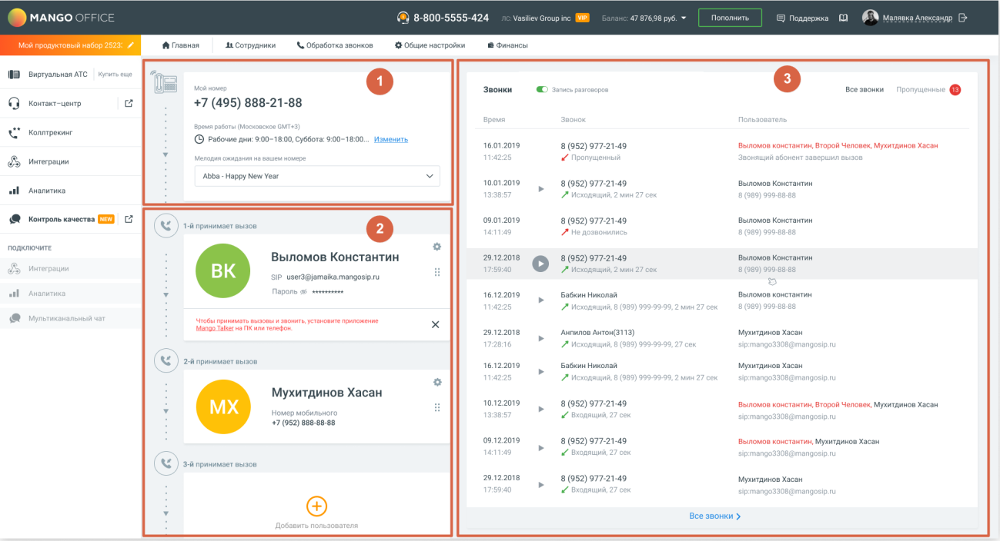

### 1.8.1. Сценарий МИКРО

> Трассировка: PDF §1.8.1 · сквозные стр. 15-16 · источники: ч.1 `kb/sources/mango-lk-manual/LK_manual_v-125-1-280.pdf` с.15-16.

Сценарий МИКРО по умолчанию предназначен для пользователей тарифного плана ВАТС «Виртуальный номер». Следуя сценарию, пользователь настроит отображение данных на главной панели ВАТС.

> **Описание иллюстрации LK-§1.8.1-1** (к §1.8.1 «Сценарий МИКРО», стр. 15; 1299×704 px). Снимок экрана / схема Личного кабинета.
> Относится к тексту руководства: «…чанию предназначен для пользователей тарифного плана ВАТС «Виртуальный номер». Следуя сценарию, пользователь настроит отображение данных на главной панели ВАТС.».
> Текст на изображении (OCR, требует сверки): MANGO O; ® 8-800-5555-424; pin; держа 0 @ Manners.; fe Говная; Сотрудники; © обработка звонков; 19 общие настройки; а оны; Виртуальная ATC; Звонки; Bee звонки; Контакт-центр; +7 (495) 888-21-88; np; Konnrpenime; © Pasoune mv: 9100-1800, Суббота: 900-1800,; Изменить; 16012019; 8 (952) 977-21-49; ыломов константин Второй Человек, Мухитаинов Xacon; rerpaun; ‘Abba - Happy New Yea; 10012019; ыломов Ko; er; al; Анолитика; Контроль качества СО 22; 03.01.2019; 8 (952) 977-21-49.; ыломов Комотантим; т-апринимоет вызов; подключите; Выломов Константин; 29.12.2018; Buunowoe Конетантии; р ser9@jamaika mang…

Главная страница ЛК ВАТС включает в себя следующие блоки:

1. Расписание и схема распределения звонков; 2. Сотрудники; 3. Звонки.
