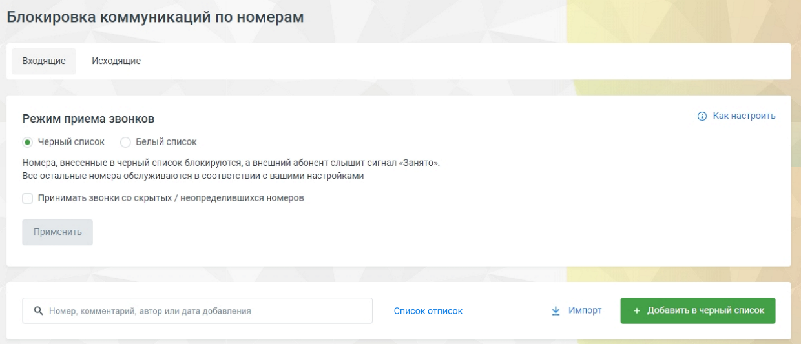
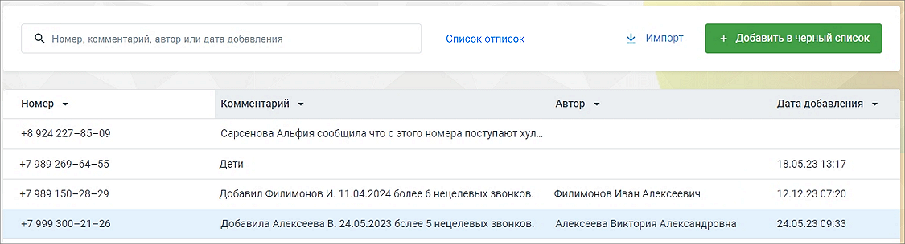

### 4.4.5. Черный/белый список

> Трассировка: PDF §4.4.5 · сквозные стр. 135-136 · источники: ч.1 `kb/sources/mango-lk-manual/LK_manual_v-125-1-280.pdf` с.135-136.

внимание

Инструмент доступен только для администратора Лицевого счета и пользователей с правом доступа «Администратор». Узнать больше можно в подразделе.

Инструмент позволит избавиться от звонков или всегда получать вызовы с определенных номеров.

Подключите услугу кликом по кнопке Подключить. После подключения услуга может быть отключена кликом по кнопке Отключить.

> **Описание иллюстрации LK-§4.4.5-1** (к §4.4.5 «Черный/белый список», стр. 135; 1240×533 px). Снимок экрана / схема Личного кабинета.
> Относится к тексту руководства: «…Подключите услугу кликом по кнопке Подключить. После подключения услуга может быть отключена кликом по кнопке Отключить.».
> Текст на изображении (OCR, требует сверки): Блокировка коммуникаций по номерам; Входящие; Исходящие; Режим приема звонков; © Какнастроить; © Черный список; Белый список; Номера, внесенные в черный список блокируются, а внешний абонент слышит сигнал «Занято».; все остальные номера обслуживаются в соответствии с вашими настройками; Принимать звонки со скрытых / неопределившихся номеров; Применить; Q Номер. комментарий, автор или дата добавления; ‘Список отписок

После подключения установите режим приема звонков.

совет

Одновременно использовать черный и белый списки невозможно: включение одного приводит к автоматическому отключению другого, и наоборот.

При поступлении вызова от внешнего абонента Виртуальная АТС определяет его номер. Если номер не удалось определить, проверяется возможность запрещать/разрешать принимать вызовы с неопределенных номеров, которая устанавливается при активации инструмента.

Обработка вызова продолжается в соответствии с остальными настройками Виртуальной АТС, если:

 включен белый список и определившийся номер присутствует в нем;  включен черный или белый список, номер не определен, звонки с неопределенных номеров разрешены;

 включен черный список и определившийся номер в нем отсутствует.

Виртуальная АТС завершает вызов, транслируя внешнему абоненту сигнал «Занято», если:

 включен белый список и определившийся номер в нем отсутствует;  включен черный или белый список, номер не определен, звонки с неопределенных номеров запрещены;  включен черный список и определившийся номер в нем присутствует.

Процедура добавления номера/номеров в один из списков одинакова и производится с помощью одноименной кнопки. В открывшейся форме укажите тип номера (способ связи) и введите в соответствующее поле телефонный номер/имя пользователя SIP (есть возможность задавать для телефонных диапазоны; для всех типов — маски номеров; маски устанавливаются с помощью специальных символов групповой замены «*» и «#»). Подробнее о правилах указания номеров, диапазонов и масок в подразделе.

Для импортирования номеров в списки нажмите кнопку «Импорт». В открывшемся окне скачайте шаблон, подготовьте файл импорта и загрузите в Личный кабинет.

> **Описание иллюстрации LK-§4.4.5-2** (к §4.4.5 «Черный/белый список», стр. 136; 1125×304 px). Снимок экрана / схема Личного кабинета.
> Относится к тексту руководства: «…Для импортирования номеров в списки нажмите кнопку «Импорт». В открывшемся окне скачайте шаблон, подготовьте файл импорта и загрузите в Личный кабинет.».
> Текст на изображении (OCR, требует сверки): авить в черн; nM; С, Номер, комментарий, автор или дата добавления; Список отписок.; Импорт; Номер ~; Комментарий ~; Автор -; Дата добавления ~; +8 924227-85-09; Сарсенова Альфия сообщила что с этого номера поступают хул.; +7989 269-64-55; „Дети; 18.05.23 13:17; +7989 150-28-29; "Добавил Филимонов И. 11.04.2024 более 6 нецелевых звонков.; Филимонов Иван Алексеевич; 12.12.23 07:20; +7999 300-21-26; `Добавила Алексеева В. 24.05.2023 более 5 нецелевых звонков.; ‘Алексеева Виктория Александровна; 24.05.23 09:33

Есть возможность добавить комментарий к номеру. Для изменения или удаления выберите номер и разверните его, кликнув по строке мышкой. Для удаления воспользуйтесь одноименной кнопкой.

В окне также доступен поиск по номерам, добавленным в черный и белый списки. Поиск проводится по принципу «на лету», по всем столбцам таблицы.

Нажатие на кнопку «Список отписок» открывает список отписок от рассылки WhatsApp в Текстовых коммуникациях. Кнопка отображается, если на ВАТС подключен раздел «Текстовые коммуникации» (базовая или расширенная версия).

Клик по пиктограмме возле наименования столбца сортирует данные в столбце в

алфавитном порядке.
