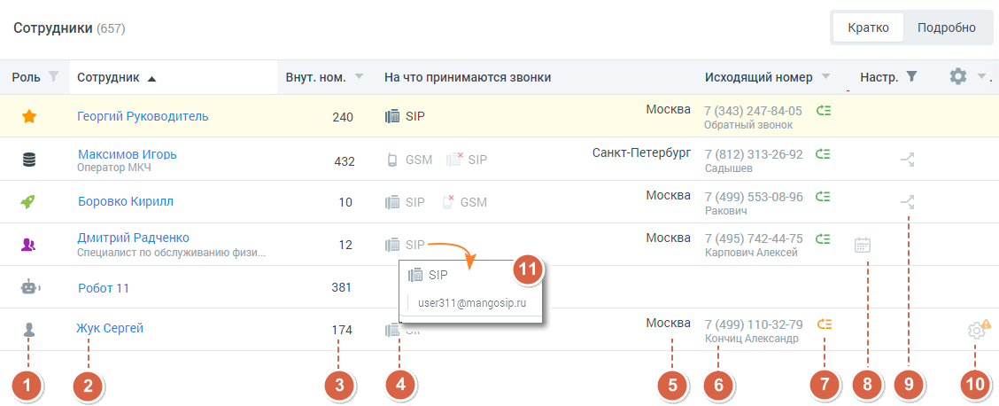
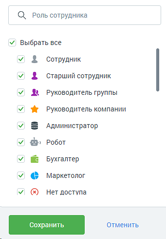
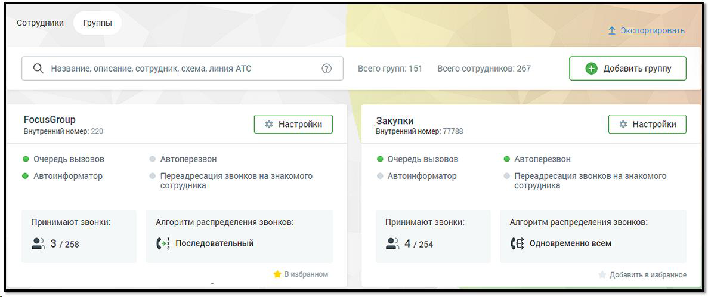
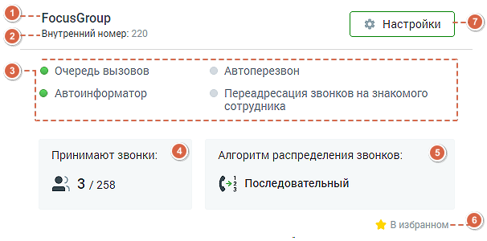

### 4.4.6. Сотрудники и группы

> Трассировка: PDF §4.4.6 · сквозные стр. 136-142 · источники: ч.1 `kb/sources/mango-lk-manual/LK_manual_v-125-1-280.pdf` с.136-142.

Вкладка «Сотрудники»

На данной вкладке содержится список пользователей текущей Виртуальной АТС. Видимость списка зависит от настроек прав доступа роли текущег пользователя.

Пользователям с ролью «Администратор ВАТС» и «Администратор» доступен список всех пользователей текущей ВАТС вне зависимости от вхождения в группы.

> **Описание иллюстрации LK-§4.4.6-1** (к §4.4.6 «Сотрудники и группы», стр. 137; 1079×226 px). Снимок экрана / схема Личного кабинета.
> Относится к тексту руководства: «…Пользователям с ролью «Администратор ВАТС» и «Администратор» доступен список всех пользователей текущей ВАТС вне зависимости от вхождения в группы.».
> Текст на изображении (OCR, требует сверки): Сотрудники и группы; ‘Сотрудники; Группы; ©, Имя сотрудника, внутренний номер, SIP или телефон; & Экспорт; & импорт; + Добавит; трудника

Нажатие на кнопку «Экспортировать» позволяет произвести экспорт сотрудников в файл csv. Нажатие на кнопку «Импортировать» позволяет произвести импорт сотрудников из шаблона csv. В файле импорта для каждого сотрудника необходимо указать уникальный email. Функция импорта доступна пользователям, у которых есть права на создание сотрудников и доступ к разделу "Сотрудники".

В поле поиска при вводе каждого символа выполняется интеллектуальный поиск по всем полям, содержащим текст: Ф.И.О., должность, способ приема звонков, название группы, настройки группы и т.д.

> **Описание иллюстрации LK-§4.4.6-2** (к §4.4.6 «Сотрудники и группы», стр. 137; 1128×458 px). Снимок экрана / схема Личного кабинета.
> Относится к тексту руководства: «…о символа выполняется интеллектуальный поиск по всем полям, содержащим текст: Ф.И.О., должность, способ приема звонков, название группы, настройки группы и т.д.».
> Текст на изображении (OCR, требует сверки): Сотрудники (657); Кратко; Подробно; Роль.; ‘Сотрудник ^; На что принимаются звонки; исходящий номер >; Настр. У; Москва; 7 (343) 247-84-05; Георгий Руководитель; 240; lia ЯР; Обратный звонок; Максимов Игорь; GSM; Хр; ‘Санкт-Петербург; 7 (812) 313-26-92; Оператор MKY; 432; Садышев; Боровко Кирилл; 10; iB ЯР; * GSM; 7 (499) 553-08-96; Ракович; Дмитрий Радченко.; 12; 7 (495) 742-44-75; Специалист по обслуживанию физи.; Карпович Алексей; ia ЯР; Робот 11; 381; user311@mangosip.ru; 7 (499) 110-32-79; Жук Сергей; 174; ao; Кончиц Александр; оо; ооо ©

Для каждого пользователя в таблицу вынесена основная информация:

1. Пиктограмма, указывающая на роль пользователя в Личном кабинете. Роль указывается при редактировании карточки сотрудника на вкладке «Карточка». С полным списком ролей можно ознакомиться на вкладке «Настройка доступа» раздела «Безопасность и ограничения».

Для фильтрации списка сотрудников по ролям следует щелкнуть по наименованию столбца. Список содержит все роли, присвоенные хотя бы одному из сотрудников ВАТС на момент просмотра отчета, включая как стандартные роли, так и дополнительные.

При установке флага напротив наименования роли в результате применения фильтра список сотрудников будет включать только сотрудников с указанными ролями. Для быстрого выбора всех ролей предусмотрен общий флаг.

При наличии большого количества ролей рекомендуется воспользоваться строкой поиска. По мере ввода символов срабатывает автоподбор.

После выбора нужных ролей необходимо нажать кнопку Сохранить. Для того, чтобы скрыть окно фильтра без применения изменений следует щелкнуть по кнопке Отменить либо в любое место вне фильтра.

> **Описание иллюстрации LK-§4.4.6-3** (к §4.4.6 «Сотрудники и группы», стр. 138; 341×489 px). Снимок экрана / схема Личного кабинета.
> Относится к тексту руководства: «…ходимо нажать кнопку Сохранить. Для того, чтобы скрыть окно фильтра без применения изменений следует щелкнуть по кнопке Отменить либо в любое место вне фильтра.».
> Текст на изображении (OCR, требует сверки): О Роль сотрудника; У Выбрать все; у 4; Сотрудник; Старший сотрудник; Руководитель группы; Руководитель компании; Администратор; Робот; Бухгалтер; Маркетолог; Нет доступа; Отменить

2. Ф.И.О. — фамилия, имя, отчество, должность (если указана) сотрудника;

3. Внутренний номер для связи с сотрудником;

4. Первые три способа приема вызова и алгоритм дозвона до сотрудника.

5. Зона тарификации;

6. Номер для исходящих звонков (номер 8-800 недоступен для выбора в качестве исходящего номера);

7. Наличие автоматической подстановки номера для входящих звонков:

> **Описание иллюстрации LK-§4.4.6-4** (к §4.4.6 «Сотрудники и группы», стр. 138; 24×20 px). Пиктограмма (значок элемента интерфейса).
> Относится к тексту руководства: «…7. Наличие автоматической подстановки номера для входящих звонков:».
> Текста на изображении нет; назначение значка — см. текст, к которому он относится.

 автоподстановка включена и настроена

> **Описание иллюстрации LK-§4.4.6-5** (к §4.4.6 «Сотрудники и группы», стр. 138; 24×20 px). Пиктограмма (значок элемента интерфейса).
> Относится к тексту руководства: «… автоподстановка включена и настроена».
> Текста на изображении нет; назначение значка — см. текст, к которому он относится.



автоподстановка включена, но не настроена

> **Описание иллюстрации LK-§4.4.6-6** (к §4.4.6 «Сотрудники и группы», стр. 139; 27×20 px). Пиктограмма (значок элемента интерфейса).
> Относится к тексту руководства: «…автоподстановка включена, но не настроена».
> Текста на изображении нет; назначение значка — см. текст, к которому он относится.

 автоподстановка отключена

При наведении курсора мышки на пиктограмму отображаются подсказки.

> **Описание иллюстрации LK-§4.4.6-7** (к §4.4.6 «Сотрудники и группы», стр. 139; 18×18 px). Пиктограмма (значок элемента интерфейса).
> Относится к тексту руководства: «…При наведении курсора мышки на пиктограмму отображаются подсказки.».
> Текста на изображении нет; назначение значка — см. текст, к которому он относится.

8. Пиктограмма говорит о наличии настроенного расписания приема звонков;

> **Описание иллюстрации LK-§4.4.6-8** (к §4.4.6 «Сотрудники и группы», стр. 139; 15×16 px). Пиктограмма (значок элемента интерфейса).
> Относится к тексту руководства: «…8. Пиктограмма говорит о наличии настроенного расписания приема звонков;».
> Текста на изображении нет; назначение значка — см. текст, к которому он относится.

9. Для сотрудника, отмеченного пиктограммой настроены правила Автосекретаря;

10. Рекомендации по заполнению карточки сотрудника. Клик по пиктограмме откроет всплывающее окно с текстом рекомендации;

11. Режим просмотра «Подробно» отображаются все телефонные номера и имена учетных записей каждого сотрудника, используемые в качестве средств связи.

Для внесения изменений в карточку сотрудника щелкните в любом месте нужной строки таблицы. Для добавления профиля нового сотрудника нажмите кнопку «Добавить сотрудника», и откроется форма «Новый абонент». Процесс заполнения формы, а также подробное описание карточки сотрудника приведены в разделе.

Вкладка «Группы обзвона» (режим просмотра списка групп обзвона)

На данной вкладке содержатся блоки всех групп обзвона.

> **Описание иллюстрации LK-§4.4.6-9** (к §4.4.6 «Сотрудники и группы», стр. 139; 1187×498 px). Снимок экрана / схема Личного кабинета.
> Относится к тексту руководства: «…На данной вкладке содержатся блоки всех групп обзвона.».
> Текст на изображении (OCR, требует сверки): Сотрудники; Группы; ^^ ` Экспортировать.; О. название, описание,; сотрудник, схема, линия АТС; Bet; ero; его п; yan: 151; всего сотрудников: 267; FocusGroup; Закупки; Внутренний номер:; Внутренний номер: 7788; © Очередь вызовов; Автоперезвон; © Автоперезвон; © Автоинформатор; Переадресация звонков на знакомого; Автоинформатор; сотрудника; Принимают звонки:; Алгоритм распределения звонков:; Принимают звонки; 23/258; (>; последовательный; (6 одновременно всем; we; обавить в избр; ани

Нажатие на кнопку «Экспортировать» позволяет произвести экспорт сотрудников групп в файл csv. Функция доступна пользователям, у которых есть право «Просматривать список групп - для всех».

Для изменения настроек группы нажмите кнопку «Настройки». Для создания новой группы щелкните по кнопке «Добавить группу», и откроется форма создания группы.

Блок каждой группы содержит следующую информацию:

> **Описание иллюстрации LK-§4.4.6-10** (к §4.4.6 «Сотрудники и группы», стр. 140; 606×300 px). Снимок экрана / схема Личного кабинета.
> Относится к тексту руководства: «…Блок каждой группы содержит следующую информацию:».
> Текст на изображении (OCR, требует сверки): ©. —-Росизбтоир; (2) _ -Внутренний номер: 220; wee meme wee we we wee ee w eee eee wee ee ee wee ee ee eee eee; Автоперезвон; © @ Очередь вызовов; ! © Автоинформатор; Переадресация звонков на знакомого; сотрудника; Принимают звонки:; Алгоритм распределения звонков:; (>: Последовательный; Ww Визбранном-- [6

> **Описание иллюстрации LK-§4.4.6-11** (к §4.4.6 «Сотрудники и группы», стр. 140; 42×42 px). Пиктограмма (значок элемента интерфейса).
> Относится к тексту руководства: «…! © Автоинформатор; Переадресация звонков на знакомого; сотрудника; Принимают звонки:; Алгоритм распределения звонков:; (>: Последовательный; Ww Визбранном-- [6».
> Текста на изображении нет; назначение значка — см. текст, к которому он относится.

> **Описание иллюстрации LK-§4.4.6-12** (к §4.4.6 «Сотрудники и группы», стр. 140; 55×48 px). Пиктограмма (значок элемента интерфейса).
> Относится к тексту руководства: «…Алгоритм распределения звонков:; (>: Последовательный; Ww Визбранном-- [6». > Текста на изображении нет; назначение значка — см. текст, к которому он относится.».
> Текста на изображении нет; назначение значка — см. текст, к которому он относится.

> **Описание иллюстрации LK-§4.4.6-13** (к §4.4.6 «Сотрудники и группы», стр. 140; 47×48 px). Пиктограмма (значок элемента интерфейса).
> Относится к тексту руководства: «… изображении нет; назначение значка — см. текст, к которому он относится.». > Текста на изображении нет; назначение значка — см. текст, к которому он относится.».
> Текста на изображении нет; назначение значка — см. текст, к которому он относится.

1. Название группы и пиктограммы рекомендаций по настройке (если есть). Клик по пиктограмме откроет всплывающее окно с текстом рекомендации;

2. Внутренний короткий номер группы (если задан) и описание группы (если задано);

3. Блок услуг с пиктограммой подключения:

> **Описание иллюстрации LK-§4.4.6-14** (к §4.4.6 «Сотрудники и группы», стр. 140; 46×46 px). Пиктограмма (значок элемента интерфейса).
> Относится к тексту руководства: «…3. Блок услуг с пиктограммой подключения:».
> Текста на изображении нет; назначение значка — см. текст, к которому он относится.

услуга подключена;

> **Описание иллюстрации LK-§4.4.6-15** (к §4.4.6 «Сотрудники и группы», стр. 140; 24×24 px). Пиктограмма (значок элемента интерфейса).
> Относится к тексту руководства: «…услуга подключена;».
> Текста на изображении нет; назначение значка — см. текст, к которому он относится.

услуга отключена;

4. Блок «Сотрудники» - отображается количество сотрудников, в формате "N/M", где N - количество принимающих звонки операторов, а M - общее количество добавленных в группу сотрудников. Для просмотра или редактирования состава группы наведите курсор на любую часть блока и кликните по кнопке «Настроить»;

5. Блок «Алгоритм распределения звонков». Варианты алгоритмов:

> **Описание иллюстрации LK-§4.4.6-16** (к §4.4.6 «Сотрудники и группы», стр. 140; 62×48 px). Пиктограмма (значок элемента интерфейса).
> Относится к тексту руководства: «…5. Блок «Алгоритм распределения звонков». Варианты алгоритмов:».
> Текста на изображении нет; назначение значка — см. текст, к которому он относится.

Последовательный

> **Описание иллюстрации LK-§4.4.6-17** (к §4.4.6 «Сотрудники и группы», стр. 140; 64×48 px). Пиктограмма (значок элемента интерфейса).
> Относится к тексту руководства: «…Последовательный».
> Текста на изображении нет; назначение значка — см. текст, к которому он относится.

Случайный

> **Описание иллюстрации LK-§4.4.6-18** (к §4.4.6 «Сотрудники и группы», стр. 140; 64×55 px). Пиктограмма (значок элемента интерфейса).
> Относится к тексту руководства: «…Случайный».
> Текста на изображении нет; назначение значка — см. текст, к которому он относится.

Параллельный по приоритету

> **Описание иллюстрации LK-§4.4.6-19** (к §4.4.6 «Сотрудники и группы», стр. 140; 64×53 px). Пиктограмма (значок элемента интерфейса).
> Относится к тексту руководства: «…Параллельный по приоритету».
> Текста на изображении нет; назначение значка — см. текст, к которому он относится.

Одновременно всем

> **Описание иллюстрации LK-§4.4.6-20** (к §4.4.6 «Сотрудники и группы», стр. 140; 64×53 px). Пиктограмма (значок элемента интерфейса).
> Относится к тексту руководства: «…Одновременно всем».
> Текста на изображении нет; назначение значка — см. текст, к которому он относится.

Равномерный

> **Описание иллюстрации LK-§4.4.6-21** (к §4.4.6 «Сотрудники и группы», стр. 140; 64×60 px). Пиктограмма (значок элемента интерфейса).
> Относится к тексту руководства: «…Равномерный».
> Текста на изображении нет; назначение значка — см. текст, к которому он относится.

Кто меньше звонил

> **Описание иллюстрации LK-§4.4.6-22** (к §4.4.6 «Сотрудники и группы», стр. 141; 62×53 px). Пиктограмма (значок элемента интерфейса).
> Относится к тексту руководства: «…Кто меньше звонил».
> Текста на изображении нет; назначение значка — см. текст, к которому он относится.

Наименьшее время разговора

Для просмотра или редактирования алгоритма наведите курсор на любую часть блока и кликните по кнопке «Настроить».

Если в настройках группы указан алгоритм распределения звонков «Последовательный» или «Параллельный по приоритету», то чем выше находится специалист в списке группы, тем раньше будет производиться дозвон на его номер.

6. Показатель нахождения группы в списке «Избранное» пользователя.

> **Описание иллюстрации LK-§4.4.6-23** (к §4.4.6 «Сотрудники и группы», стр. 141; 58×56 px). Пиктограмма (значок элемента интерфейса).
> Относится к тексту руководства: «…6. Показатель нахождения группы в списке «Избранное» пользователя.».
> Текста на изображении нет; назначение значка — см. текст, к которому он относится.

- группа находится в Избранном;

> **Описание иллюстрации LK-§4.4.6-24** (к §4.4.6 «Сотрудники и группы», стр. 141; 58×56 px). Пиктограмма (значок элемента интерфейса).
> Относится к тексту руководства: «…- группа находится в Избранном;».
> Текста на изображении нет; назначение значка — см. текст, к которому он относится.

- группа не находится в Избранном;

Группы из списка «Избранное» отображаются в начале списка групп;

7. Настройки – клик на кнопку открывает карточку группы для просмотра или редактирования.
