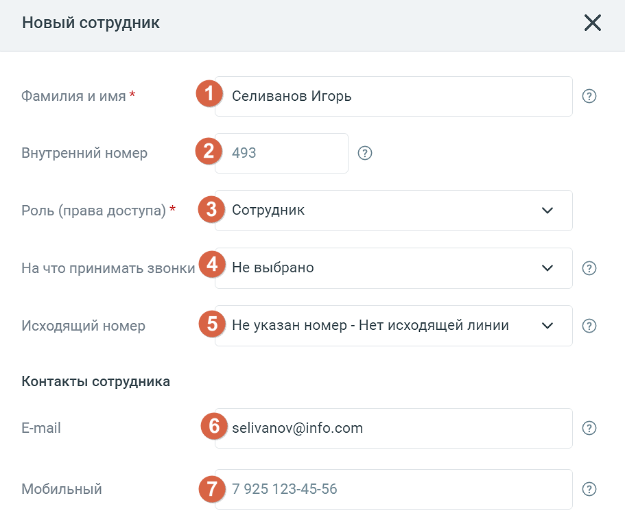
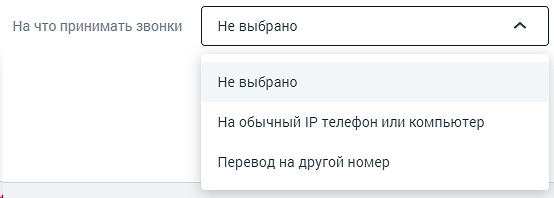
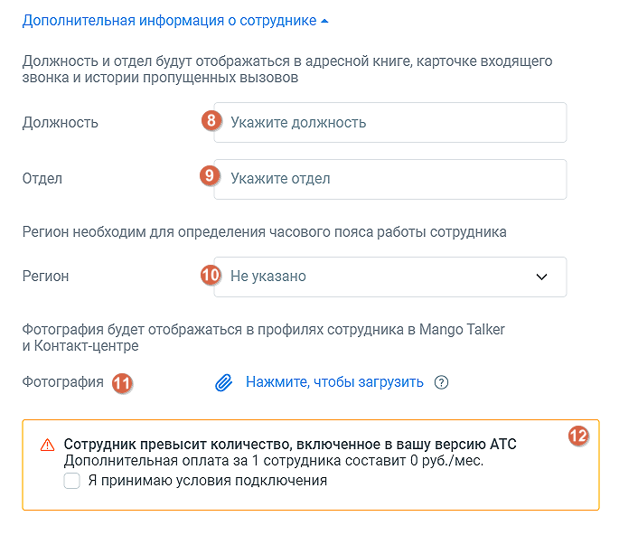
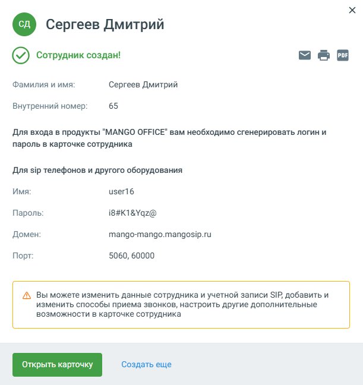
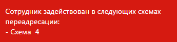

#### 4.4.6.1. Работа с сотрудниками

> Трассировка: PDF §4.4.6.1 · сквозные стр. 142-147 · источники: ч.1 `kb/sources/mango-lk-manual/LK_manual_v-125-1-280.pdf` с.142-147.

Для добавления профиля нового пользователя нажмите соответствующую кнопку, и откроется форма «Новый сотрудник».

> **Описание иллюстрации LK-§4.4.6.1-1** (к §4.4.6.1 «Работа с сотрудниками», стр. 142; 911×764 px). Снимок экрана / схема Личного кабинета.
> Относится к тексту руководства: «…Для добавления профиля нового пользователя нажмите соответствующую кнопку, и откроется форма «Новый сотрудник».».
> Текст на изображении (OCR, требует сверки): Новый сотрудник; Фамилия и имя *; [1] Селиванов Игорь; Внутренний номер; Роль (права доступа) * [3] Сотрудник; На что принимать звонки (4) He выбрано; Исходящий номер; о Не указан номер - Нет исходящей линии; Контакты сотрудника; E-mail; 6) selivanov@info.com; Мобильный; О 7225 123-4556

1. Укажите Ф.И.О. сотрудника. Если специалист с такими данными уже существует, отображаются соответствующее сообщение и ссылка на его карточку, в которой при необходимости можно внести изменения.

2. При создании профиля сотруднику автоматически присваивается порядковый внутренний номер. При необходимости его можно изменить. Внутренний номер должен быть уникальным и состоять из двух (минимум) двух и семи (максимум) символов;

совет

Рекомендованная минимальная длина внутреннего номера составляет две цифры во избежание возникновения конфликтов с номерами пунктов голосового меню.

3. Укажите роль сотрудника (права доступа к функционалу Личного кабинета).

4. Укажите способ приема звонков.

> **Описание иллюстрации LK-§4.4.6.1-2** (к §4.4.6.1 «Работа с сотрудниками», стр. 143; 554×198 px). Снимок экрана / схема Личного кабинета.
> Относится к тексту руководства: «…4. Укажите способ приема звонков.».
> Текст на изображении (OCR, требует сверки): На что принимать звонки; Не выбрано; На обычный IP телефон или компьютер; Перевод на другой номер

При выборе вариантов «На обычный IP-телефон или компьютер» требуется наличие учетной записи SIP. Она создается в автоматическом режиме или задается позднее при редактировании карточки сотрудника.

При выборе вариантов «Перевод на другой номер» необходимо указать телефонный номер в формате 7 925 123-45-67.

5. Исходящий номер: Выбор линии для исходящих звонков выполняется, только если к Виртуальной АТС подключено более одного телефонного номера, включая SIP-линии. Номер 8-800 недоступен для выбора в качестве исходящего номера.

При выборе значения «Не указан номер – Нет исходящей линии» для сотрудника не указывается исходящий номер, что приводит к отсутствию возможности использовать внешнюю исходящую связь.

Если при создании сотрудника на ВАТС нет ни одного телефонного номера DID или номера-заглушки, но есть одна SIP-линия, то поле «Исходящий номер» не отображается, а данная SIP-линия автоматически указывается в качестве линии для исходящих звонков. При количестве линий две и более поле отображается.

6. При создании сотрудника указанный электронный адрес записывается в карточку сотрудника. На этот адрес сотруднику отправляется письмо с информацией по завершению регистрации и установлению пароля сотрудника в Личном кабинете. Поле обязательно для заполнения и проверяется на уникальность. Если введенный электронный адрес принадлежит другому сотруднику ВАТС, появится соответствующее системное уведомление.

7. Если поле «Мобильный» оставить пустым, номер может подтягиваться из вкладки «Телефония» (если он соответствует параметрам мобильного телефона). Поле проверяется на уникальность. Если введенный номер мобильного телефона принадлежит другому сотруднику ВАТС, появится соответствующее системное уведомление. Поле является обязательным для заполнения, если оно используется в настройках двухфакторной авторизации.

> **Описание иллюстрации LK-§4.4.6.1-3** (к §4.4.6.1 «Работа с сотрудниками», стр. 144; 685×592 px). Снимок экрана / схема Личного кабинета.
> Относится к тексту руководства: «…у ВАТС, появится соответствующее системное уведомление. Поле является обязательным для заполнения, если оно используется в настройках двухфакторной авторизации.».
> Текст на изображении (OCR, требует сверки): Дополнительная информация о сотруднике ^; Должность и отдел будут отображаться в адресной книге, карточке входящего; звонка и истории пропущенных вызовов; Должность; о Укажите должность; Отдел; о Укажите отдел; Регион необходим для определения часового пояса работы сотрудника; Регион; 10) Не указано; Фотография будет отображаться в профилях сотрудника в Mango Talker; и Контакт-центре; Фотография М1); & Нажмите, чтобы загрузить @; Л Сотрудник превысит количество, включенное в вашу версию АТС; Дополнительная оплата за 1 сотрудника составит 0 руб./мес.; Я принимаю условия подключения

8. Укажите должность нового сотрудника.

9. Укажите отдел, в котором работает сотрудник.

10. Выберите из выпадающего списка регион, в котором территориально находится сотрудник.

11. Загрузите фото сотрудника. Допустимые форматы png, jpeg, bmp.

12. Отметьте чекбокс согласия на дополнительную оплату за превышение количество сотрудников, добавленный в ЛК ВАТС.

Завершение

После заполнения полей формы нажмите «Создать». Будет выполнена автоматическая проверка на корректность введенных данных. Если поле было заполнено с ошибкой, на экране отобразится соответствующее сообщение. Если ошибок нет, откроется форма (см. рис. ниже).

> **Описание иллюстрации LK-§4.4.6.1-4** (к §4.4.6.1 «Работа с сотрудниками», стр. 145; 611×648 px). Снимок экрана / схема Личного кабинета.
> Относится к тексту руководства: «…ктность введенных данных. Если поле было заполнено с ошибкой, на экране отобразится соответствующее сообщение. Если ошибок нет, откроется форма (см. рис. ниже).».
> Текст на изображении (OCR, требует сверки): © Сергеев Дмитрий; (©) Сотрудник создан!; Фамилия и имя:; Сергеев Дмитрий; 65; Внутренний номер:; Для входа в продукты “MANGO OFFICE" вам необходимо сгенерировать логин и; пароль в карточке сотрудника; Для sip телефонов и другого оборудования; Имя:; user16; Пароль:; i8#K1&Yqz@; Домен:; mango-mango.mangosip.ru; Порт:; 5060, 60000; А Вы можете изменить данные сотрудника и учетной записи SIP, добавить и; изменить способы приема звонков, настроить другие дополнительные; возможности в карточке сотрудника; Создать еще

На указанный e-mail сотрудника автоматически отправляется информационное сообщение с доступами к учетной записи.

Если требуется совершить создать несколько сотрудников, выберите кнопку Добавить сотрудника повторно и повторите предыдущие действия.

Для редактирования карточки сотрудника откройте его, нажав на имя сотруждника в списке сотружников. Карточка включает четыре вкладки, см. далее в этом разделе.

Имя сотрудника указывается в заголовке на любой вкладке. Для редактирования

> **Описание иллюстрации LK-§4.4.6.1-5** (к §4.4.6.1 «Работа с сотрудниками», стр. 146; 30×30 px). Пиктограмма (значок элемента интерфейса).
> Относится к тексту руководства: «…Имя сотрудника указывается в заголовке на любой вкладке. Для редактирования».
> Текста на изображении нет; назначение значка — см. текст, к которому он относится.

> **Описание иллюстрации LK-§4.4.6.1-6** (к §4.4.6.1 «Работа с сотрудниками», стр. 146; 17×16 px). Пиктограмма (значок элемента интерфейса).
> Относится к тексту руководства: «…я сотрудника указывается в заголовке на любой вкладке. Для редактирования». > Текста на изображении нет; назначение значка — см. текст, к которому он относится.».
> Текста на изображении нет; назначение значка — см. текст, к которому он относится.

наименования нажмите . Введите новое имя и нажмите . После того, как все изменения внесены, нажмите «Сохранить» в нижней части вкладки.

Для удаления сотрудника нажмите кнопку Удалить сотрудника. При удалении выполняется проверка, задействован ли сотрудник:

 в схемах переадресации,

 в переадресации по номеру клиента,

 в настройках виджетов "Обратный звонок",

 в мультиканальных виджетах;

 в кампаниях исходящего обзвона Контакт-центра в статусах «Завершена», «Запланирована», «Остановлена» - в этом случае сотрудник исключается из списка операторов и удаляется;

 если удаляемый сотрудник участвует в запланированном вызове Контакт-центра, вызов будет отменен, сотрудник удаляется.

Если сотрудник указан хотя бы в одной схеме, переадресации по номеру клиента, настройке либо кампании Исходящего обзвона в статусе, отличном от «Завершена», «Запланирована», «Остановлена», удаление не производится, а на экране отображается предупреждение примерного вида:

> **Описание иллюстрации LK-§4.4.6.1-7** (к §4.4.6.1 «Работа с сотрудниками», стр. 146; 345×82 px). Снимок экрана / схема Личного кабинета.
> Относится к тексту руководства: «…о обзвона в статусе, отличном от «Завершена», «Запланирована», «Остановлена», удаление не производится, а на экране отображается предупреждение примерного вида:».
> Текст на изображении (OCR, требует сверки): Сотрудник задействован в следующих схемах; переадресации:; - Схема 4

.

Так же удаляются все настроенные для сотрудника правила обработки звонков.

ИМПОРТ СОТРУДНИКОВ

Для импорта сотрудников кликните по кнопке «Импорт сотрудников» и выполните действия, указанные в открывшемся окне. Формат импортируемого файла csv.

При импорте выполняются следующие условия:

 система не проверят сотрудников на дубли. Если в списке несколько одинаковых сотрудников или ФИО нового сотрудника совпадает с именем существующего сотрудника ВАТС, то все равно создается новый сотрудник.

 если создание какого-то конкретного сотрудника возможно (обязательные поля заполнены корректно, но в необязательных заполненных есть какие-то ошибки), то система создает сотрудника, пропуская обработку этих необязательных полей (считает их незаполненными).

 если создание какого-то конкретного сотрудника невозможно (не заполнены обязательные поля), то система пропускает сотрудника и идет дальше, т.е. создает следующих сотрудников.

ЭКСПОРТ СОТРУДНИКОВ

Нажатие на кнопку «Экспортировать» позволяет произвести экспорт сотрудников в файл csv. Функция доступна пользователям, у которых есть права на создание сотрудников и доступ к разделу "Сотрудники".
