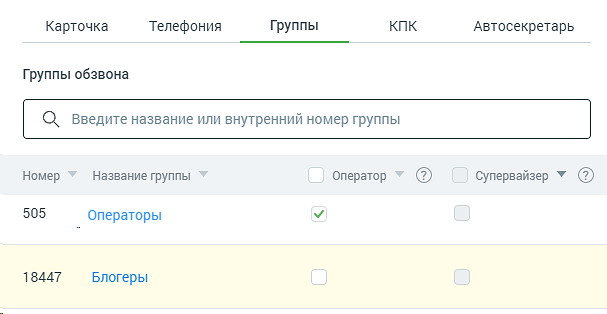

##### 4.4.6.1.3. Вкладка «Группы»

> Трассировка: PDF §4.4.6.1.3 · сквозные стр. 157-158 · источники: ч.1 `kb/sources/mango-lk-manual/LK_manual_v-125-1-280.pdf` с.157-158.

Вид вкладки представлен на рисунке ниже.

> **Описание иллюстрации LK-§4.4.6.1.3-1** (к §4.4.6.1.3 «Вкладка «Группы»», стр. 158; 607×314 px). Снимок экрана / схема Личного кабинета.
> Относится к тексту руководства: «…Вид вкладки представлен на рисунке ниже.».
> Текст на изображении (OCR, требует сверки): Карточка; Телефония; Группы; КПК; Автосекретарь; Группы обзвона; О) введите название или внутренний номер группы; Номер; Название группы; Оператор; Супервайзер VY (); 505; _ Операторы; 18447; Блогеры

Права в группах

При необходимости добавьте пользователю права оператора и/или супервайзера для групп в Контакт-центре. Операторы могут обрабатывать звонки, распределенные на группу, в которой они состоят, а супервайзеры помимо этого — контролировать деятельность операторов. Для добавления нажмите соответствующую ссылку и отметьте нужные группы. Сохраните внесенные изменения.

Оператор/Супервайзер – Установленный флаг означает, что сотрудник, карточка которого открыта, является оператором/супервайзером соответствующей группы. Сотрудник в зависимости от наличия прав может менять данную настройку себе либо другим сотрудникам.
