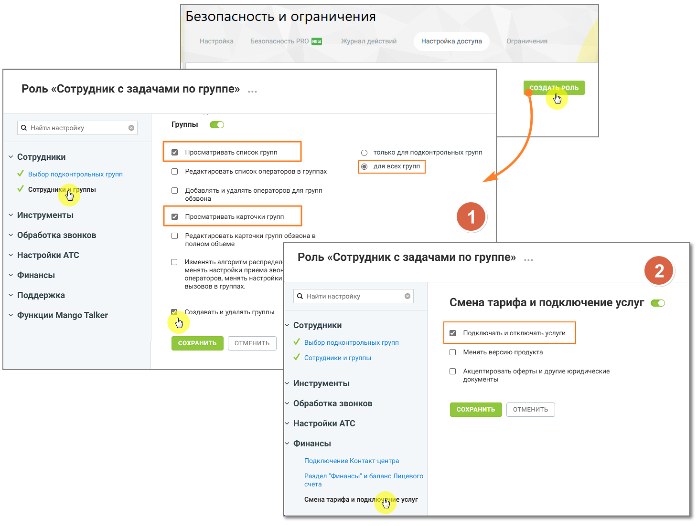

#### 4.4.6.2. Работа с группами

> Трассировка: PDF §4.4.6.2 · сквозные стр. 163-165 · источники: ч.1 `kb/sources/mango-lk-manual/LK_manual_v-125-1-280.pdf` с.163-165.

Для добавления группы воспользуйтесь одноименной ссылкой. Откроется карточка группы, содержащая три вкладки.

внимание

Чтобы сотрудник с пользовательской ролью мог создавать, изменять или удалять группы, помимо прав в разделе Группы, необходимо в разделе Финансы включить разрешение «Смена тарифа и подключение услуг». Без этого действия с группами будут недоступны.

> **Описание иллюстрации LK-§4.4.6.2-1** (к §4.4.6.2 «Работа с группами», стр. 163; 1459×1103 px). Снимок экрана / схема Личного кабинета.
> Относится к тексту руководства: «…мимо прав в разделе Группы, необходимо в разделе Финансы включить разрешение «Смена тарифа и подключение услуг». Без этого действия с группами будут недоступны.».
> Текст на изображении (OCR, требует сверки): Безопасность и ограничения; Настройка; Безопасность PRO (3); Журнал действий; Настройка доступа; Ограничения; СОЗДАН; РОЛЬ; Роль «Сотрудник с задачами по группе»; Группы; Q Найти настройку; © только для подконтрольных групп; у Сотрудники; © длявсех групп; М выбор подконтрольных групп; О Редактировать список операторов в группах; О Добавлять и удалять операторов для групп; обзвона; У coer; Инструменты; Просматривать карточки групп; Обработка звонков; О Редактировать карточки групп обзвонав; полном объеме; Настройки АТС; О Изменять алгоритм распредел; Роль «Сотрудник с задачами по группе» .; мен…

Для изменения настроек группы нажмите на ссылку Настроить группу.

Для удаления группы откройте настройки группы и нажмите кнопку Удалить группу на любой из вкладок. При удалении выполняется проверка, задействована ли группа:

 в схемах переадресации;

 в переадресации по номеру клиента;

 в настройках виджетов "Обратный звонок";

 в кампаниях исходящего обзвона Контакт-центра в статусах «Завершена», «Запланирована», «Остановлена» - в этом случае группа исключается из списка групп операторов и удаляется.

Если группа указана хотя бы в одной схеме, переадресации по номеру клиента, настройке либо кампании в статусе, отличном от «Завершена», «Запланирована», «Остановлена», на экране отображается предупреждение примерного вида. Группа при этом не удаляется.

> **Описание иллюстрации LK-§4.4.6.2-2** (к §4.4.6.2 «Работа с группами», стр. 164; 345×42 px). Снимок экрана / схема Личного кабинета.
> Относится к тексту руководства: «…ампании в статусе, отличном от «Завершена», «Запланирована», «Остановлена», на экране отображается предупреждение примерного вида. Группа при этом не удаляется.».
> Текст на изображении (OCR, требует сверки): Группа задействована в схеме переадресации

Из удаленной группы исключаются все сотрудники.

Сохраните внесенные в карточку изменения нажатием на кнопку Сохранить или клавишей [Enter] на клавиатуре.

Название группы сохраняется отдельно, независимо от сохранения данных внутри карточки группы.

> **Описание иллюстрации LK-§4.4.6.2-3** (к §4.4.6.2 «Работа с группами», стр. 164; 16×18 px). Пиктограмма (значок элемента интерфейса).
> Относится к тексту руководства: «…Название группы сохраняется отдельно, независимо от сохранения данных внутри карточки группы.».
> Текста на изображении нет; назначение значка — см. текст, к которому он относится.

Нажатие на кнопку Отменить, пиктограмму или клавишу [Esc] на клавиатуре закрывает карточку группы без сохранения изменений.
