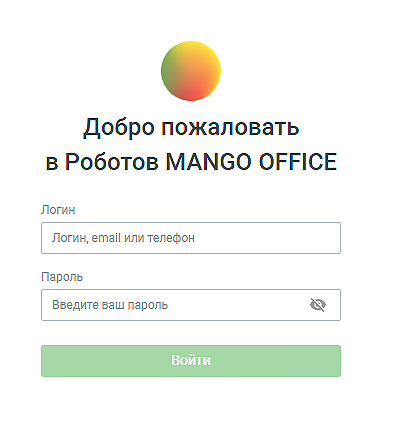
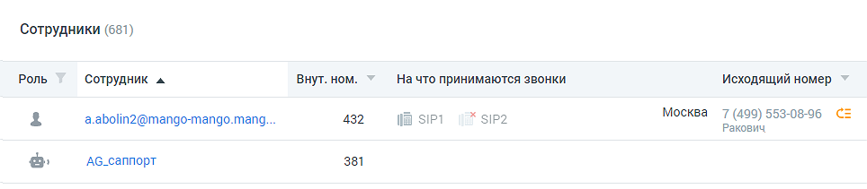
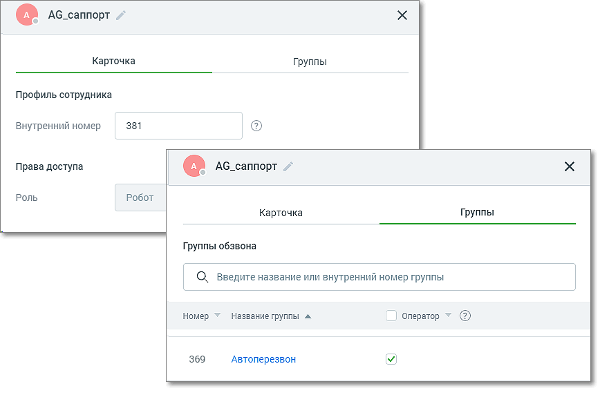

#### 4.4.6.3. Роботы

> Трассировка: PDF §4.4.6.3 · сквозные стр. 175-176 · источники: ч.1 `kb/sources/mango-lk-manual/LK_manual_v-125-1-280.pdf` с.175-176.

Модуль Роботы - инструмент для автоматизации приема входящих звонков и исходящего обзвона. Доступ к модулю осуществляется по адресу http://robot.mango- office.ru.

Авторизуйтесь в системе, заполнив поля формы авторизации:

> **Описание иллюстрации LK-§4.4.6.3-1** (к §4.4.6.3 «Роботы», стр. 175; 393×439 px). Снимок экрана / схема Личного кабинета.
> Относится к тексту руководства: «…Авторизуйтесь в системе, заполнив поля формы авторизации:».
> Текст на изображении (OCR, требует сверки): Добро пожаловать; в Роботов MANGO OFFICE; Логин; Логин, email или телефон; Пароль; Введите ваш пароль; SS ae

При первом входе в модуль открывается форма покупки робота-оператора. Ознакомьтесь с условиями, введите необходимое количество роботов и нажмите кнопку Купить робота.

Роботы-сотрудники отображаются в Личном кабинете в списке сотрудников с иконкой

> **Описание иллюстрации LK-§4.4.6.3-2** (к §4.4.6.3 «Роботы», стр. 175; 23×18 px). Пиктограмма (значок элемента интерфейса).
> Относится к тексту руководства: «…Роботы-сотрудники отображаются в Личном кабинете в списке сотрудников с иконкой».
> Текста на изображении нет; назначение значка — см. текст, к которому он относится.

, служебная роль – «Робот».

> **Описание иллюстрации LK-§4.4.6.3-3** (к §4.4.6.3 «Роботы», стр. 175; 964×211 px). Снимок экрана / схема Личного кабинета.
> Относится к тексту руководства: «…, служебная роль – «Робот».».
> Текст на изображении (OCR, требует сверки): Сотрудники (681); Роль.; ‘Сотрудник ^; внут. ном.; На что принимаются звонки; исходящий номер; a.abolin2@mango-mango.mang,; 432; у р; Х sip2; Москва 7 (499) 553-08-96 СЕ; Ракович; 381; Аб.саппорт

По клику на имени робота в списке открывается карточка робота.

> **Описание иллюстрации LK-§4.4.6.3-4** (к §4.4.6.3 «Роботы», стр. 176; 868×572 px). Снимок экрана / схема Личного кабинета.
> Относится к тексту руководства: «…По клику на имени робота в списке открывается карточка робота.».
> Текст на изображении (OCR, требует сверки): @ АС_саппорт ~; Карточка; Группы; Профиль сотрудника; Внутренний номер; 381; Права доступа; Роль; Робот; Группы обзвона; О) Введите название или внутренний номер группы; Номер Y Название группы «; 369; Автоперезвон

Карточка робота содержит следующую информацию:

 Имя робота – может быть изменено по клику на пиктограмме «карандаш»;  Профиль сотрудника – внутренний номер робота для перевода вызовов;  Роль - значение поля «Робот». Поле недоступно для редактирования;  Добавление исключение робота из групп обзвона – в группе обзвона робот может быть только оператором.

Сотрудник-робот отображается в статистике аналогично другим сотрудникам, может быть добавлен в группы и участвовать в схеме переадресации.
