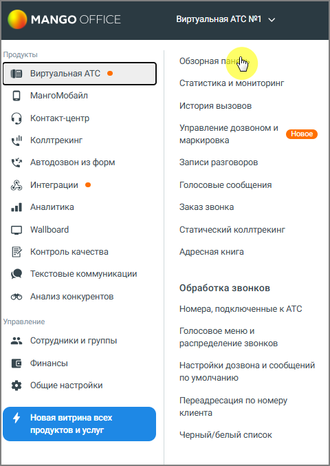

## 4.5. Инструменты

> Трассировка: PDF §4.5 · сквозные стр. 176-177 · источники: ч.1 `kb/sources/mango-lk-manual/LK_manual_v-125-1-280.pdf` с.176-177.

Раздел Инструменты доступен пользователю из:

1. Обзорной панели Личного кабинета

2. Вертикальной навигационной панели Рабочего стола

> **Описание иллюстрации LK-§4.5-1** (к §4.5 «Инструменты», стр. 177; 480×677 px). Снимок экрана / схема Личного кабинета.
> Относится к тексту руководства: «…2. Вертикальной навигационной панели Рабочего стола».
> Текст на изображении (OCR, требует сверки): MANGO OFFICE; Виртуальная ATC N21 v; ты; Про; Обзорная; Статистика и мониторинг; МангоМобайл; История вызовов; Контакт-центр; Управление дозвоном и; wl; Коллтрекинг; маркировка; we; Автодозвон из форм; Записи разговоров; Интеграции ®; Голосовые сообщения; al; Аналитика; Заказ звонка; Wallboard; Статический коллтрекинг; Контроль качества; Адресная книга; Текстовые коммуникации; Обработка звонков; Анализ конкурентов; Номера, подключенные к АТС; Управление; Голосовое меню и; eo; Сотрудники и группы; распределение звонков; Финансы; Настройки дозвона и сообщений; по умолчанию; Общие настройки; Пере…
