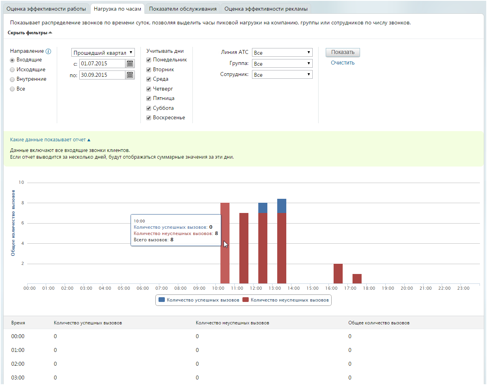

#### 4.5.1.2. Нагрузка по часам

> Трассировка: PDF §4.5.1.2 · сквозные стр. 180-182 · источники: ч.1 `kb/sources/mango-lk-manual/LK_manual_v-125-1-280.pdf` с.180-182.

Для построения отчета воспользуйтесь следующими фильтрами:

1. Выберите направление вызовов, используя одноименный переключатель:

 Входящие – звонки, пришедшие на любой номер, подключенный к АТС в качестве внешней линии (номера MANGO OFFICE, номера сторонних операторов, номера 8-800);

 Исходящие – звонки, совершенные сотрудниками на номера, не указанные в карточках сотрудников;

 Внутренние – звонки, совершенные и полученные сотрудниками (группами), по номерам, указанным в карточках сотрудников;

 Все — сумма входящих, исходящих и внутренних звонков.

совет

При указании варианта «Исходящие» нельзя использовать фильтры «Линия АТС» и «Группа», а варианта «Внутренние» — фильтр «Линия АТС».

2. Укажите период, охватываемый отчетом. При необходимости можно указать даты самостоятельно. Максимальная длина периода формирования отчета составляет один год.

3. В блоке «Учитывать дни» установите флаги для тех дней недели, которые будут учтены в отчете. Если флаг не установлен, то звонки соответствующих дней недели в отчет не попадут.

4. Выберите входящую линию:

 Номер или sip-линию;

 группу;

 конкретного сотрудника;

 линию, указанную для виджета «Звонок с сайта» или «обратный звонок».

Для формирования отчета в соответствии с указанными критериями фильтрации нажмите Показать.

> **Описание иллюстрации LK-§4.5.1.2-1** (к §4.5.1.2 «Нагрузка по часам», стр. 181; 1235×978 px). Снимок экрана / схема Личного кабинета.
> Относится к тексту руководства: «…Для формирования отчета в соответствии с указанными критериями фильтрации нажмите Показать.».
> Текст на изображении (OCR, требует сверки): Оценка эффективности работы; Нагрузка по часам; Показатели обслуживания; Оценка эффективности рекламы; Показывает распределение звонков по времени суток, позволяя выделить часы пиковой нагрузки на компанию, группы или сотрудников по числу звонков.; Скрыть фильтры =; "Направление ©; Учитывать дни; Показать; Прошедший квартал ¥; Линия ATC | Все.; @ Входящие; Понедельник; < [01.07.2015; Группа:; Все; Очистить; О Исходящие; Вторник; по:; 30.09.2015; Сотрудник:; © Внутренние; Среда; Bee; Четверг; Пятница; ‘Суббота; Воскресенье; Какие данные показывает отчет a.; `Данные включают все входящие звонки …

Если выбрана конкретная группа сотрудников, то в списке «Сотрудник» будут доступны только вариант «Все», а также входящие в нее работники. При указании определенного специалиста в списке «Группа» окажутся доступны только группы, в которые он включен, а также вариант «Все».

Во время работы с фильтрами рекомендуем развернуть текстовую подсказку «Какие данные показывает отчет». Её содержимое меняется в реальном времени в соответствии с выбранным набором фильтров отчета.

совет

При наведении курсора на элементы графика отображается всплывающая подсказка (см. пример на рисунке выше).
