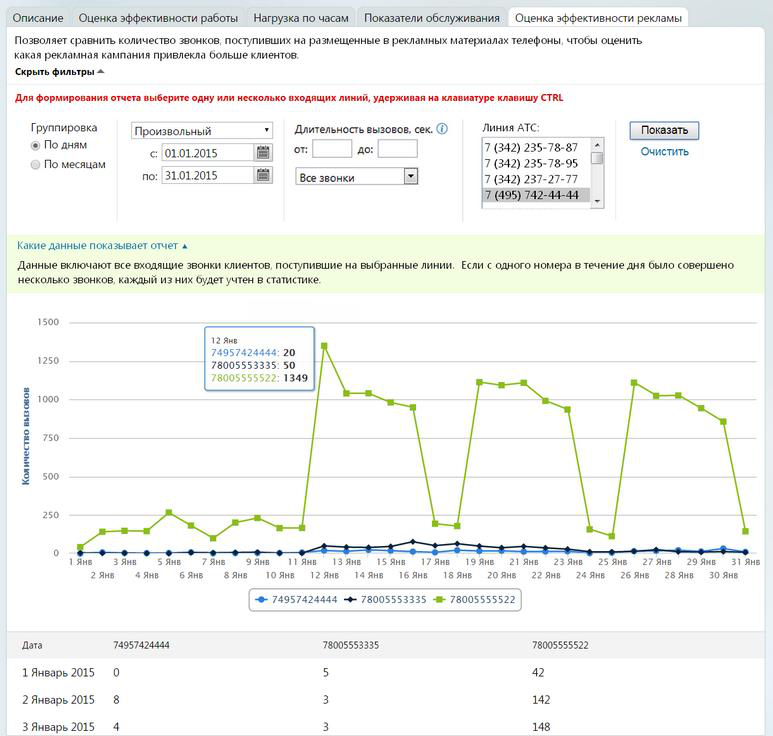

#### 4.5.1.4. Оценка эффективности рекламы

> Трассировка: PDF §4.5.1.4 · сквозные стр. 183-185 · источники: ч.1 `kb/sources/mango-lk-manual/LK_manual_v-125-1-280.pdf` с.183-185.

Выберите тип группировки, используя одноименный переключатель. Ограничения по периодам действуют следующим образом:

 с группировкой по дням: не более одного месяца;

 с группировкой по месяцам: не более одного года.

При необходимости укажите период (по умолчанию предлагается «Произвольный»), или даты, нажимая на значок календаря или вводя их в формате дд.мм.гггг в соответствующие поля.

Далее при необходимости задайте продолжительность вызовов, используя соответствующие поля в блоке «Длительность вызовов, сек.».

В этом же блоке предусмотрен выбор звонков, по которым будет сформирован отчет:

 все входящие звонки - отображение всех входящих звонков (принятых и пропущенных);

 уникальные клиенты – звонки (принятые и пропущенные), совершенные с уникальных номеров телефонов.

Отчет формируется только по входящим вызовам. Предусмотрена возможность указать одну или несколько входящих линий (по умолчанию выбраны все), используя одноименный список. В качестве Линии АТС указываются номера MANGO OFFICE, номера сторонних операторов, номера 8-800 либо виджеты «Звонок с сайта» или «Обратный звонок». Выбрать/отменить выбор можно кликом мышки при зажатой клавише CTRL на клавиатуре.

Для формирования отчета нажмите Показать.

> **Описание иллюстрации LK-§4.5.1.4-1** (к §4.5.1.4 «Оценка эффективности рекламы», стр. 184; 773×736 px). Снимок экрана / схема Личного кабинета.
> Относится к тексту руководства: «…Для формирования отчета нажмите Показать.».
> Текст на изображении (OCR, требует сверки): Описание Оценка эффективности работы Нагрузка по часам Показатели обслуживания Оценка эффективности рекламы; Позволяет сравнить количество звонков, поступивших на размещенные в рекламных материалах телефоны, чтобы оценить; какая рекламная кампания привлекла больше клиентов.; Скрыть фильтры ~; Для формирования отчета выберите одну или несколько входящих линий, удерживая на клавиатуре клавишу CTRL; Группировка; Линия АТС:; Произвольный; Длительность вызовов, сек. [0]; ®) По дням; <; 01.01.2015; от;; |7 (342) 235-78-87; Очистить; © По месяцам; 7 (342) 235-78-95; по: 31.01.2015; | Все звонки; 261%…

Для получения более подробной информации наведите курсор на график на гистограмме. Нажмите на элемент цветовой легенды, чтобы включить или отключить отображение соответствующих данных на гистограмме.
