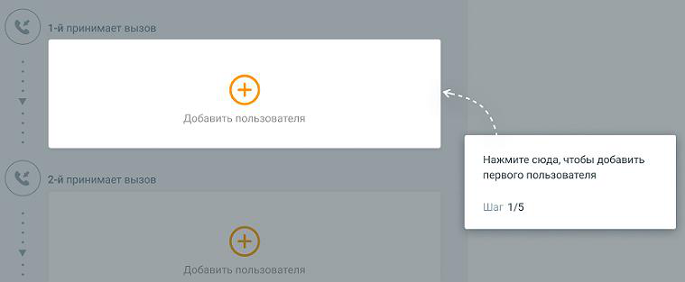
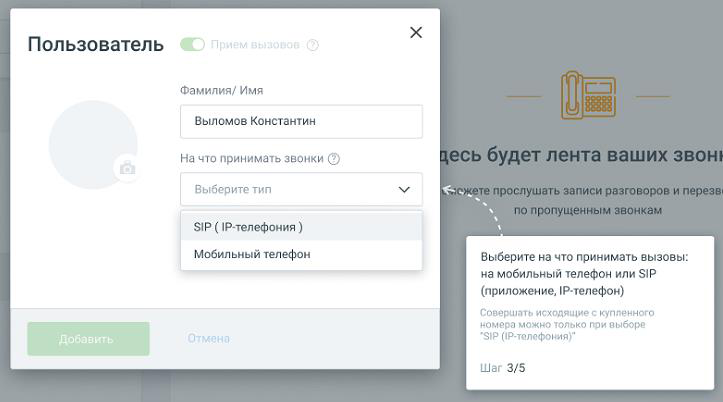

#### 1.8.1.2. Добавление сотрудников.

> Трассировка: PDF §1.8.1.2 · сквозные стр. 16-18 · источники: ч.1 `kb/sources/mango-lk-manual/LK_manual_v-125-1-280.pdf` с.16-18.

> **Описание иллюстрации LK-§1.8.1.2-1** (к §1.8.1.2 «Добавление сотрудников.», стр. 16; 37×34 px). Пиктограмма (значок элемента интерфейса).
> Относится к тексту руководства: «…начало раздела».
> Текста на изображении нет; назначение значка — см. текст, к которому он относится.

Шаг 1. Добавление пользователя. Клик по пиктограмме открывает карточку добавления пользователя.

> **Описание иллюстрации LK-§1.8.1.2-2** (к §1.8.1.2 «Добавление сотрудников.», стр. 17; 759×313 px). Снимок экрана / схема Личного кабинета.
> Относится к тексту руководства: «…Шаг 1. Добавление пользователя. Клик по пиктограмме открывает карточку добавления пользователя.».
> Текст на изображении (OCR, требует сверки): Добавить пользователя; Нажмите сюда, чтобы добавить; первого пользователя; Шаг 1/5

Шаг 2. Укажите имя нового пользователя. Указанное имя будет отображаться в списке сотрудников.

Шаг 3. Выберите способ приема звонков:

 мобильный телефон – укажите номер мобильного телефона сотрудника  SIP (IP-телефония) – sip-адрес и пароль сотрудника генерируются автоматически

> **Описание иллюстрации LK-§1.8.1.2-3** (к §1.8.1.2 «Добавление сотрудников.», стр. 17; 723×402 px). Снимок экрана / схема Личного кабинета.
> Относится к тексту руководства: «… мобильный телефон – укажите номер мобильного телефона сотрудника  SIP (IP-телефония) – sip-адрес и пароль сотрудника генерируются автоматически».
> Текст на изображении (OCR, требует сверки): Пользователь; Фамилия/ Имя; Выломов Константин; На что принимать звонки (2); Выберите тип; Sy; SIP (1Р-телефония ); Мобильный телефон; Выберите на что принимать вызовы; на мобильный телефон или SIP; (приложение, |Р-телефон); Совершать исходя; е с купленного; номера можно тол; ко при выборе; “SIP (Р-телефония)"; Шаг 3/5

Шаг 4. Подтверждение добавления пользователя и проверка правильности ввода данных.

Отредактировать данные пользователя вы можете после прохождения онбординга

> **Описание иллюстрации LK-§1.8.1.2-4** (к §1.8.1.2 «Добавление сотрудников.», стр. 17; 18×16 px). Пиктограмма (значок элемента интерфейса).
> Относится к тексту руководства: «…Отредактировать данные пользователя вы можете после прохождения онбординга».
> Текста на изображении нет; назначение значка — см. текст, к которому он относится.

нажав на пиктограмму .

Чтобы удалить сотрудника, откройте карточку сотрудника, кликните по кнопке Удалить пользователя, подтвердите удаление.

> **Описание иллюстрации LK-§1.8.1.2-5** (к §1.8.1.2 «Добавление сотрудников.», стр. 18; 17×20 px). Пиктограмма (значок элемента интерфейса).
> Относится к тексту руководства: «…Чтобы удалить сотрудника, откройте карточку сотрудника, кликните по кнопке Удалить пользователя, подтвердите удаление.».
> Текста на изображении нет; назначение значка — см. текст, к которому он относится.

Клик по пиктограмме прерывает работу обучающего модуля Онбординг.
