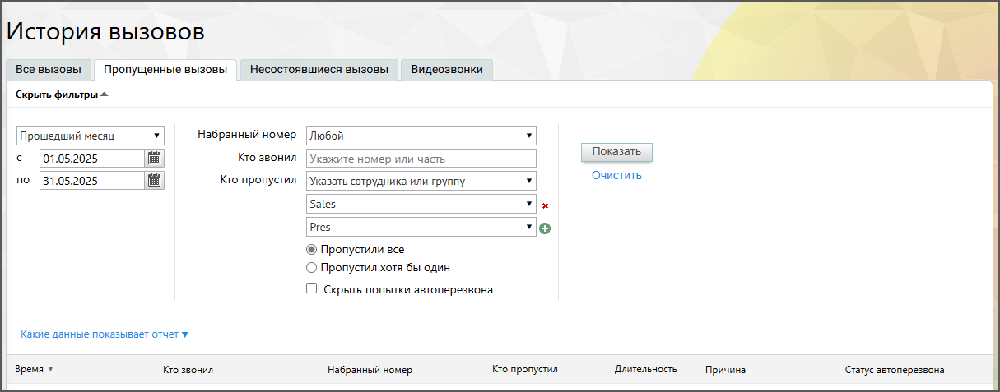
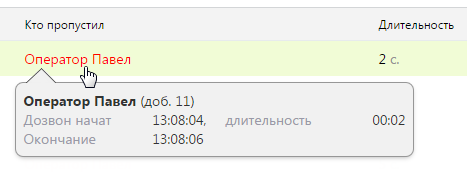
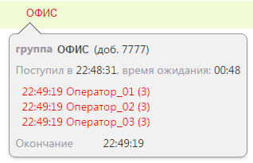
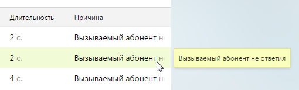

#### 4.5.2.2. Пропущенные вызовы

> Трассировка: PDF §4.5.2.2 · сквозные стр. 189-191 · источники: ч.1 `kb/sources/mango-lk-manual/LK_manual_v-125-1-280.pdf` с.189-191.

Данный отчет содержит информацию обо всех пропущенных входящих вызовах. Порядок действий для создания и сохранения отчета аналогичен процедуре при работе с отчетом «Все вызовы».

> **Описание иллюстрации LK-§4.5.2.2-1** (к §4.5.2.2 «Пропущенные вызовы», стр. 189; 1215×477 px). Снимок экрана / схема Личного кабинета.
> Относится к тексту руководства: «…ржит информацию обо всех пропущенных входящих вызовах. Порядок действий для создания и сохранения отчета аналогичен процедуре при работе с отчетом «Все вызовы».».
> Текст на изображении (OCR, требует сверки): История BbI3O0BOB; Все вызовы; Пропущенные вызовы; 'Несостоявшиеся вызовы; Видеозвонки; Скрыть фильтры =; Прошедший месяц; Набранный номер Любой; Показать; (01.05.2025; Кто звонил |Укажите номер или часть; по [31.05.2025; Кто пропустил | Указать сотрудника или группу; Очистить,; Sales; Pres; © Пропустили все; О Пропустил хотя бы один; О скрыть попытки автоперезвона; Какие данные показывает отчет у; Время у; Кто звонил; Набранный номер.; Кто пропустил; Длительность; Причина; (Статус автоперезвона

Для построения отчета воспользуйтесь следующими фильтрами:

1. Период. Отчет формируется по указанному периоду. При выборе значения «Произвольный» в полях «с» и «по» следует указать точные даты начала и завершения периода.

2. Набранный номер - номер ВАТС, номера сторонних операторов, номера 8-800 и линии виджетов «Звонок с сайта» и «Обратный звонок». Предусмотрена возможность выбора всех номеров;

3. Кто звонил - Номер или SIP-адрес абонента. Если поле оставлено незаполненным, то отчет формируется по всем внешним номерам;

4. Кто пропустил - имя сотрудника или название группы, пропустивших вызов. Кроме того, предусмотрен пункт «Никто (звонки закончились в голосовом меню)» для отображения вызовов, пропущенных на стадии работы абонента с голосовым меню.

5. Отношение между пропустившими вызов - фильтр доступен только в случае, если указано два и более сотрудника (группы), пропустивших вызов. При выборе варианта «Пропустили все» фильтр срабатывает как логическое условие «И»: запись будет отображена только в том случае, если вызов был пропущен всеми указанными сотрудниками (группами). В противном случае фильтр срабатывает как логическое «ИЛИ»: запись отображается, если в вызове принимал участие хотя бы один из абонентов.

6. Скрыть попытки автоперезвона – при отметке чекбокса в отчёте будут скрыты автоматические повторы вызовов, выполняемые системой в случае недозвона. Это позволяет исключить из анализа технические вызовы и сосредоточиться только на реальных попытках соединения с клиентом.

Отчет формируется после нажатия Показать.

Сформированный отчет состоит из столбцов:

 Время – время начала дозвона;

 Кто звонил – номер абонента, с которого был совершен вызов. Если звонил сотрудник ВАТС, то отображается его ФИО. Если звонок был совершен посредством кнопки с сайта, то в поле будет отображаться название соответствующей кнопки;

 Набранный номер – номер, на который был совершен вызов, либо линия, указанная для виджета «Обратный звонок», если клиентом был сделан заказ на звонок при помощи соответствующего виджета;

 Кто пропустил – имя сотрудника или название группы, пропустивших вызов

 Длительность – длительность вызова;

 Причина – уточняющая причина завершения вызова.

 Статус автоперезвона – функциональность аналогична статусу автоперезвона на вкладке «Все вызовы».

При щелчке по ФИО сотрудника или названию группы в столбце «Кто пропустил» отображается подсказка, содержащая дополнительную информацию по вызову.

> **Описание иллюстрации LK-§4.5.2.2-2** (к §4.5.2.2 «Пропущенные вызовы», стр. 190; 467×173 px). Снимок экрана / схема Личного кабинета.
> Относится к тексту руководства: «…При щелчке по ФИО сотрудника или названию группы в столбце «Кто пропустил» отображается подсказка, содержащая дополнительную информацию по вызову.».
> Текст на изображении (OCR, требует сверки): Кто пропустил; Длительность; Оператор Павел; cave; Оператор Павел (доб. 11); Дозвон начат; 13:08:04, длительность; 00:02; Окончание; 13:08:06

При пропущенном звонке на группу подсказка содержит список сотрудников, пропустивших вызов. Для каждого сотрудника указывается количество дозвонов

> **Описание иллюстрации LK-§4.5.2.2-3** (к §4.5.2.2 «Пропущенные вызовы», стр. 190; 318×205 px). Снимок экрана / схема Личного кабинета.
> Относится к тексту руководства: «…При пропущенном звонке на группу подсказка содержит список сотрудников, пропустивших вызов. Для каждого сотрудника указывается количество дозвонов».
> Текст на изображении (OCR, требует сверки): ОФИС; группа ОФИС (доб. 7777); Поступил в 22:48:31, время ожидания: 00:48; 22:49:19 Оператор_01 (3); 22:49:19 Оператор_02 (3); 22:49:19 Оператор_03 (3); Окончание; 22:49:19

При наведении курсора на столбец «Причина» отображается всплывающая подсказка, содержащая полный текст причины завершения вызова.

> **Описание иллюстрации LK-§4.5.2.2-4** (к §4.5.2.2 «Пропущенные вызовы», стр. 191; 510×154 px). Снимок экрана / схема Личного кабинета.
> Относится к тексту руководства: «…При наведении курсора на столбец «Причина» отображается всплывающая подсказка, содержащая полный текст причины завершения вызова.».
> Текст на изображении (OCR, требует сверки): Длительность; Причина; 2с.; Вызываемый абонент =; cae; 4c; Вызываемый абонент +

Как и на закладке «Все вызовы», здесь предусмотрен экспорт файла отчета форматов Excel и CSV. Выберите нужный вариант и нажмите на соответствующую пиктограмму. В результате будет открыто стандартное диалоговое окно браузера, позволяющее открыть или сохранить файл.
