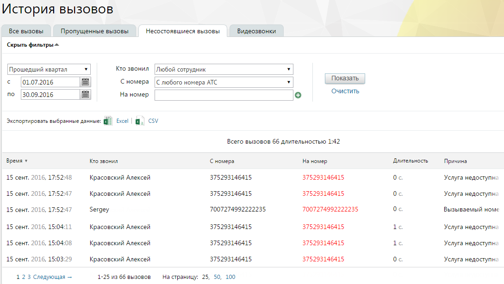

#### 4.5.2.3. Несостоявшиеся вызовы

> Трассировка: PDF §4.5.2.3 · сквозные стр. 191-192 · источники: ч.1 `kb/sources/mango-lk-manual/LK_manual_v-125-1-280.pdf` с.191-192.

Данный отчет содержит информацию обо всех несостоявшихся исходящих вызовах, совершенных на внешний номер (номера) клиента.

Отчет позволяет отследить несостоявшиеся вызовы, совершенные:

 любым сотрудником определенной группы;

 определенным сотрудником;

 с определенной линии;

 на определенный внешний номер или номера клиента.

Порядок действий для создания и сохранения отчета аналогичен процедуре при работе с предыдущими отчетами.

> **Описание иллюстрации LK-§4.5.2.3-1** (к §4.5.2.3 «Несостоявшиеся вызовы», стр. 191; 1089×615 px). Снимок экрана / схема Личного кабинета.
> Относится к тексту руководства: «…Порядок действий для создания и сохранения отчета аналогичен процедуре при работе с предыдущими отчетами.».
> Текст на изображении (OCR, требует сверки): История BbI3OBOB; Все вызовы; Пропущенные вызовы; Несостоявшиеся вызовы; Видеозвонки; Скрыть фильтры ^; Прошедший квартал; Кто звонил |Любой сотрудник; 01.07.2016; С номера; |С любого номера АТС; Показать; по; 30.09.2016; На номер; Очистить,; Экспортировать выбранные данных; Excel | fa] CSV; Всего вызовов 66 длительностью 1:42; Время у; Кто звонил; "Длительность; Ha номер.; Причина; 15 сент, 2016, 17:52:48; Красовский Алексей; 375293146415; Oc.; Услуга недоступна; 15 сент, 2016, 17:52:47; 7007274992222235; Вызываемый номе; Sergey; 15 сент, 2016, 15:04:11; Le; 15 сент, 2016, 15:04:08; 15 сент, …

Сформированный отчет состоит из столбцов:

 Время – время начала дозвона;

 Кто звонил – имя сотрудника ВАТС;

 С номера – номер или название SIP-линии сотрудника ВАТС;

 На номер – номер либо SIP-линия, на который был совершен вызов;

 Длительность – длительность вызова;

 Причина – причина завершения вызова.

Пример

Необходимо просмотреть все неуспешные исходящие звонки, совершенные на определенный номер клиента любым сотрудником определенной группы.

Для этого следует:

 Указать требуемый период;

 В фильтре «Кто звонил» указать выбрать значение «Любой сотрудник группы [Название группы]»;

 Значение фильтра «С номера» оставить без изменений или указать номер или SIP-линию выбранной группы;

 В фильтре «На номер» указать номер клиента;

 Нажать Показать.

В результате отчет отобразит список неуспешных вызовов, совершенных любым сотрудником указанной группы на определенный номер клиента за выбранный период.
