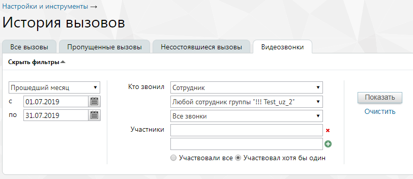

#### 4.5.2.4. Видеозвонки

> Трассировка: PDF §4.5.2.4 · сквозные стр. 192-194 · источники: ч.1 `kb/sources/mango-lk-manual/LK_manual_v-125-1-280.pdf` с.192-194.

Данный отчет содержит информацию обо всех видеозвонках.

Отчет позволяет отследить видеозвонки, совершенные:

 любым сотрудником определенной группы;

 определенным сотрудником;

 успешные или неуспешные видеозвонки;

 с участием определенного сотрудника или любого сотрудника группы.

Порядок действий для создания и сохранения отчета аналогичен процедуре при работе с предыдущими отчетами.

> **Описание иллюстрации LK-§4.5.2.4-1** (к §4.5.2.4 «Видеозвонки», стр. 193; 812×352 px). Снимок экрана / схема Личного кабинета.
> Относится к тексту руководства: «…Порядок действий для создания и сохранения отчета аналогичен процедуре при работе с предыдущими отчетами.».
> Текст на изображении (OCR, требует сверки): Настройки и инструменты —; История ВЫЗОВОВ; Все вызовы; Пропущенные вызовы; Несостоявшиеся вызовы; Видеозвонки; Скрыть фильтры —; Кто звонил; Прошедший месяц; Сотрудник; puma; 01.07.2019; Любой сотрудник группы "!!! Test_uz_2"; | Показать |; Очистить; по |31.07.2019; Все звонки; Участники; Участвовали все @ Участвовал хотя бы один

Сформированный отчет состоит из столбцов:

 Время – время начала дозвона;

 Кто звонил – имя сотрудника ВАТС;

 С номера – номер или название SIP-линии сотрудника ВАТС;

 На номер – номер либо SIP-линия, на который был совершен вызов;

 Длительность – длительность вызова;

 Причина – причина завершения вызова.

Через 4 часа после завершения видеозвонка становится доступна для скачивания запись видеоконференции. Формат записи mp4, разрешение не ниже 1024х768. Для скачивания кликните по иконке «скачать» напротив выбранной записи. Видеоконференция длительностью менее 6 секунд считается несостоявшейся. Ее запись недоступна для скачивания.
