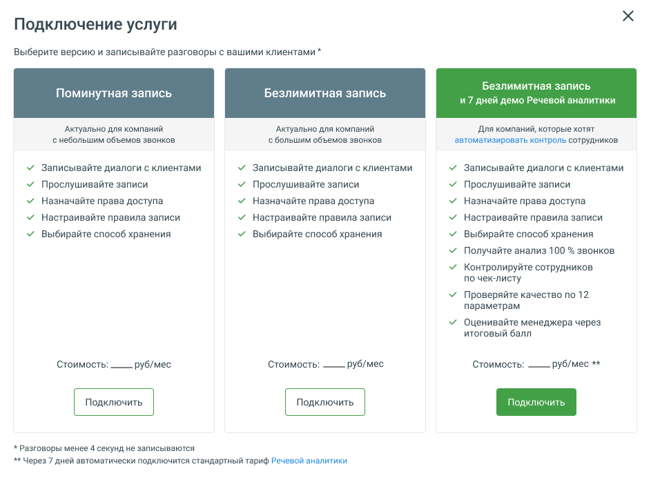

### 4.5.3. Запись разговоров

> Трассировка: PDF §4.5.3 · сквозные стр. 194-195 · источники: ч.1 `kb/sources/mango-lk-manual/LK_manual_v-125-1-280.pdf` с.194-195.

Виртуальная АТС может записывать — вручную или автоматически — нужный разговор (разговоры) для дальнейшего использования этих записей в интересах вашего бизнеса. Созданные аудиофайлы можно прослушать, распознать и проанализировать с помощью «Речевой аналитики», загрузить из облачного хранилища, переслать на нужные адреса электронной почты.

Для подключения инструмента нажмите одноименную кнопку и выберите (см. рисунок ниже) режим использования сервиса:

 Безлимитная запись — безлимитная запись всех разговоров по определенному тарифу за месяц использования услуги;  Поминутная запись — поминутная тарификация использования услуги. Стоимость подключения услуги зависит от текущего тарифного плана ВАТС.  Безлимитная запись и 7 дней демо Речевой аналитики — безлимитная запись всех разговоров, с подключенной на семь дней демоверсией Речевой аналитики.

"

> **Описание иллюстрации LK-§4.5.3-1** (к §4.5.3 «Запись разговоров», стр. 194; 943×696 px). Снимок экрана / схема Личного кабинета.
> Относится к тексту руководства: «…"».
> Текст на изображении (OCR, требует сверки): Подключение услуги; Выберите версию и записывайте разговоры с вашими клиентами *; Безлимитная запись.; Поминутная запись; Безлимитная запись; и7 дней демо Речевой аналитики; ‘Актуально для компаний; Ana компаний, которые хотят; снебольшим объемов звонков; ‘с большим объемов звонков; автоматизировать контроль сотрудников; Записывайте диалоги с клиентами; Прослушивайте записи; Назначайте права доступа; Настраивайте правила записи; выбирайте способ хранения; Получайте анализ 100 % звонков.; Контролируйте сотрудников; по чек-листу; Проверяйте качество по 12; параметрам; Оценивайте менеджера через;…

Правила записи разговоров указываются во вкладке «Настройки». Допускается запись как всех разговоров, так и выборочно путем создания правил записи: по группе, сотруднику, способу связи или определенному внешнему номеру.
