#### 4.5.3.1. Записанные разговоры

> Трассировка: PDF §4.5.3.1 · сквозные стр. 195-204 · источники: ч.1 `kb/sources/mango-lk-manual/LK_manual_v-125-1-280.pdf` с.195-204.

В этой вкладке можно просмотреть и отсортировать информацию, а также прослушать и скачать записанные разговоры.

Для поиска записанных разговоров воспользуйтесь фильтрами:

1) Из выпадающего списка выберите период отчета либо укажите произвольный;

2) Укажите значение в поле «Кто звонил»: Клиент либо Сотрудник;

 Для значения «Клиент» укажите часть номера или номер, с которого звонил клиент;  Для значения «Сотрудник» выберите группу, конкретного сотрудника либо выберите значение «Любой сотрудник»;

3) Аналогичным образом укажите значения для поля «С кем говорил»;

4) Укажите номер или виджет «Текстовых коммуникаций» , на который осуществился дозвон;

5) При необходимости укажите длительность беседы: предусмотрена возможность выбора определенной длительности либо ввода произвольной длины разговора в формате мм:сс.;

Дополнительные фильтры Речевой аналитики:

6) Поиск по распознанным записям разговоров. Введите ключевое слово или словосочетание, которое вы хотите найти в разговоре (например, "акция", "доставка", "оплата"). Нажмите кнопку "Enter", чтобы слово, которое вы ввели, стало поисковым тегом. Разрешенные для ввода в данное поле символы:

 Кавычки. "" и «»  Дефис (тире)  Запятая  Буквы (кириллица, латиница)  Пробел

Поиск доступен, если на ВАТС подключена услуга «Распознавание разговоров».

ПРИМЕР: Требуется выяснить интерес покупателей к акции Скоро лето. Вводим в поле поиска запрос “скоро лето”, выбираем канал Клиент и получаем список распознанных записей разговоров, где клиенты интересовались акцией. Далее можно прослушать записи и выяснить степень заинтересованности клиента и другую информацию.

7) Выберите, кто говорил эти слова: клиент или сотрудник. Также доступен вариант "никто не говорил". 8) Выберите тематику разговора (например, "продажи", "поддержка", "технические вопросы"). Подробнее о тематиках читайте в Руководстве пользователя по Речевой аналитике. 9) Выберите, хотите ли вы найти разговоры, относящиеся или не относящиеся к данным тематикам:

 Если выбрано Говорили, будут отображены записи разговоров, в которых были затронуты хотя бы одна из выбранных тематик.

 Если выбрано Не говорили, будут показаны только те записи разговоров, в которых не была затронуто ни одна из выбранных тематик. Эта функция может быть полезна, например, для выявления сотрудников, которые упускают возможность предложить акционные продукты в разговоре с клиентами. 10) Выберите эмоции, которые были выражены в разговоре: "любые эмоции", "негативные", "нейтральные". Эмоции разговоров определяет специальный алгоритм искусственного интеллекта, который анализирует как акустические (тембр, громкость), так и лингвистические характеристики. 11) Если выбраны "негативные" или "нейтральные" эмоции, можно указать, кто именно - клиент или сотрудник - проявил эти эмоции в ходе разговора. 12) Укажите длительность тишины. Изучение интервалов тишины может помочь руководителю выявить узкие места в рабочих процессах и процедурах обслуживания клиентов.

Нажмите Показать отчет для формирования списка записанных разговоров, удовлетворяющего условиям фильтров. Нажатие кнопки Очистить фильтры сбрасывает выбранные фильтры.

Если пользователь имеет ограниченные права доступа на прослушивание записей разговоров (например, “прослушивать только свои записи”), то в результатах поиска по ключевым словам будут только его записи.

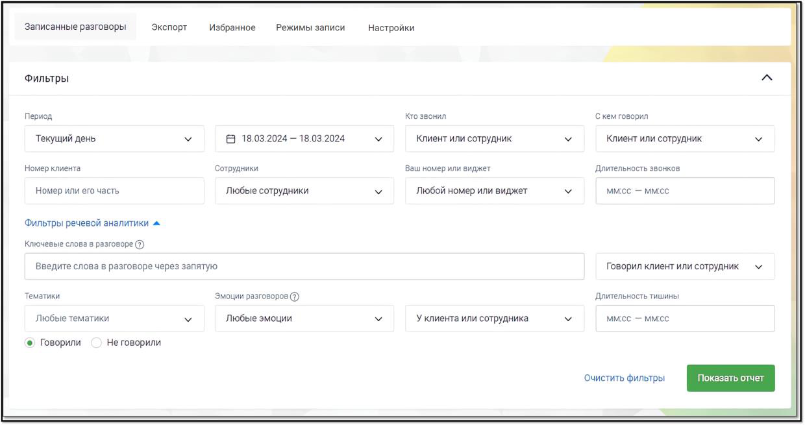

> **Описание иллюстрации LK-§4.5.3.1-1** (к §4.5.3.1 «Записанные разговоры», стр. 196; 1240×655 px). Снимок экрана / схема Личного кабинета.
> Относится к тексту руководства: «…а доступа на прослушивание записей разговоров (например, “прослушивать только свои записи”), то в результатах поиска по ключевым словам будут только его записи.».
> Текст на изображении (OCR, требует сверки): Записанные разговоры:; Экспорт; Избранное; Режимы записи; Настройки; ee; Фильтры; Период; Кто звонил; C xem говорил; Текущий день; В 18.03.2024 — 18.03.2024; Клиент или сотрудник; Номер клиента.; Сотрудники; Ваш номер или виджет; Длительность звонков:; Номер или его часть; Любые сотрудники; Любой номер или виджет; ммсс — ммес; Фильтры речевой аналитики a.; Ключевые слова в разговоре (2); Введите слова в разговоре через запятую; Говорил клиент или сотрудник; Тематики; Длительность тишины; Эмоции разговоров @); Любые тематики; Любые эмоции; Уклиента или сотрудника; ©) Говорили; He говорили

При выборе одной или нескольких записей становятся доступными следующие действия:

 Экспорт аудио – скачать выбранные записи на компьютер пользователя (не более 1 ГБ единоразово);

 Конспектировать – в окне расшифровки звонка выполняется автоматическое формирование краткого резюме разговора с помощью искусственного

интеллекта. В верхней части страницы, над текстом диалога, появляется блок «Конспект» – сжатое содержание разговора, созданное на основе анализа распознанной речи.

При отключённой Речевой аналитике нажатие на кнопку открывает окно подключения, где пользователь может активировать полную версию РА и выбрать движок распознавания речи.

внимание

Функция подключения Речевой аналитики доступна только при наличии у пользователя прав «Просматривать и изменять настройки», «Подписывать оферты», а также «Подключать и отключать услуги».

 Удалить – удалить выбранные записи без возможности восстановления.

> **Описание иллюстрации LK-§4.5.3.1-2** (к §4.5.3.1 «Записанные разговоры», стр. 197; 34×32 px). Пиктограмма (значок элемента интерфейса).
> Относится к тексту руководства: «… Удалить – удалить выбранные записи без возможности восстановления.».
> Текста на изображении нет; назначение значка — см. текст, к которому он относится.

Под пиктограммой доступны следующие опции:

 Отправить на e-mail – отправить выбранные записи на e-mail;

 Расшифровать – отправить выбранные записи на расшифровку «Речевой аналитикой». После подключения Речевой аналитики пользователю не нужно дожидаться, пока накопятся записи разговоров для распознавания. Кнопка «Расшифровать» дает возможность сразу отправить на распознавание из ЛК ВАТС уже накопленные в облачном хранилище записи.

 Экспорт расшифровок – скачать текстовую расшифровку записей (доступно, если на ВАТС подключена услуга Распознавание разговоров и запись расшифрована);

Также при выборе одной или нескольких записей выполняется подсчет общей длительности разговоров и объем файлов.

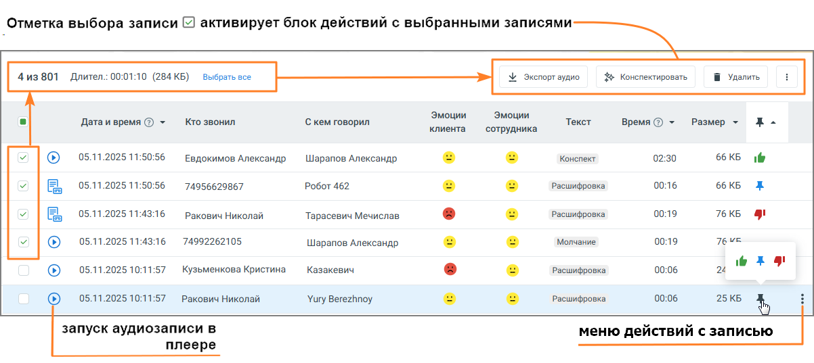

> **Описание иллюстрации LK-§4.5.3.1-3** (к §4.5.3.1 «Записанные разговоры», стр. 197; 1202×537 px). Снимок экрана / схема Личного кабинета.
> Относится к тексту руководства: «…Также при выборе одной или нескольких записей выполняется подсчет общей длительности разговоров и объем файлов.».
> Текст на изображении (OCR, требует сверки): Отметка выбора записи [7 активирует блок действий с выбранными записями; 4 из 801; Длител.: 00:01:10 (284 КБ) в; рать; Экспорт аудио; $e Конопектировать; Я Удалить, В; Кто звонил; Эмоции; Текст; Дата и время © ~; С кем говорил; клиента; ‘сотрудника; Размер ~; Re; 05.11.2025 11:50:56; Евдокимов Александр; Шарапов Александр; Конспект; 02:30; 66 КБ; ie; 74956629867; Робот 462; Расшифровка; 00:16; 05.11.2025 11:43:16; Ракович Николай; Тарасевич Мечислав; 00:19; 76 КБ; ry; 74992262105; Молчание; Jeune; wre; 05.11.2025 10:11:57; Кузьменкова Кристина; Казакевич; 00:06; Yury Berezhnoy; 25КБ \; запуск …

Для того, чтобы добавить запись разговора в список «избранных» или проставить метку

> **Описание иллюстрации LK-§4.5.3.1-4** (к §4.5.3.1 «Записанные разговоры», стр. 198; 44×53 px). Пиктограмма (значок элемента интерфейса).
> Относится к тексту руководства: «…Для того, чтобы добавить запись разговора в список «избранных» или проставить метку».
> Текста на изображении нет; назначение значка — см. текст, к которому он относится.

записи, следует в строке щелкнуть в области столбца с пиктограммой и выбрать один из следующих вариантов:

> **Описание иллюстрации LK-§4.5.3.1-5** (к §4.5.3.1 «Записанные разговоры», стр. 198; 42×41 px). Пиктограмма (значок элемента интерфейса).
> Относится к тексту руководства: «…записи, следует в строке щелкнуть в области столбца с пиктограммой и выбрать один из следующих вариантов:».
> Текста на изображении нет; назначение значка — см. текст, к которому он относится.

 – метка «Хороший звонок»;



> **Описание иллюстрации LK-§4.5.3.1-6** (к §4.5.3.1 «Записанные разговоры», стр. 198; 42×41 px). Пиктограмма (значок элемента интерфейса).
> Относится к тексту руководства: «…».
> Текста на изображении нет; назначение значка — см. текст, к которому он относится.

– метка «Плохой звонок»;

> **Описание иллюстрации LK-§4.5.3.1-7** (к §4.5.3.1 «Записанные разговоры», стр. 198; 31×36 px). Пиктограмма (значок элемента интерфейса).
> Относится к тексту руководства: «…– метка «Плохой звонок»;».
> Текста на изображении нет; назначение значка — см. текст, к которому он относится.

 – метка «В избранное».

Кликните по метке, чтобы ее снять.

> **Описание иллюстрации LK-§4.5.3.1-8** (к §4.5.3.1 «Записанные разговоры», стр. 198; 24×23 px). Пиктограмма (значок элемента интерфейса).
> Относится к тексту руководства: «…Кликните по метке, чтобы ее снять.».
> Текста на изображении нет; назначение значка — см. текст, к которому он относится.

Клик по пиктограмме в строке записи открывает окно действий с выбранной записью: Экспорт аудио, Расшифровать, Экспорт расшифровки, Отправить, Удалить, Список доступа к записи, Копировать ссылку. Возможные действия с записью зависят от прав, предоставленных пользователю в ЛК ВАТС.

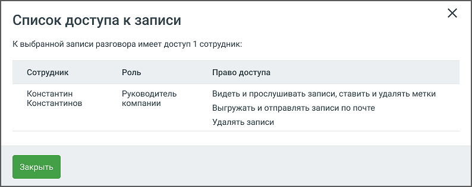

> **Описание иллюстрации LK-§4.5.3.1-9** (к §4.5.3.1 «Записанные разговоры», стр. 198; 794×316 px). Снимок экрана / схема Личного кабинета.
> Относится к тексту руководства: «…сшифровки, Отправить, Удалить, Список доступа к записи, Копировать ссылку. Возможные действия с записью зависят от прав, предоставленных пользователю в ЛК ВАТС.».
> Текст на изображении (OCR, требует сверки): Список доступа к записи; К выбранной записи разговора имеет доступ 1 сотрудник:; Сотрудник; Роль; Право доступа; Константин; Руководитель; Видеть и прослушивать записи, ставить и удалять метки; Константинов; компании; Выгружать и отправлять записи по почте; Удалять записи

Прослушивание записей

> **Описание иллюстрации LK-§4.5.3.1-10** (к §4.5.3.1 «Записанные разговоры», стр. 198; 38×38 px). Пиктограмма (значок элемента интерфейса).
> Относится к тексту руководства: «…Прослушивание записей».
> Текста на изображении нет; назначение значка — см. текст, к которому он относится.

Для прослушивания записи следует щелкнуть по пиктограмме напротив наименования нужной записи. Одновременно в плеер допускается добавить не более одной записи. Также запись может быть обозначена следующими пиктограммами:

> **Описание иллюстрации LK-§4.5.3.1-11** (к §4.5.3.1 «Записанные разговоры», стр. 198; 29×29 px). Пиктограмма (значок элемента интерфейса).
> Относится к тексту руководства: «…против наименования нужной записи. Одновременно в плеер допускается добавить не более одной записи. Также запись может быть обозначена следующими пиктограммами:».
> Текста на изображении нет; назначение значка — см. текст, к которому он относится.

– на данный момент запись воспроизводится.

> **Описание иллюстрации LK-§4.5.3.1-12** (к §4.5.3.1 «Записанные разговоры», стр. 198; 26×27 px). Пиктограмма (значок элемента интерфейса).
> Относится к тексту руководства: «…– на данный момент запись воспроизводится.».
> Текста на изображении нет; назначение значка — см. текст, к которому он относится.

– воспроизведение записи приостановлено.

> **Описание иллюстрации LK-§4.5.3.1-13** (к §4.5.3.1 «Записанные разговоры», стр. 198; 27×27 px). Пиктограмма (значок элемента интерфейса).
> Относится к тексту руководства: «…– воспроизведение записи приостановлено.».
> Текста на изображении нет; назначение значка — см. текст, к которому он относится.

– запись прослушана.

> **Описание иллюстрации LK-§4.5.3.1-14** (к §4.5.3.1 «Записанные разговоры», стр. 198; 24×22 px). Пиктограмма (значок элемента интерфейса).
> Относится к тексту руководства: «…– запись прослушана.».
> Текста на изображении нет; назначение значка — см. текст, к которому он относится.

– запись отправлена на расшифровку «Речевой аналитикой».

> **Описание иллюстрации LK-§4.5.3.1-15** (к §4.5.3.1 «Записанные разговоры», стр. 198; 20×20 px). Пиктограмма (значок элемента интерфейса).
> Относится к тексту руководства: «…– запись отправлена на расшифровку «Речевой аналитикой».».
> Текста на изображении нет; назначение значка — см. текст, к которому он относится.

– доступна только текстовая расшифровка звонка.

> **Описание иллюстрации LK-§4.5.3.1-16** (к §4.5.3.1 «Записанные разговоры», стр. 198; 41×32 px). Пиктограмма (значок элемента интерфейса).
> Относится к тексту руководства: «…– доступна только текстовая расшифровка звонка.».
> Текста на изображении нет; назначение значка — см. текст, к которому он относится.

– запись хранится на ftp-сервере. Существуют два возможных варианта:

 если запись хранится исключительно на FTP, то на вкладке с ней нельзя совершать никаких действий;

 если запись хранится как на FTP, так и на файловом облачном хранилище MANGO OFFICE, то на вкладке с ней можно совершать любые необходимые действия.

> **Описание иллюстрации LK-§4.5.3.1-17** (к §4.5.3.1 «Записанные разговоры», стр. 199; 31×37 px). Пиктограмма (значок элемента интерфейса).
> Относится к тексту руководства: «… если запись хранится как на FTP, так и на файловом облачном хранилище MANGO OFFICE, то на вкладке с ней можно совершать любые необходимые действия.».
> Текста на изображении нет; назначение значка — см. текст, к которому он относится.

– запись зашифрована, просмотр текстовой расшифровки и прослушивание записи на продуктах MANGO OFFICE недоступны.

> **Описание иллюстрации LK-§4.5.3.1-18** (к §4.5.3.1 «Записанные разговоры», стр. 199; 32×32 px). Пиктограмма (значок элемента интерфейса).
> Относится к тексту руководства: «…– запись зашифрована, просмотр текстовой расшифровки и прослушивание записи на продуктах MANGO OFFICE недоступны.».
> Текста на изображении нет; назначение значка — см. текст, к которому он относится.

– запись не обнаружена, вероятно, она была удалена другим пользователем. Строка записи исчезнет при перезагрузке списка.

Для управления прослушиванием используется встроенный плеер.

Для отображения результатов поиска в распознанных записях разговоров используется осциллограмма на встроенном плеере, с выделенными фрагментами разговора.

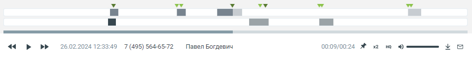

> **Описание иллюстрации LK-§4.5.3.1-19** (к §4.5.3.1 «Записанные разговоры», стр. 199; 957×124 px). Снимок экрана / схема Личного кабинета.
> Относится к тексту руководства: «…Для отображения результатов поиска в распознанных записях разговоров используется осциллограмма на встроенном плеере, с выделенными фрагментами разговора.».
> Текст на изображении (OCR, требует сверки): vw; 00:09/00:24 #; ув; SS; 26.02.2024 12:33:49 7 (495) 564-6572; Павел Богдевич

В области плеера на тех участках разговора, где были вхождения ключевых слов, отображаются метки:

> **Описание иллюстрации LK-§4.5.3.1-20** (к §4.5.3.1 «Записанные разговоры», стр. 199; 24×24 px). Пиктограмма (значок элемента интерфейса).
> Относится к тексту руководства: «…В области плеера на тех участках разговора, где были вхождения ключевых слов, отображаются метки:».
> Текста на изображении нет; назначение значка — см. текст, к которому он относится.

1) для ключевых слов, найденных из строки ввода поисковых запросов

> **Описание иллюстрации LK-§4.5.3.1-21** (к §4.5.3.1 «Записанные разговоры», стр. 199; 24×24 px). Пиктограмма (значок элемента интерфейса).
> Относится к тексту руководства: «…1) для ключевых слов, найденных из строки ввода поисковых запросов».
> Текста на изображении нет; назначение значка — см. текст, к которому он относится.

2) для ключевых слов (терм) из пользовательских тематик

> **Описание иллюстрации LK-§4.5.3.1-22** (к §4.5.3.1 «Записанные разговоры», стр. 199; 18×16 px). Пиктограмма (значок элемента интерфейса).
> Относится к тексту руководства: «…2) для ключевых слов (терм) из пользовательских тематик».
> Текста на изображении нет; назначение значка — см. текст, к которому он относится.

3) для ключевых слов (терм) из AI-тематик

Если в левом блоке «Распознанные словари и слова» отметить какой-либо чекбокс, то в правом блоке «Текст разговора» ключевые слова будут визуально выделяться. Метки на осциллограмме, соответствующие выбранному чекбоксу, также будут визуально

> **Описание иллюстрации LK-§4.5.3.1-23** (к §4.5.3.1 «Записанные разговоры», стр. 199; 19×16 px). Пиктограмма (значок элемента интерфейса).
> Относится к тексту руководства: «…о в правом блоке «Текст разговора» ключевые слова будут визуально выделяться. Метки на осциллограмме, соответствующие выбранному чекбоксу, также будут визуально».
> Текста на изображении нет; назначение значка — см. текст, к которому он относится.

> **Описание иллюстрации LK-§4.5.3.1-24** (к §4.5.3.1 «Записанные разговоры», стр. 199; 18×16 px). Пиктограмма (значок элемента интерфейса).
> Относится к тексту руководства: «…осциллограмме, соответствующие выбранному чекбоксу, также будут визуально». > Текста на изображении нет; назначение значка — см. текст, к которому он относится.».
> Текста на изображении нет; назначение значка — см. текст, к которому он относится.

выделяться более темным цветом: (см. пример 1 на рисунке ниже)

> **Описание иллюстрации LK-§4.5.3.1-25** (к §4.5.3.1 «Записанные разговоры», стр. 199; 24×24 px). Пиктограмма (значок элемента интерфейса).
> Относится к тексту руководства: «…выделяться более темным цветом: (см. пример 1 на рисунке ниже)».
> Текста на изображении нет; назначение значка — см. текст, к которому он относится.

Если чекбокс не отмечен (см. пример 2 на рисунке ниже), метка не меняет цвет.

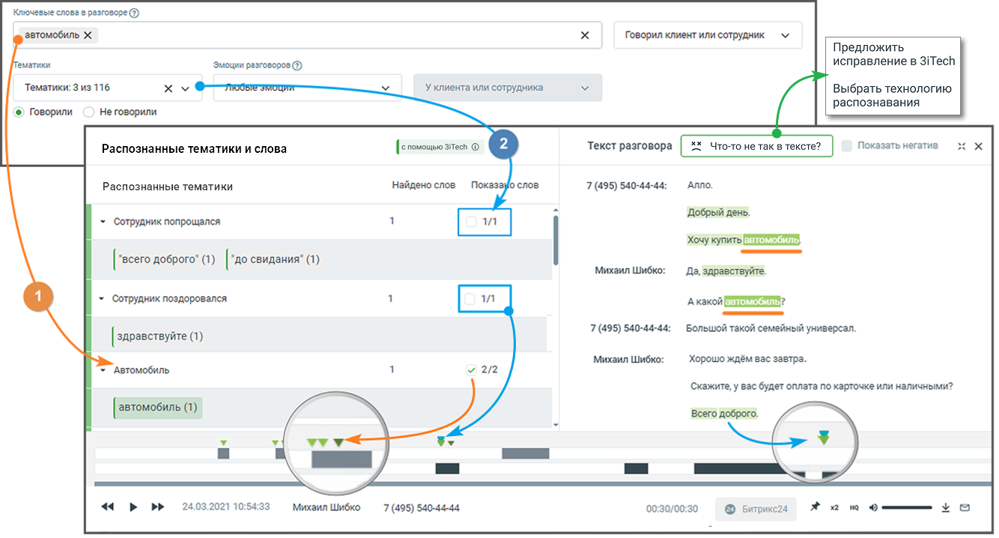

> **Описание иллюстрации LK-§4.5.3.1-26** (к §4.5.3.1 «Записанные разговоры», стр. 200; 1334×718 px). Снимок экрана / схема Личного кабинета.
> Относится к тексту руководства: «…Если чекбокс не отмечен (см. пример 2 на рисунке ниже), метка не меняет цвет.».
> Текст на изображении (OCR, требует сверки): Ключевые слова в разговоре @; ‚автомобиль X; Говорил клиент или сотрудник; Предложить; Тематики; Эмоции разговоров ©); исправление в 3iTech; Тематики: 3 из 116; xv; ou; `Уклиента или сотрудника; Выбрать технологию; распознавания; © Говорили; Неговорили; Распознанные тематики и слова; Текст разговора; 5% что-то He так в тексте?; Показать негатив:; Распознанные тематики; найдено слов; зауо слов; 7 (495) 540-44-44:; Алло.; Добрый день.; > Сотрудник попрощался; р евтомобиль; [ “всего доброго" (1) |“до свидания" (1); Михаил Шибко:; Да, здравствуйте.; > Сотрудник поздоровался; С Давтомобильз; Большо…

Результаты поиска ключевых слов, заданных в строке поиска, с учетом тематик (инструмент

расшифровки разговора включен).

> **Описание иллюстрации LK-§4.5.3.1-27** (к §4.5.3.1 «Записанные разговоры», стр. 200; 31×30 px). Пиктограмма (значок элемента интерфейса).
> Относится к тексту руководства: «…расшифровки разговора включен).».
> Текста на изображении нет; назначение значка — см. текст, к которому он относится.

Иконкой в блоке Распознанные тематики и слова обозначаются AI тематики.

> **Описание иллюстрации LK-§4.5.3.1-28** (к §4.5.3.1 «Записанные разговоры», стр. 200; 213×30 px). Снимок экрана / схема Личного кабинета.
> Относится к тексту руководства: «…Иконкой в блоке Распознанные тематики и слова обозначаются AI тематики.».
> Текст на изображении (OCR, требует сверки): | % Сотрудник поздоровался

> **Описание иллюстрации LK-§4.5.3.1-29** (к §4.5.3.1 «Записанные разговоры», стр. 200; 24×24 px). Пиктограмма (значок элемента интерфейса).
> Относится к тексту руководства: «…уководства: «…Иконкой в блоке Распознанные тематики и слова обозначаются AI тематики.». > Текст на изображении (OCR, требует сверки): | % Сотрудник поздоровался».
> Текста на изображении нет; назначение значка — см. текст, к которому он относится.

> **Описание иллюстрации LK-§4.5.3.1-30** (к §4.5.3.1 «Записанные разговоры», стр. 200; 18×16 px). Пиктограмма (значок элемента интерфейса).
> Относится к тексту руководства: «… > Текст на изображении (OCR, требует сверки): | % Сотрудник поздоровался». > Текста на изображении нет; назначение значка — см. текст, к которому он относится.».
> Текста на изображении нет; назначение значка — см. текст, к которому он относится.

> **Описание иллюстрации LK-§4.5.3.1-31** (к §4.5.3.1 «Записанные разговоры», стр. 200; 19×16 px). Пиктограмма (значок элемента интерфейса).
> Относится к тексту руководства: «… изображении нет; назначение значка — см. текст, к которому он относится.». > Текста на изображении нет; назначение значка — см. текст, к которому он относится.».
> Текста на изображении нет; назначение значка — см. текст, к которому он относится.

> **Описание иллюстрации LK-§4.5.3.1-32** (к §4.5.3.1 «Записанные разговоры», стр. 200; 18×16 px). Пиктограмма (значок элемента интерфейса).
> Относится к тексту руководства: «… изображении нет; назначение значка — см. текст, к которому он относится.». > Текста на изображении нет; назначение значка — см. текст, к которому он относится.».
> Текста на изображении нет; назначение значка — см. текст, к которому он относится.

При наведении курсора на метки плеера отображается всплывающее окно с указанием канала, в рамках которого была распознаны ключевые слова, а также сами ключевые слова.

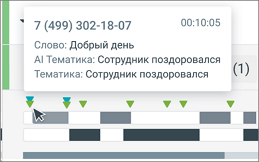

> **Описание иллюстрации LK-§4.5.3.1-33** (к §4.5.3.1 «Записанные разговоры», стр. 200; 259×162 px). Снимок экрана / схема Личного кабинета.
> Относится к тексту руководства: «…ведении курсора на метки плеера отображается всплывающее окно с указанием канала, в рамках которого была распознаны ключевые слова, а также сами ключевые слова.».
> Текст на изображении (OCR, требует сверки): 00:10:05; Слово: Добрый день; Al Тематика: Сотрудник поздоровался; Тематика: Сотрудник поздоровался; vv; Le!; Bw

Выбор метки на плеере переводит воспроизведение записи разговора на участок, соответствующий метке.

Если разговор содержит несколько одинаковых терм или ключевых слов, пиктограммы

> **Описание иллюстрации LK-§4.5.3.1-34** (к §4.5.3.1 «Записанные разговоры», стр. 200; 46×15 px). Пиктограмма (значок элемента интерфейса).
> Относится к тексту руководства: «…Если разговор содержит несколько одинаковых терм или ключевых слов, пиктограммы».
> Текста на изображении нет; назначение значка — см. текст, к которому он относится.

позволяют быстро переключаться между фрагментами, содержащими выбранные термы/ключевые слова. Предварительно в левом блоке «Распознанные тематики и слова» необходимо отметить соответствующие чекбоксы.

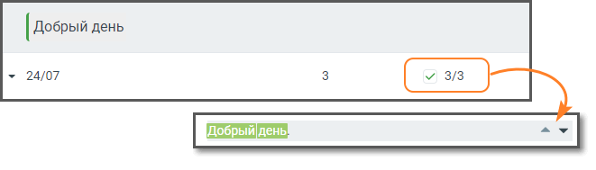

> **Описание иллюстрации LK-§4.5.3.1-35** (к §4.5.3.1 «Записанные разговоры», стр. 201; 661×189 px). Снимок экрана / схема Личного кабинета.
> Относится к тексту руководства: «…гментами, содержащими выбранные термы/ключевые слова. Предварительно в левом блоке «Распознанные тематики и слова» необходимо отметить соответствующие чекбоксы.».
> Текст на изображении (OCR, требует сверки): Добрый день; я 24/07

Если разговор содержит интервалы тишины, заданные в фильтрах, они отобразятся в

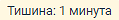

> **Описание иллюстрации LK-§4.5.3.1-36** (к §4.5.3.1 «Записанные разговоры», стр. 201; 119×20 px). Фрагмент интерфейса (кнопка, переключатель или поле).
> Относится к тексту руководства: «…Если разговор содержит интервалы тишины, заданные в фильтрах, они отобразятся в».

соответствующем месте расшифровки разговора:

Если услуга «Расшифровка разговоров» отключена, тексты разговоров на плеере не отображаются.

> **Описание иллюстрации LK-§4.5.3.1-37** (к §4.5.3.1 «Записанные разговоры», стр. 201; 22×22 px). Пиктограмма (значок элемента интерфейса).
> Относится к тексту руководства: «…Если услуга «Расшифровка разговоров» отключена, тексты разговоров на плеере не отображаются.».
> Текста на изображении нет; назначение значка — см. текст, к которому он относится.

Клик по пиктограмме сворачивает окно записи разговора в компактный формат. Для

> **Описание иллюстрации LK-§4.5.3.1-38** (к §4.5.3.1 «Записанные разговоры», стр. 201; 22×22 px). Пиктограмма (значок элемента интерфейса).
> Относится к тексту руководства: «…Клик по пиктограмме сворачивает окно записи разговора в компактный формат. Для».
> Текста на изображении нет; назначение значка — см. текст, к которому он относится.

отображения окна в полной форме следует нажать на пиктограмму .

При отметке чек-боксов «Показать негатив» в транскрибации и на плеере разговора, определенные, как содержащие негатив, будут выделяться фоновым цветом.

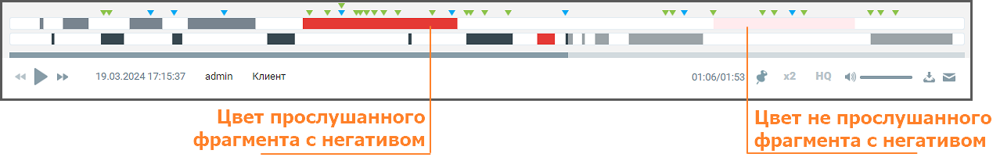

> **Описание иллюстрации LK-§4.5.3.1-39** (к §4.5.3.1 «Записанные разговоры», стр. 201; 1278×215 px). Снимок экрана / схема Личного кабинета.
> Относится к тексту руководства: «…При отметке чек-боксов «Показать негатив» в транскрибации и на плеере разговора, определенные, как содержащие негатив, будут выделяться фоновым цветом.».
> Текст на изображении (OCR, требует сверки): ууу wrvy v; vvwy; wy; vy vy; vy; и EE ey; m= пи пт м ee; ОНИ; «pr; 19.03.2024 17:15:37; admin; Клиент; HQ; Цвет прослушанного; Цвет не прослушанного; фрагмента с негативом

При закрытии ВАТС аудиозаписи разговоров становятся недоступны пользователю, но все еще находятся в файловом хранилище. Через 30 календарных дней аудиозаписи полностью удаляются из файлового хранилища.

Плеер содержит основную информацию о звонке:

 ФИО клиента;

 Дата и время звонка;

 Длительность записи.

При необходимости нажмите:

> **Описание иллюстрации LK-§4.5.3.1-40** (к §4.5.3.1 «Записанные разговоры», стр. 201; 126×20 px). Фрагмент интерфейса (кнопка, переключатель или поле).
> Относится к тексту руководства: «…При необходимости нажмите:».

 – приостановить/продолжить воспроизведение; переключиться на предыдущую/следующую запись;

> **Описание иллюстрации LK-§4.5.3.1-41** (к §4.5.3.1 «Записанные разговоры», стр. 201; 22×20 px). Пиктограмма (значок элемента интерфейса).
> Относится к тексту руководства: «… – приостановить/продолжить воспроизведение; переключиться на предыдущую/следующую запись;».
> Текста на изображении нет; назначение значка — см. текст, к которому он относится.

 – добавить запись в список «избранных» и установить метку;

 – изменить скорость воспроизведения. Варианты – 1х / 1,5х / 2х;

> **Описание иллюстрации LK-§4.5.3.1-42** (к §4.5.3.1 «Записанные разговоры», стр. 201; 19×13 px). Пиктограмма (значок элемента интерфейса).
> Относится к тексту руководства: «… – изменить скорость воспроизведения. Варианты – 1х / 1,5х / 2х;».
> Текста на изображении нет; назначение значка — см. текст, к которому он относится.

 – включение функции шумоподавления. Наличие функции записит от

> **Описание иллюстрации LK-§4.5.3.1-43** (к §4.5.3.1 «Записанные разговоры», стр. 201; 19×13 px). Пиктограмма (значок элемента интерфейса).
> Относится к тексту руководства: «… – включение функции шумоподавления. Наличие функции записит от».
> Текста на изображении нет; назначение значка — см. текст, к которому он относится.

текущего тарифного плана ВАТС. Включение функции возможно только при установленном флаге «Подавлять шумы при прослушивании» на закладке «Настройки»;

> **Описание иллюстрации LK-§4.5.3.1-44** (к §4.5.3.1 «Записанные разговоры», стр. 201; 118×16 px). Фрагмент интерфейса (кнопка, переключатель или поле).
> Относится к тексту руководства: «…текущего тарифного плана ВАТС. Включение функции возможно только при установленном флаге «Подавлять шумы при прослушивании» на закладке «Настройки»;».

 – изменить громкость воспроизведения;

> **Описание иллюстрации LK-§4.5.3.1-45** (к §4.5.3.1 «Записанные разговоры», стр. 201; 18×19 px). Пиктограмма (значок элемента интерфейса).
> Относится к тексту руководства: «… – изменить громкость воспроизведения;».
> Текста на изображении нет; назначение значка — см. текст, к которому он относится.

 – скачать запись;



> **Описание иллюстрации LK-§4.5.3.1-46** (к §4.5.3.1 «Записанные разговоры», стр. 202; 19×15 px). Пиктограмма (значок элемента интерфейса).
> Относится к тексту руководства: «…».
> Текста на изображении нет; назначение значка — см. текст, к которому он относится.

– отправить запись на e-mail.

AI Конспекты

Если у пользователя подключена Речевая аналитика и в ее настройках включена услуга AI Конспекты, в разделе Запись разговоров становится доступна функция просмотра автоматически сформированных резюме звонков.

внимание

Функция доступна пользователям с доступом «Настройки распознавания сотрудников и номеров». Доступ настраивается в ЛК ВАТС → Безопасность и ограничения → Настройка доступа → [выбрать роль] → Речевая аналитика.

Чтобы открыть конспект:

1. Перейдите в раздел Запись разговоров. Откройте нужный звонок. Нажмите кнопку Конспектировать.

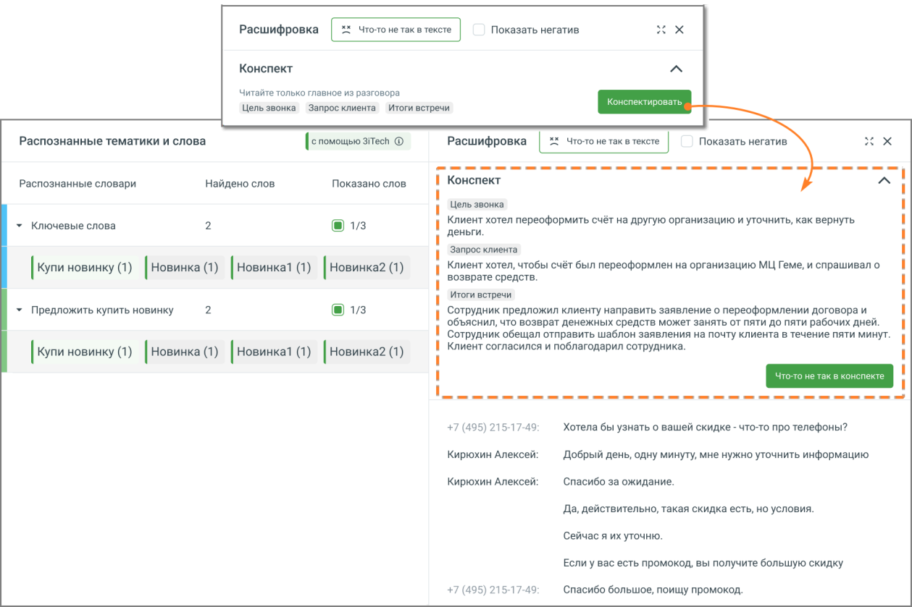

> **Описание иллюстрации LK-§4.5.3.1-47** (к §4.5.3.1 «Записанные разговоры», стр. 202; 1259×839 px). Снимок экрана / схема Личного кабинета.
> Относится к тексту руководства: «…1. Перейдите в раздел Запись разговоров. Откройте нужный звонок. Нажмите кнопку Конспектировать.».
> Текст на изображении (OCR, требует сверки): расшифровка; Показать негатив,; Конспект; Читайте только главное из разговора; Цель звонка; Запрос клиента; Итоги встречи; Распознанные тематики и слова; [с помощью aitech ©; Расшифровка | =“ Что-то нетак в тексте.; Распознанные словари; Найдено слов; Показано слов; + Ключевые слова; Клиент хотел переоформить счёт Ha другую организацию и уточнить, как вернуть; ‘деньги.; Запрос клиента.; Клиент хотел, чтобы счёт был переоформлен на организацию МЦ Teme, и спрашивал о; [Купи новинку (1) [новинка (1) | Новинкат (1) | Новинка? (1); возврате средств.; > Предложить купить новинку; Сотрудник предложил…

2. В окне расшифровки звонка над текстом разговора сформируется Конспект — краткое содержание диалога, подготовленное AI. В нём будут выделены:

 цель звонка,  запрос клиента,  итоги встречи. 3. Персональные данные клиентов из Конспекта исключены.

Если в содержании конспекта что-то не соответствует реальному разговору, нажмите кнопку «Что-то не так в конспекте». Откроется форма, в которой можно:

 оставить комментарий;

 предложить, что добавить или изменить;

 указать контактные данные для обратной связи.

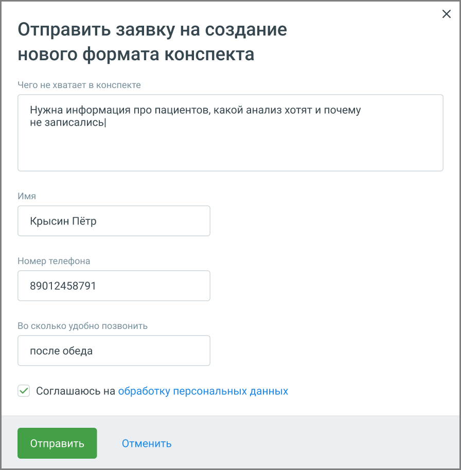

> **Описание иллюстрации LK-§4.5.3.1-48** (к §4.5.3.1 «Записанные разговоры», стр. 203; 896×913 px). Снимок экрана / схема Личного кабинета.
> Относится к тексту руководства: «… указать контактные данные для обратной связи.».
> Текст на изображении (OCR, требует сверки): Отправить заявку на создание; нового формата конспекта; Чего не хватает в конспекте; Нужна информация про пациентов, какой анализ хотят и почему; не записались]; Имя; Крысин Пётр; Номер телефона; 89012458791; Во сколько удобно ПОЗВОНИТЬ; после обеда; У Соглашаюсь Ha обработку персональных данных

Также вы можете предложить свой вариант оформления резюме – собственный промт. Это полезно, если в стандартном конспекте не хватает информации или структура не соответствует задачам вашего бизнеса.

Промт — это текстовая инструкция, по которой AI формирует краткое содержание разговора. Вы можете указать, какие элементы должны быть включены, что стоит убрать или изменить. Это позволяет настраивать конспекты под особенности вашего бизнеса, например, добавить причины отказа клиента, эмоциональную реакцию или этапы обработки запроса.

Чтобы отправить предложение, откройте расшифровку любого звонка и нажмите кнопку Что-то не так в конспекте. Откроется форма обратной связи. В ней укажите, что именно вы хотите изменить, оставьте контактные данные и отметьте удобное время для связи.

Отправленные заявки поступают в команду продукта и сохраняются в системе. На основе пользовательских предложений разрабатываются новые шаблоны, которые могут быть добавлены в список доступных форматов конспектов.

Таким образом, вы получаете возможность влиять на работу AI и адаптировать резюме разговоров под потребности вашей компании.
