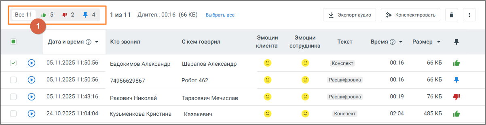

#### 4.5.3.2. Избранное

> Трассировка: PDF §4.5.3.2 · сквозные стр. 204 · источники: ч.1 `kb/sources/mango-lk-manual/LK_manual_v-125-1-280.pdf` с.204.

Вкладка “Избранное” содержит список записей разговоров, отмеченных метками.

Все помеченные записи приводятся в порядке, который соответствует времени определенной записи. Таким образом, последняя по времени запись отображается в верхней части списка. И наоборот – самая ранняя запись отображается последней в списке.

> **Описание иллюстрации LK-§4.5.3.2-1** (к §4.5.3.2 «Избранное», стр. 204; 1202×310 px). Снимок экрана / схема Личного кабинета.
> Относится к тексту руководства: «…ленной записи. Таким образом, последняя по времени запись отображается в верхней части списка. И наоборот – самая ранняя запись отображается последней в списке.».
> Текст на изображении (OCR, требует сверки): Лиз 11; Длител.: 0016 (66 КБ); Выбрать все; \ Экспорт аудио; $ комектировать; Эмоции; Дата и время © ~; Кто звонил; С кем говорил; Размер ~; клиента — сотрудника; 05.11.2025 11:50:56; Евдокимов Александр; Шарапов Александр; Конспект; 00:16; 66 КБ; ie; 74956629867; Робот 462; Расшифровка; 05.11.2025 11:43:16; 00:19; 76 КБ; Ракович Николай; Тарасевич Мечислав; ry; 24.10.2025 11:04:04; Кузьменкова Кристина; Казакевич; 02:04; 485 KB

Предусмотрена фильтрация записей по меткам. Для этого следует выбрать соответствующую метку в области фильтров (1).

Предусмотрена сортировка по убыванию/возрастанию записей в столбцах: Дата и время, Длительность, Размер. Для сортировки необходимо нажать на соответствующую пиктограмму

> **Описание иллюстрации LK-§4.5.3.2-2** (к §4.5.3.2 «Избранное», стр. 204; 20×13 px). Пиктограмма (значок элемента интерфейса).
> Относится к тексту руководства: «…трена сортировка по убыванию/возрастанию записей в столбцах: Дата и время, Длительность, Размер. Для сортировки необходимо нажать на соответствующую пиктограмму».
> Текста на изображении нет; назначение значка — см. текст, к которому он относится.

или .

> **Описание иллюстрации LK-§4.5.3.2-3** (к §4.5.3.2 «Избранное», стр. 204; 20×10 px). Пиктограмма (значок элемента интерфейса).
> Относится к тексту руководства: «…или .».
> Текста на изображении нет; назначение значка — см. текст, к которому он относится.

Действия по прослушиванию, удалению и экспорту записей и их расшифровок аналогичны описанным действиям в предыдущем подразделе.
