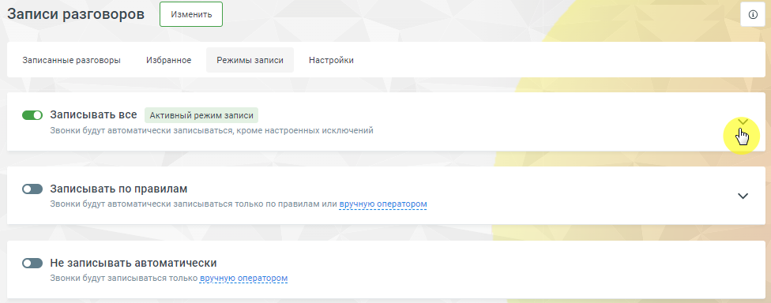
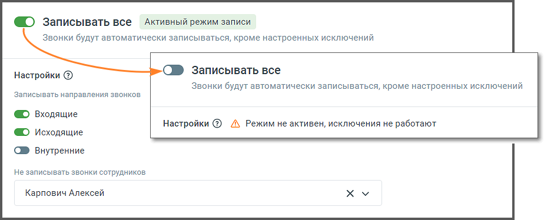
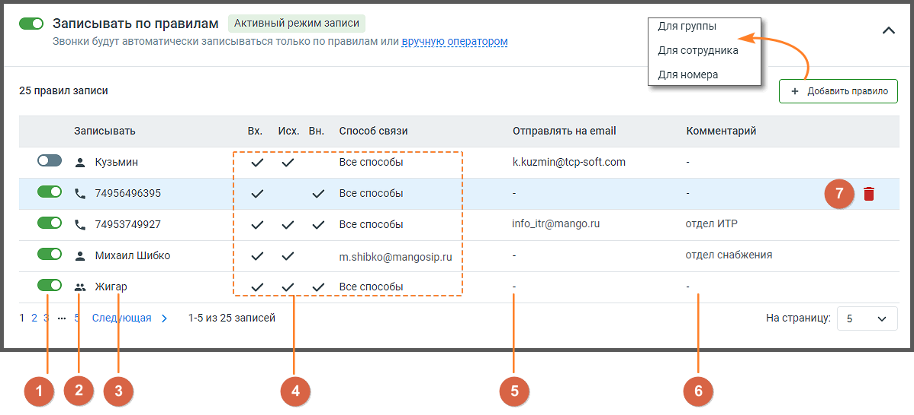
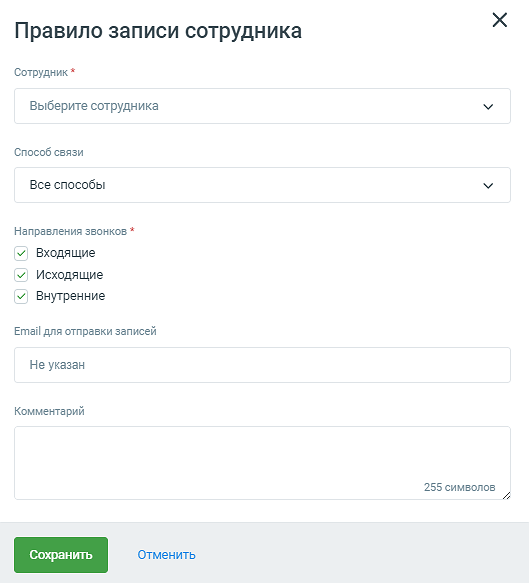
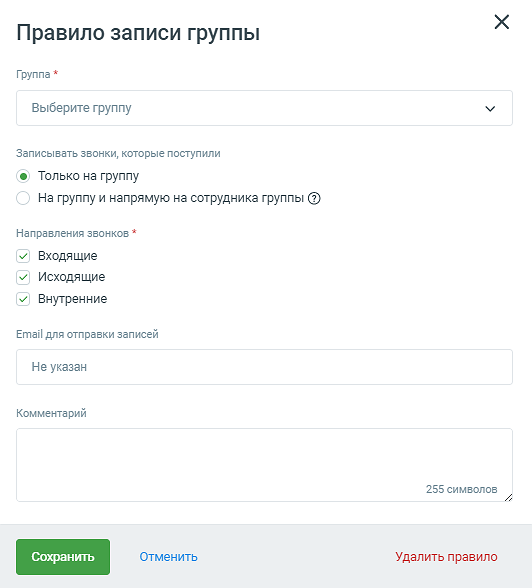
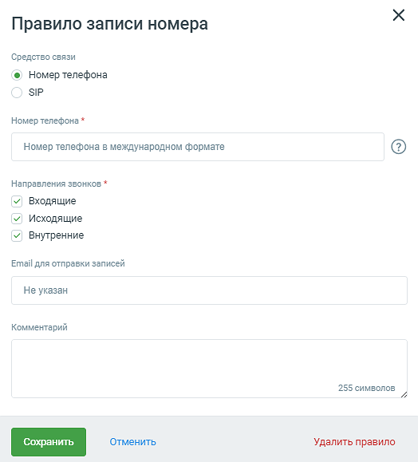

#### 4.5.3.3. Режимы записи

> Трассировка: PDF §4.5.3.3 · сквозные стр. 204-210 · источники: ч.1 `kb/sources/mango-lk-manual/LK_manual_v-125-1-280.pdf` с.204-210.

Данная вкладка предназначена для создания и настройки правил записи разговоров. С ее помощью вы можете задать как общие правила, так и для отдельных сотрудников, групп и номеров.

Общий вид вкладки:

> **Описание иллюстрации LK-§4.5.3.3-1** (к §4.5.3.3 «Режимы записи», стр. 205; 976×384 px). Снимок экрана / схема Личного кабинета.
> Относится к тексту руководства: «…Общий вид вкладки:».
> Текст на изображении (OCR, требует сверки): Записи разговоров; `Записанные разговоры; Избранное; Режимы записи; 'Настройки; записывать все дктивный режим записи; Звонки будут автоматически записываться, кроме настроенных исключений; № записывать по правилам; Звонки будут автоматически записываться только по правилам или вручную оператором; C® Не записывать автоматически; Звонки будут записываться только вруч; ‚ром

Кликом по пиктограмме сворачивания/разворачивания открываются настройки

выбранного режима записи.

Записывать все

При включенном переключателе режима все разговоры заданного направления, для хранения которых хватает места в облачном хранилище, будут автоматически записываться.

> **Описание иллюстрации LK-§4.5.3.3-2** (к §4.5.3.3 «Режимы записи», стр. 205; 941×374 px). Снимок экрана / схема Личного кабинета.
> Относится к тексту руководства: «… включенном переключателе режима все разговоры заданного направления, для хранения которых хватает места в облачном хранилище, будут автоматически записываться.».
> Текст на изображении (OCR, требует сверки): О записывать все Активный режим записи; Звонки будут автоматически записываться, кроме настроенных исключений; Записывать все; Настройки ©; записывать направления звонков; © входящие; Настройки @ Л Режим не активен, исключения не работают; @ исходящие; № Внутренние; Не записывать звонки сотрудников; Карпович Алексей; ху

Предусмотрена возможность выбора направления звонков:

 Входящие;

 Исходящие;

 Внутренние.

Для того, чтобы по определенному направлению запись звонков не осуществлялась, необходимо отключить переключатель напротив названия нужного направления.

Во время внутреннего разговора для каждого сотрудника делается отдельная запись той части беседы, в которой он участвовал. Таким образом, для звонка с двумя внутренними участниками будет создано две одинаковые записи.

Также предусмотрена возможность исключения записи звонков с участием определенных сотрудников. Для этого следует выбрать их имена из выпадающего списка и нажать кнопку Сохранить исключения.

Записывать по правилам

При включенном переключателе режима автоматическая запись разговоров осуществляется выборочно, с использованием правил записи.

> **Описание иллюстрации LK-§4.5.3.3-3** (к §4.5.3.3 «Режимы записи», стр. 206; 1198×546 px). Снимок экрана / схема Личного кабинета.
> Относится к тексту руководства: «…При включенном переключателе режима автоматическая запись разговоров осуществляется выборочно, с использованием правил записи.».
> Текст на изображении (OCR, требует сверки): © записывать по правилам Активный режим записи; `Для группы; звонки будут автоматически записываться только по правилам или вру:; Для сотрудника; Для номера; 25 правил записи; `Записывать.; Исх. BH.; Способ связи; ‘Отправлять на email; Комментарий; Кузьмин; Все способы; kkuzmin@tep-soft.com; 74956496395; 74953749927; info_itr@mango.ru; отдел ИТР; Михаил Шибко; m.shibko@mangosip.ru; отдел снабжения; Жигар; 12; Следующая >; 1-5 из 25 записей; Ha страницу:; оее

Список содержит правила записи разговоров для отдельных сотрудников, групп и номеров.

1) По умолчанию каждое созданное правило активируется автоматически. Для того, чтобы отключить правило, следует перевести переключатель в положение «выключено».

2) Каждое правило обозначено одной из трех пиктограмм, которые указывают на назначение правила – для сотрудника, группы или номера.

3) Имя сотрудника, номер телефона/SIP-адрес или наименование группы.

4) Блок разрешенных направлений звонков и способа связи.

5) Адрес электронной почты для пересылки записей разговоров.

6) Комментарий к правилу.

7) Пиктограмма удаления правила.

При щелчке по правилу на экране отображается форма редактирования соответствующего правила записи.

Для создания нового правила следует нажать кнопку Добавить правило.

Для сотрудника

При создании правила записи для звонков сотрудника следует заполнить следующие поля:

 Имя сотрудника;

 Способ связи. Предусмотрен выбор либо всех, либо одного способа связи данного сотрудника;

 Разрешенные направления звонков.

При необходимости укажите адрес электронной почты для пересылки записей разговоров с использованием параметра «E-mail для отправки записей», а также комментарий к правилу в соответствующее поле.

> **Описание иллюстрации LK-§4.5.3.3-4** (к §4.5.3.3 «Режимы записи», стр. 207; 529×583 px). Снимок экрана / схема Личного кабинета.
> Относится к тексту руководства: «…ектронной почты для пересылки записей разговоров с использованием параметра «E-mail для отправки записей», а также комментарий к правилу в соответствующее поле.».
> Текст на изображении (OCR, требует сверки): Правило записи сотрудника; Сотрудник *; Выберите сотрудника; Способ связи; Все способы; Направления звонков *; у Входящие; У Исходящие; У! Внутренние; Email для отправки записей; Не указан; Комментарий; 255 символов

После внесения изменений следует нажать кнопку Сохранить.

После удаления сотрудника заданное для него правило удаляется автоматически.

Для группы

При создании правила записи для группы следует указать:

 Название группы;

 Переключатель Только на группу – запись разговоров будет вестись только для звонков, поступивших на группу;

 Переключатель Только на группу и напрямую на сотрудника группы – запись разговоров будет вестись как для звонков, поступивших на группу, так и для прямых звонков, поступивших на сотрудника группы по короткому номеру

 Разрешенные направления звонков.

При необходимости укажите адрес электронной почты для пересылки записей разговоров с использованием параметра «E-mail для отправки записей», а также комментарий к правилу в соответствующее поле.

> **Описание иллюстрации LK-§4.5.3.3-5** (к §4.5.3.3 «Режимы записи», стр. 208; 532×588 px). Снимок экрана / схема Личного кабинета.
> Относится к тексту руководства: «…ектронной почты для пересылки записей разговоров с использованием параметра «E-mail для отправки записей», а также комментарий к правилу в соответствующее поле.».
> Текст на изображении (OCR, требует сверки): Правило записи группы; Группа *; Выберите группу; Записывать звонки, которые поступили; @) Только на группу; На группу и напрямую на сотрудника группы @); Направления звонков *; у. Входящие; У Исходящие; У! Внутренние; Email для отправки записей; Не указан; Комментарий; 255 символов; Удалить правило

После внесения изменений следует нажать кнопку Сохранить.

После удаления группы заданное для нее правило удаляется автоматически.

Для номера

При создании правила записи для номера следует указать:

 Средство связи;

 Номер телефона либо SIP-адрес в зависимости от выбранного средства связи;

 Разрешенные направления звонков.

При необходимости укажите адрес электронной почты для пересылки записей разговоров с использованием параметра «E-mail для отправки записей», а также комментарий к правилу в соответствующее поле.

> **Описание иллюстрации LK-§4.5.3.3-6** (к §4.5.3.3 «Режимы записи», стр. 209; 524×579 px). Снимок экрана / схема Личного кабинета.
> Относится к тексту руководства: «…ектронной почты для пересылки записей разговоров с использованием параметра «E-mail для отправки записей», а также комментарий к правилу в соответствующее поле.».
> Текст на изображении (OCR, требует сверки): Правило записи номера; Средство связи; ® Номер телефона; ЯР; Номер телефона *; Номер телефона в международном формате; Направления звонков *; У Входящие; У Исходящие; У! Внутренние; Email для отправки записей; Не указан; Комментарий; 255 символов; Удалить правило

После внесения изменений следует нажать кнопку Сохранить.

Не записывать автоматически

При включенном переключателе режима для записи разговора необходимо подтверждение оператора.

> **Описание иллюстрации LK-§4.5.3.3-7** (к §4.5.3.3 «Режимы записи», стр. 209; 687×106 px). Снимок экрана / схема Личного кабинета.
> Относится к тексту руководства: «…При включенном переключателе режима для записи разговора необходимо подтверждение оператора.».
> Текст на изображении (OCR, требует сверки): Оператор может активировать ручную запись; С Не записывать автоматически; по нажатию на #5 или через Mango Та!Кеги; Звонки будут записываться только вручную оператором; Контакт-центр. Ручную запись можно; отключить в настройках; oe

Ссылка настройки ведет на вкладку «Настройки» страницы Запись разговоров.
