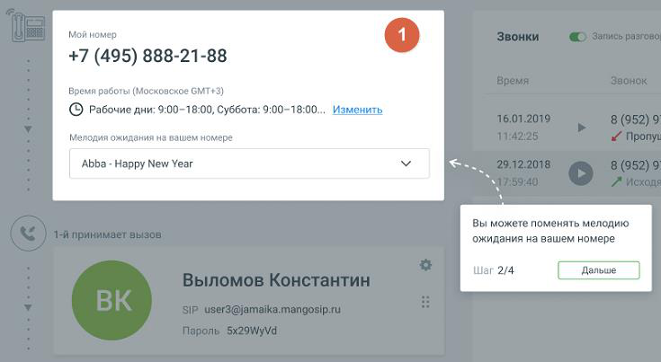

#### 1.8.1.3. Главная страница (сценарий МИКРО)

> Трассировка: PDF §1.8.1.3 · сквозные стр. 18-19 · источники: ч.1 `kb/sources/mango-lk-manual/LK_manual_v-125-1-280.pdf` с.18-19.

Настройте интерфейс главной страницы, следуя информационным подсказкам.

> **Описание иллюстрации LK-§1.8.1.3-1** (к §1.8.1.3 «Главная страница (сценарий МИКРО)», стр. 18; 735×403 px). Снимок экрана / схема Личного кабинета.
> Относится к тексту руководства: «…Настройте интерфейс главной страницы, следуя информационным подсказкам.».
> Текст на изображении (OCR, требует сверки): Мой номер; +7 (495) 888-21-88; Время работы (Московское 6МТ+3); (© Рабочие дни: 9:00-18:00, Суббота: 9:00-18:00...; Изменить; Мелодия ожидания на вашем номере; Abba - Happy New Year; Вы можете поменять мелодию; ожидания на вашем номере; Шаг 2/4; Дальше |

> **Описание иллюстрации LK-§1.8.1.3-2** (к §1.8.1.3 «Главная страница (сценарий МИКРО)», стр. 18; 48×44 px). Пиктограмма (значок элемента интерфейса).
> Относится к тексту руководства: «…ббота: 9:00-18:00...; Изменить; Мелодия ожидания на вашем номере; Abba - Happy New Year; Вы можете поменять мелодию; ожидания на вашем номере; Шаг 2/4; Дальше |».
> Текста на изображении нет; назначение значка — см. текст, к которому он относится.

Вид Блока главной страницы зависит от сложности схем распределения звонков пользователя ВАТС, установленных в разделе «Голосовое меню и распределение звонков».

Варианты интерфейса Блока 1 приведены на рис.1 и рис.2 ниже.
