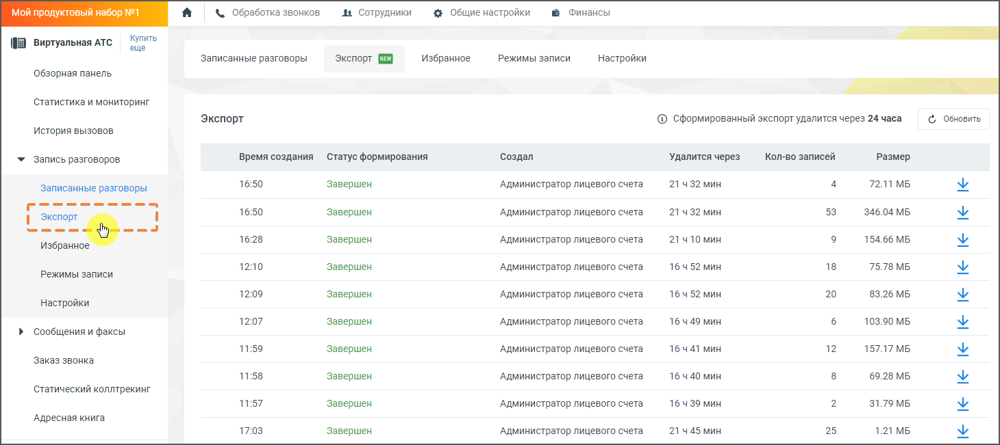

#### 4.5.3.5. Экспорт

> Трассировка: PDF §4.5.3.5 · сквозные стр. 214-216 · источники: ч.1 `kb/sources/mango-lk-manual/LK_manual_v-125-1-280.pdf` с.214-216.

Вкладка "Экспорт" в Личном Кабинете Виртуальной АТС предоставляет возможность выгрузки записей разговоров для последующего хранения и анализа. Данная функция предназначена для руководителей и супервизоров, которым необходимо регулярно выгружать записи для хранения в собственных системах. Функционал позволяет создавать архивы звонков, скачивать их, а также управлять уже сформированными выгрузками.

> **Описание иллюстрации LK-§4.5.3.5-1** (к §4.5.3.5 «Экспорт», стр. 214; 1460×651 px). Снимок экрана / схема Личного кабинета.
> Относится к тексту руководства: «…ужать записи для хранения в собственных системах. Функционал позволяет создавать архивы звонков, скачивать их, а также управлять уже сформированными выгрузками.».
> Текст на изображении (OCR, требует сверки): «ди Сотрудники; @ Общие настройки; @ Финансы; Купить; ИНН; (I Виртуальная ATC; еще; режимы записи; Записанные разговоры; Экспорт (8; ‘Избранное; Настройки; Обзорная панель; Статистика и мониторинг; Экспорт; ® сформированный экспорт удалится через 24 часа; ©, Обновить,; История вызовов; Кол-во записей; У Запись разговоров; Время создания; ‘Статус формирования; ‘Создал; Удалится через; Размер; 16:50; 21ч32 мин; 72.11 МБ; Завершен; Администратор лицевого счета; 53; 346.04 МБ.; | Экспорт; Sooo; oo); 16:28; 21410 мин; 154.66 МБ.; Избран; 1210; 16452 мин; 18; 75.78 MB; 12:09; 20; 83.26 МБ; 12:07; 16…

Основные функции вкладки "Экспорт":

1. Формирование и выгрузка записей разговоров: Пользователь может выбрать записи разговоров для экспорта, после чего начинается процесс формирования архива. Статус формирования можно отслеживать в реальном времени.

2. Статусы выгрузки:

 Создан: Запрос на выгрузку создан.  Отправлен на выгрузку: Выгрузка началась.  Начал формироваться: Архив записей формируется.  Завершен: Архив готов к скачиванию.  Ошибка формирования: Произошла ошибка при создании архива.

3. Ограничения выгрузки:

 При отсутствии подключенной услуги "Выгрузка до 50 Гб" выгрузка ограничена 1 Гб записей.  При наличии подключенной услуги возможно выгружать до 10 Гб записей (порядка 200 тысяч разговоров).

4. Как подключить услугу:

 Если у вас есть права на подключение услуг в ЛК ВАТС, на вкладке "Экспорт" появится уведомление со ссылкой "Снять ограничение". Нажмите на нее, чтобы открыть окно подключения услуги "Выгрузка до 50 Гб" и следуйте инструкциям для завершения процесса.  Если у вас нет прав на подключение, обратитесь к администратору ЛК с запросом на подключение услуги.

5. Скачивание выгрузки: После завершения формирования архива, пользователю предоставляется возможность скачать его. Сформированные архивы доступны для скачивания в течение 24 часов, после чего они удаляются автоматически.

6. Интеграция с аналитикой: События по выгрузке данных отправляются в систему Яндекс.Метрика для последующего анализа активности пользователей.

7. Обработка данных:

 Система не поддерживает выгрузку данных по FTP.  При наличии файлов из FTP, информация о них будет отображена в выгрузке, но сами файлы не будут включены в архив.

Как пользоваться вкладкой "Экспорт":

1. Создание выгрузки:

 Войдите в Личный Кабинет Виртуальной АТС.  Перейдите во вкладку "Экспорт" в разделе "Запись разговоров".  Нажмите на кнопку создания новой выгрузки и выберите необходимые звонки.

2. Отслеживание статуса выгрузки: На странице "Экспорт" можно отслеживать текущее состояние всех выгрузок. По завершении формирования архива, вы

> **Описание иллюстрации LK-§4.5.3.5-2** (к §4.5.3.5 «Экспорт», стр. 215; 28×28 px). Пиктограмма (значок элемента интерфейса).
> Относится к тексту руководства: «…2. Отслеживание статуса выгрузки: На странице "Экспорт" можно отслеживать текущее состояние всех выгрузок. По завершении формирования архива, вы».
> Текста на изображении нет; назначение значка — см. текст, к которому он относится.

сможете скачать его, нажав на иконку скачивания .

3. Управление выгрузками:

 Вы можете удалять архивы, которые больше не нужны.  Для удаления выгрузки нажмите на соответствующую кнопку рядом с архивом. Обратите внимание, что через 24 часа выгрузка удалится автоматически.

4. Уведомления:

 По завершении экспорта вы получите уведомление на электронную почту с ссылкой на скачивание архива.

внимание

Пользователи с ограниченными правами доступа не смогут выгружать записи разговоров руководителя компании, если у него активирована опция "Запретить прослушивать записи моих разговоров".

Воспользуйтесь данной инструкцией для эффективного управления архивами записей разговоров и минимизации временных затрат на выгрузку данных.

совет

Права доступа пользовательской роли к вкладке можно настроить в разделе Общие настройки → Безопасность и ограничения → Настройка доступа → Запись разговоров, проставив для роли чекбокс «Выгружать, отправлять записи и расшифровки разговоров по почте».
