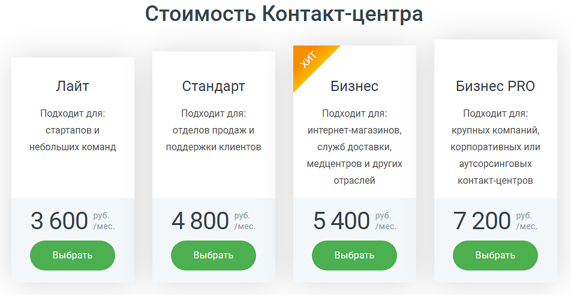
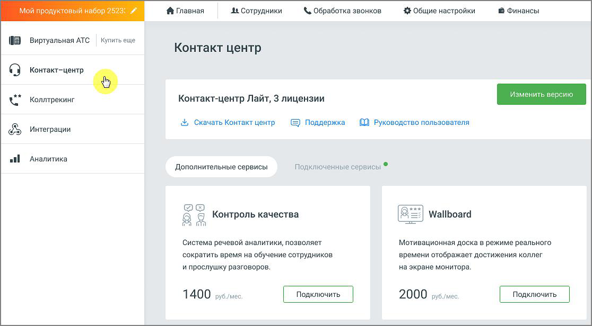

### 4.5.4. Контакт-центр

> Трассировка: PDF §4.5.4 · сквозные стр. 216-218 · источники: ч.1 `kb/sources/mango-lk-manual/LK_manual_v-125-1-280.pdf` с.216-218.

Контакт-центр предназначен для управления потоком обращений в реальном времени.

Для подключения услуги воспользуйтесь одним из вариантов:

1) Откройте в браузере страницу Контакт-центр MANGO OFFICE, ознакомьтесь с информацией о возможностях модуля и нажмите кнопку Подключить в одной из версий. При подключении потребуется авторизация в Личном кабинете пользователя ВАТС.

> **Описание иллюстрации LK-§4.5.4-1** (к §4.5.4 «Контакт-центр», стр. 216; 20×24 px). Пиктограмма (значок элемента интерфейса).
> Относится к тексту руководства: «… с информацией о возможностях модуля и нажмите кнопку Подключить в одной из версий. При подключении потребуется авторизация в Личном кабинете пользователя ВАТС.».
> Текста на изображении нет; назначение значка — см. текст, к которому он относится.

2) Щелкните по иконке модуля в вертикальном меню Личного кабинета пользователя ВАТ и нажмите кнопку Подключить в одной из версий.

> **Описание иллюстрации LK-§4.5.4-2** (к §4.5.4 «Контакт-центр», стр. 217; 952×493 px). Снимок экрана / схема Личного кабинета.
> Относится к тексту руководства: «…2) Щелкните по иконке модуля в вертикальном меню Личного кабинета пользователя ВАТ и нажмите кнопку Подключить в одной из версий.».
> Текст на изображении (OCR, требует сверки): Стоимость Контакт-центра; Лайт; Стандарт; Бизнес; Бизнес PRO; Подходит для:; ‘стартапов и; отделов продаж и; интернет-магазинов,; крупных компаний,; небольших команд; поддержки клиентов.; служб доставки,; корпоративных или; медцентров и других; аутсорсинговых; отраслей; контакт-центров; руб.; 360; (мес.; 480; 540; 720

После подключения услуги иконка модуля перемещается выше, в раздел подключенных продуктов. По клику на иконку открывается страница «Контакт-центр Mango Office», с описанием текущей версии услуги, количеством приобретенных лицензий и ссылкой на скачивание приложения Контакт-центра.

внимание

Если временно заблокировать Виртуальную АТС, с которой связан Контакт- центр MANGO OFFICE, то он будет заблокирован на тот же период. При этом лицензионные платежи за его использование будут списываться с Лицевого счета в течение периода добровольной блокировки.

Также на странице размещается информация о подключенных сервисах и сервисах с возможностью подключения.

> **Описание иллюстрации LK-§4.5.4-3** (к §4.5.4 «Контакт-центр», стр. 218; 1116×616 px). Снимок экрана / схема Личного кабинета.
> Относится к тексту руководства: «…Также на странице размещается информация о подключенных сервисах и сервисах с возможностью подключения.».
> Текст на изображении (OCR, требует сверки): ой; вый; 03}; fi Главная; At Сотрудники; & Обработка звонков; 3 Общие настройки; 1 Финансы; Купить еще; Виртуальная АТС; Контакт центр; Коллтрекинг; Контакт-центр Лайт, 3 лицензии; Скачать Контакт центр; [0 Руководство пользователя; Интеграции; & Поддержка; ail; `Аналитика; Дополнительные сервисы; Подключенные сервисы ®; Wallboard; 8 Я Контроль качества; Система речевой аналитики, позволяет; Мотивационная доска в режиме реального; ‘сократить время на обучение сотрудников; времени отображает достижения коллег; и прослушку разговоров.; на экране монитора; 1400 зувлиес; 2000 вузе

Чтобы изменить текущую версию услуги, нажмите на кнопку Изменить версию.

Отключение услуги возможно только через личного менеджера.

Дальнейшие настройки и работа с инструментом - через приложение Контакт-центр MANGO OFFICE.

внимание

Пункт главного меню "Контакт центр" доступен только в том случае, когда на ВАТС не подключен продукт «Сделки». В противном случае ссылка на скачивание приложения Контакт-центра располагается в разделе "Сделки".

Для использования продукта ваше оборудование должно удовлетворять следующим системным требованиям Требования для Контакт-центр MANGO OFFICE.

Взаимодействие с Контакт-центром MANGO OFFICE можно осуществлять через API. API Контакт-центра позволяет управлять статусами пользователей, получать уведомления о смене статусов, а также работать со сделками, кампаниями исходящего обзвона, обращениями и задачами. Для использования API Контакт- центра MANGO OFFICE в данном разделе необходимо подключить услугу "Открытое API". Для получения дополнительной информации ознакомьтесь с Руководством по API Контакт-центра MANGO OFFICE.
