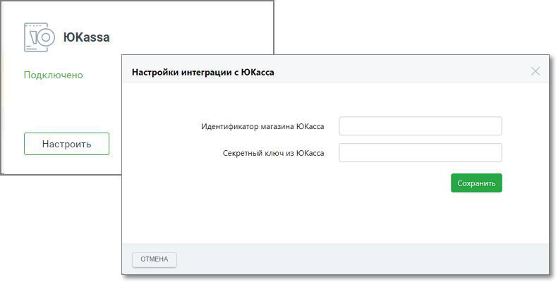

#### 4.5.4.1. Юkassa

> Трассировка: PDF §4.5.4.1 · сквозные стр. 218-220 · источники: ч.1 `kb/sources/mango-lk-manual/LK_manual_v-125-1-280.pdf` с.218-220.

Подключите сервис Юkassa в Личном кабинете ВАТС и отправляйте клиентам ссылки на оплату ваших товаров и услуг из Контакт-центра MANGO OFFICE.

Для подключения откройте вкладку «Дополнительные сервисы» в разделе Контакт- центр и кликните по кнопке «Подключить» в блоке Юkassa.

> **Описание иллюстрации LK-§4.5.4.1-1** (к §4.5.4.1 «Юkassa», стр. 219; 300×196 px). Снимок экрана / схема Личного кабинета.
> Относится к тексту руководства: «…Для подключения откройте вкладку «Дополнительные сервисы» в разделе Контакт- центр и кликните по кнопке «Подключить» в блоке Юkassa.».
> Текст на изображении (OCR, требует сверки): [We ЮКазза; Отправляйте ссылку на оплату клиентам; Отслеживайте оплату и настраивайте; автоматические действия со сделкой.; Бесплатно

внимание

Для подключения вам понадобится зарегистрировать аккаунт на https://yookassa.ru.

После подключения блок Юkassa отобразится на вкладке «Подключенные сервисы». Переходите к настройке интеграции – нажмите на кнопку «Настроить». В открывшемся окне введите данные, полученные в Личном кабинете Юkassa:

 идентификатор магазина Юkassa

 секретный ключ из Юkassa

Сохраните внесенные изменения кликом по кнопке «Сохранить».

> **Описание иллюстрации LK-§4.5.4.1-2** (к §4.5.4.1 «Юkassa», стр. 219; 788×400 px). Снимок экрана / схема Личного кабинета.
> Относится к тексту руководства: «…Сохраните внесенные изменения кликом по кнопке «Сохранить».».
> Текст на изображении (OCR, требует сверки): Ko ЮКа$5а; Настройки интеграции с ЮКасса; Подключено; Идентификатор магазина ЮКасса; Секретный ключ из ЮКасса; ОТМЕНА
