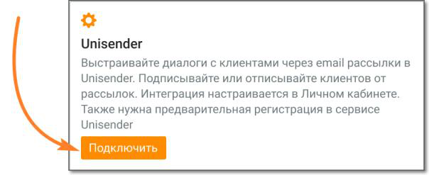
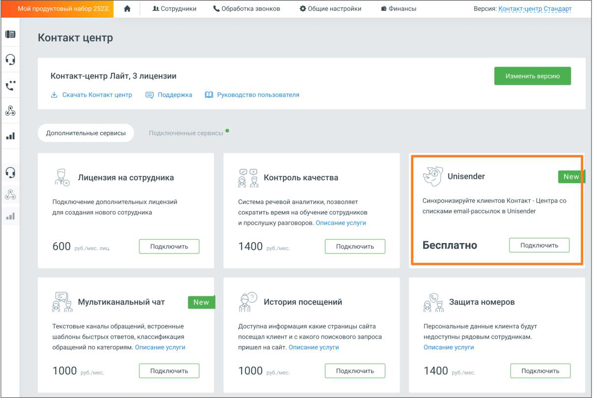
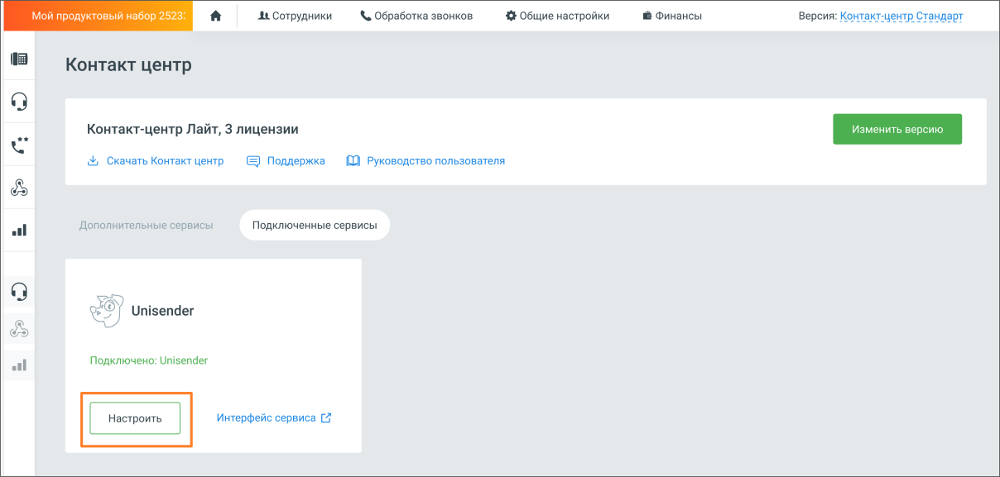
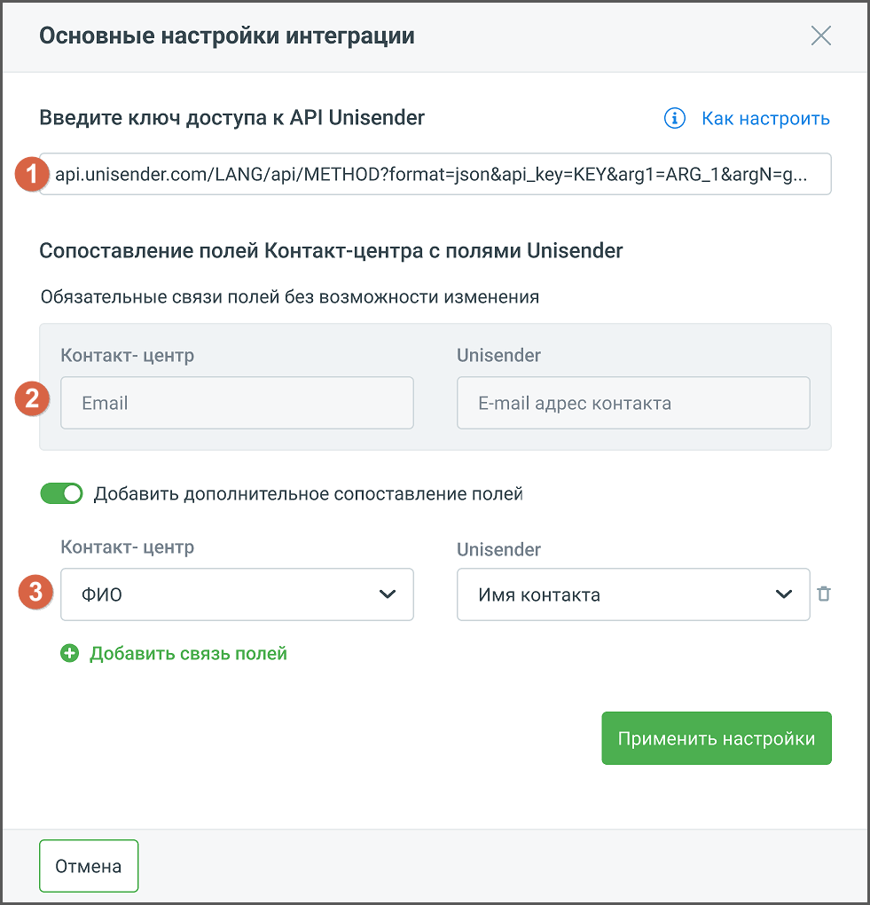

#### 4.5.4.2. Unisender

> Трассировка: PDF §4.5.4.2 · сквозные стр. 220-222 · источники: ч.1 `kb/sources/mango-lk-manual/LK_manual_v-125-1-280.pdf` с.220-222.

Интеграция Контакт-центра Mango OFFICE с сервисом рассылок Unisender позволяет настроить синхронизацию списков рассылок в Unisender и списков клиентов в Адресной книге, вносить изменения в списки рассылок на стороне Unisender из Контакт-центра.

внимание

Для настройки интеграции необходимо иметь аккаунт в Unisender, а также роль в Контакт-центре, с правом настраивать интеграции.

Кликните по кнопке Подключить в блоке Unisender.

> **Описание иллюстрации LK-§4.5.4.2-1** (к §4.5.4.2 «Unisender», стр. 220; 604×247 px). Снимок экрана / схема Личного кабинета.
> Относится к тексту руководства: «…Кликните по кнопке Подключить в блоке Unisender.».
> Текст на изображении (OCR, требует сверки): Unisender; Выстраивайте диалоги с клиентами через email рассылки в; Unisender. Подписывайте или отписывайте клиентов OT; рассылок. Интеграция настраивается в Личном кабинете.; Также нужна предварительная регистрация в сервисе

Откроется окно Личного кабинета пользователя ВАТС, вкладка «Дополнительные сервисы». Найдите блок «Unisender» и нажмите кнопку Подключить. В открывшемся окне подтвердите согласие на подключение.

> **Описание иллюстрации LK-§4.5.4.2-2** (к §4.5.4.2 «Unisender», стр. 220; 1208×812 px). Снимок экрана / схема Личного кабинета.
> Относится к тексту руководства: «…льзователя ВАТС, вкладка «Дополнительные сервисы». Найдите блок «Unisender» и нажмите кнопку Подключить. В открывшемся окне подтвердите согласие на подключение.».
> Текст на изображении (OCR, требует сверки): At Сотрудники; & Обработка звонков; 42 Общие настройки; 8 Финансы; Версия: Контакт-центр Стандарт; Контакт центр; Контакт-центр Лайт, 3 лицензии; Ss; Скачать Контакт центр.; 0 Руководство пользователя; & Поддержка; Дополнительные сервисы; Подключенные сервисы; New; Лицензия на сотрудника; oY Unisender; С контроль качества; Подключение дополнительных лицензий; Система речевой аналитики, позволяет; ‘Синхронизируйте клиентов Контакт - Центра со; для создания нового сотрудника; сократить время на обучение сотрудников; списками етай:рассылок в Unisender; и прослушку разговоров. Описание услуги; 140…

Далее на вкладке «Подключенные сервисы» в блоке «Unisender» необходимо произвести настройки интеграции. Нажмите кнопку Настроить.

> **Описание иллюстрации LK-§4.5.4.2-3** (к §4.5.4.2 «Unisender», стр. 221; 1208×577 px). Снимок экрана / схема Личного кабинета.
> Относится к тексту руководства: «…Далее на вкладке «Подключенные сервисы» в блоке «Unisender» необходимо произвести настройки интеграции. Нажмите кнопку Настроить.».
> Текст на изображении (OCR, требует сверки): ук; ый Hak; 1 Финансы; И пр.; At Сотрудники; & Обработка звонков.; 4$ Общие настройки; Версия: К; центр Стандарт; Контакт центр; Контакт-центр Лайт, 3 лицензии; Скачать Контакт центр; © Поддержка; £0) Руководство пользователя; Дополнительные сервисы; Подключенные сервисы; oy; / Unisender; oo; Подключено: Unisender; al; Интерфейс сервиса [7

Откроется окно основных настроек интеграции:

> **Описание иллюстрации LK-§4.5.4.2-4** (к §4.5.4.2 «Unisender», стр. 221; 981×1020 px). Снимок экрана / схема Личного кабинета.
> Относится к тексту руководства: «…Откроется окно основных настроек интеграции:».
> Текст на изображении (OCR, требует сверки): Основные настройки интеграции; Введите ключ доступа к API Unisender; @ Как настроить; [1] api.unisender.com/LANG/api/METHOD?format=json&api_key=KEY &arg1=ARG_1&argN=g...; Сопоставление полей Контакт-центра с полями Unisender; Обязательные связи полей без возможности изменения; Контакт- центр; Unisender; [2] Email; E-mail адрес контакта; ©@®) добавить дополнительное сопоставление полей; Имя контакта; уп; © Добавить связь полей

Окно настроек содержит следующие элементы:

1. Поле для ввода ключа доступа – ключ предоставляется на стороне Unisender. Чтобы получить ключ, пройдите по ссылке API-ключ UniSender и выполните указанные в инструкции действия.

2. Информационный блок обязательных связей – связь между указанными полями Контакт-центра и Unisender будет создана автоматически.

3. Блок дополнительной связи – открывается, если переключатель «Добавить дополнительное сопоставление полей» активен. Здесь можно настроить дополнительные связи между полями Контакт-центра и Unisender. Например, передавать в Unisender имя пользователя, для настройки персонализированного обращения в рассылке.

Кнопка «Добавить связь полей» добавляет новую связку «Контакт-центр/Unisender».

Сохраните внесенные изменения кликом по кнопке Применить настройки.

После интеграции доступны следующие действия:

 Отписать клиентов (email) – единичная и массовая отписка

 Подписать клиентов (email) – единичная и массовая подписка

 Создать новый список рассылки

 Удалить список рассылки

 Изменить наименование списка рассылки
