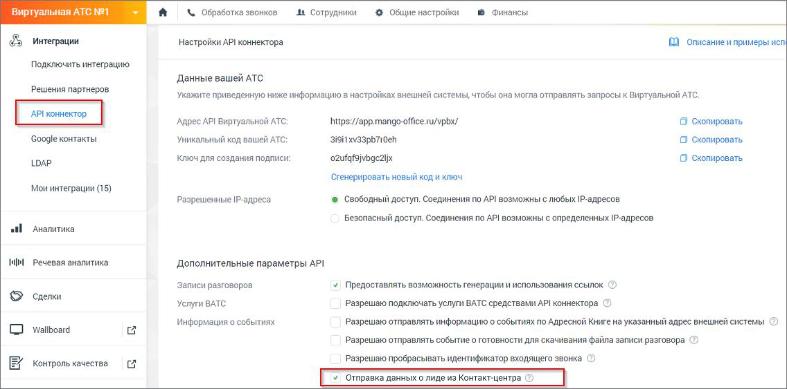

#### 4.5.4.3. Битрикс 24

> Трассировка: PDF §4.5.4.3 · сквозные стр. 222-223 · источники: ч.1 `kb/sources/mango-lk-manual/LK_manual_v-125-1-280.pdf` с.222-223.

Для отправки данных из Контакт-центра в CRM Битрикс 24 необходимо подключить услугу Интеграции в Личном кабинете пользователя ВАТС, а также настроить API коннектор.

Подключение осуществляется в разделе «Интеграции» → кнопка «API коннектор» → подраздел «Дополнительные параметры API».

Установите галочку в чекбоксе «Отправка данных о лиде из Контакт-центра».

Перезапустите приложение Контакт-центр MANGO OFFICE для обновления настроек.

> **Описание иллюстрации LK-§4.5.4.3-1** (к §4.5.4.3 «Битрикс 24», стр. 222; 1136×563 px). Снимок экрана / схема Личного кабинета.
> Относится к тексту руководства: «…Перезапустите приложение Контакт-центр MANGO OFFICE для обновления настроек.».
> Текст на изображении (OCR, требует сверки): ES интеграции; Настройки API коннектора; 0 описание и примеры ven; Подключить интеграцию; Данные вашей АТС; Решения партнеров.; Укажите приведенную ниже информацию в настройках внешней системы, чтобы она могла отправлять запросы к Виртуальной АТС.; Адрес API Виртуальной ATC:; https://app.mango-office.ru/ypbx/; О скопировать; Google контакты; Уникальный код вашей АТС:; SiSiTxv33pb710eh; О скопировать,; Lap; Ключ для создания подписи:; o2ufafgivbgcalix; ‘Сгенерировать новый код и ключ; Мои интеграции (15); Разрешенные IP-anpeca; ® Свободный доступ. Соединения no API возможны с любых !Р-дресов; Б…

При подключенной интеграции на вкладке в Контакт-центре отображается уведомление – Услуга подключена. По умолчанию включен режим ручной отправки данных операторами Контакт-центра, кликом по кнопке «Отправить».

Отправка обращения в Битрикс24 возможна, только если обращение привязано к контакту Адресной книги.
