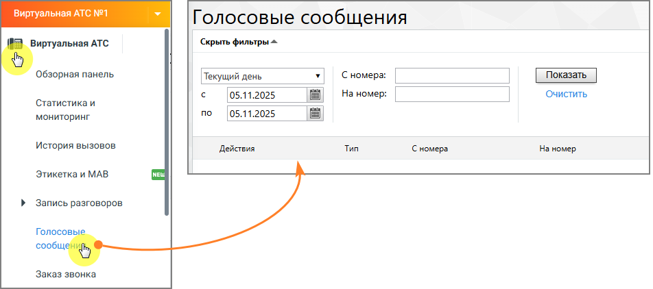

### 4.5.6. Голосовые сообщения

> Трассировка: PDF §4.5.6 · сквозные стр. 223-224 · источники: ч.1 `kb/sources/mango-lk-manual/LK_manual_v-125-1-280.pdf` с.223-224.

Инструмент предоставляет доступ к управлению содержимым облачного хранилища.

> **Описание иллюстрации LK-§4.5.6-1** (к §4.5.6 «Голосовые сообщения», стр. 223; 952×422 px). Снимок экрана / схема Личного кабинета.
> Относится к тексту руководства: «…Инструмент предоставляет доступ к управлению содержимым облачного хранилища.».
> Текст на изображении (OCR, требует сверки): Голосовые сообщения; Виртуальная АТС; Скрыть фильтры =; Обзорная панель; Текущий день; Сномера:; `Показать; 05.11.2025; На номер:; Очистить,; Статистика и; по; мониторинг; История вызовов; Действия; Тип; Сномера; Ha номер.; Этикетка и MAB; Запись разговоров; Голосовы; сообще; Заказ звонка

При необходимости можно указать даты (по умолчанию предлагается период «Текущий день»), нажав значок календаря, или ввести их в формате дд.мм.гггг в соответствующие поля. Кнопка «Очистить» позволяет вернуться к значению по умолчанию. В специальных полях можно указать, сообщения с какого и на какой номер вы хотите просмотреть.

Нажмите кнопку «Показать», и в таблице будут отображены сообщения, которые удовлетворяют условиям выборки. Можно задать отображение 25, 50 или 100 элементов на 1 странице.

> **Описание иллюстрации LK-§4.5.6-2** (к §4.5.6 «Голосовые сообщения», стр. 223; 18×18 px). Пиктограмма (значок элемента интерфейса).
> Относится к тексту руководства: «…пку «Показать», и в таблице будут отображены сообщения, которые удовлетворяют условиям выборки. Можно задать отображение 25, 50 или 100 элементов на 1 странице.».
> Текста на изображении нет; назначение значка — см. текст, к которому он относится.

Для прослушивания сообщения нажмите кнопку слева от сообщения. Откроется окно проигрывателя.

> **Описание иллюстрации LK-§4.5.6-3** (к §4.5.6 «Голосовые сообщения», стр. 223; 16×16 px). Пиктограмма (значок элемента интерфейса).
> Относится к тексту руководства: «…Для прослушивания сообщения нажмите кнопку слева от сообщения. Откроется окно проигрывателя.».
> Текста на изображении нет; назначение значка — см. текст, к которому он относится.

Для загрузки одного сообщения нажмите кнопку слева от него, и появится стандартное диалоговое окно браузера, позволяющее открыть или сохранить файл. Для скачивания нескольких установите галочки в первом столбце таблицы. Вы можете выбирать для загрузки элементы разных типов. Если необходимо скачать все записи, установите галочку в верхней строке (заголовке) таблицы. Если отфильтрованные элементы невозможно отобразить на одной странице, появляется кнопка «Выбрать все ... записи, соответствующие фильтрам». Нажмите кнопку «Скачать», и появится стандартное диалоговое окно браузера, позволяющее открыть или сохранить файл. Загрузите архив ZIP, содержащий выбранные записи разговоров.

Удаление записей происходит аналогично скачиванию. После подтверждения запроса выбранные элементы стираются без возможности их восстановления.
