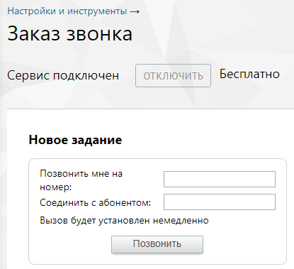

### 4.5.7. Заказ звонка

> Трассировка: PDF §4.5.7 · сквозные стр. 224-225 · источники: ч.1 `kb/sources/mango-lk-manual/LK_manual_v-125-1-280.pdf` с.224-225.

Инструмент «Заказ звонка» позволяет организовать вызов через Личный кабинет. Для этого нужно лишь ввести в соответствующие поля свой номер и номер, на который необходимо дозвониться. Виртуальная АТС отправит вызов на первый, и когда звонок будет принят, отправит вызов на второй.

> **Описание иллюстрации LK-§4.5.7-1** (к §4.5.7 «Заказ звонка», стр. 224; 415×379 px). Снимок экрана / схема Личного кабинета.
> Относится к тексту руководства: «…щие поля свой номер и номер, на который необходимо дозвониться. Виртуальная АТС отправит вызов на первый, и когда звонок будет принят, отправит вызов на второй.».
> Текст на изображении (OCR, требует сверки): Настройки и инструменты >; Заказ звонка; ОТКЛЮЧИТЬ; Бесплатно; Сервис подключен; Новое задание; Позвонить мне на; номер:; Соединить с абонентом:; Вызов будет установлен немедленно; Позвонить

Для ввода имени пользователя SIP требуется заполнить поле «Соединить с абонентом», причем необходимо ввести соответствующий идентификатор, разделив их двоеточием без пробела: sip:ivanov@mangosip.ru.

Если введен только собственный номер, то после поднятия трубки можно набрать номер нужного абонента с использованием интерактивного голосового меню.

Телефонные номера следует вводить в международном формате без пробелов и других знаков: 74951234567.

Если необходимо указать номер офисной АТС, которая поддерживает донабор в тональном режиме, можно указать его вместе с добавочным местным номером, разделив их запятой или точкой без пробела, например, 74951234567,789. Запятая означает паузу перед донабором в 2, а точка — в 5 секунд.

Нажмите кнопку «Позвонить». После этого Виртуальная АТС начинает дозвон.
