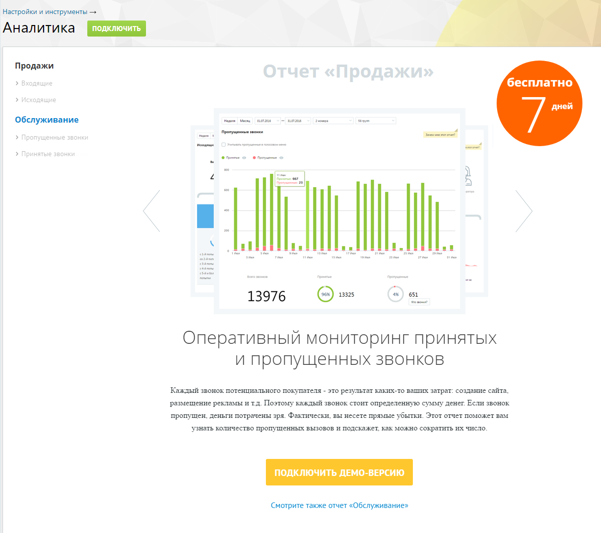
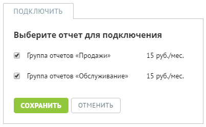
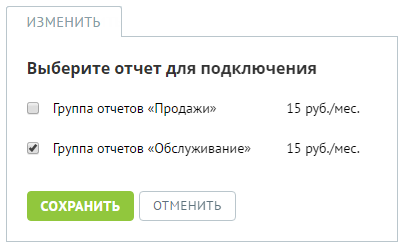
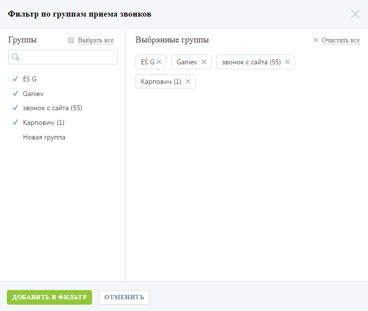

### 4.5.9. Аналитика

> Трассировка: PDF §4.5.9 · сквозные стр. 230-234 · источники: ч.1 `kb/sources/mango-lk-manual/LK_manual_v-125-1-280.pdf` с.230-234.

Инструмент «Аналитика» позволяет формировать статистические отчеты, отображающие данные по работе сотрудников ВАТС, а также сведения о звонках в разных разрезах.

Инструмент включает две группы отчетов, разделенные на подгруппы в зависимости от типа вызова:

 Продажи

o Входящие o Исходящие;

 Обслуживание

o Пропущенные звонки; o Принятые звонки.

Подключение отчетов

Перейдите на страницу инструмента «Аналитика» и ознакомьтесь с описанием отчетов, входящих в определенную группу.

> **Описание иллюстрации LK-§4.5.9-1** (к §4.5.9 «Аналитика», стр. 231; 1198×1065 px). Снимок экрана / схема Личного кабинета.
> Относится к тексту руководства: «…Перейдите на страницу инструмента «Аналитика» и ознакомьтесь с описанием отчетов, входящих в определенную группу.».
> Текст на изображении (OCR, требует сверки): Настройки и инструменты >; Аналитика; подключить; Продажи; дящ; бесплатно; дней; Обслуживание; no; tom; som; cn); пропущенные нож; eal; се; 651; 13976; one; Оперативный мониторинг принятых; и пропущенных звонков; Каждый звонок потенциального покупателя - это результат каких-то ваших затрат: создание сайта.; размещение рекламы и тд. Поэтому каждый звонок стоит определенную сумму денег Если звонок; пропущен, деньги потрачены зря. Фактически. вы несете прямые убытки. Этот отчет поможет вам; узнать количество пропущенных вызовов и подскажет. как можно сократить их число.; ‘Смотрите также отчет «Об…

Вы можете воспользоваться бесплатной демо-версией групп отчетов на протяжении 7 дней с момента подключения. Для этого выберите нужную группу отчетов и нажмите Подключить демо-версию.

Для получения полноценного доступа к группам отчетов без ограничений по времени нажмите Подключить и установите флаги напротив наименований групп отчетов, которые вы хотите подключить.

> **Описание иллюстрации LK-§4.5.9-2** (к §4.5.9 «Аналитика», стр. 232; 403×248 px). Снимок экрана / схема Личного кабинета.
> Относится к тексту руководства: «…го доступа к группам отчетов без ограничений по времени нажмите Подключить и установите флаги напротив наименований групп отчетов, которые вы хотите подключить.».
> Текст на изображении (OCR, требует сверки): ПОДКЛЮЧИТЬ; Выберите отчет для подключения; Группа отчетов «Продажи»; 15 руб./мес; Группа отчетов «Обслуживание»; | сохранить | ОТМЕНИТЬ

Ознакомьтесь с условиями оплаты и нажмите Сохранить.

Если ранее вы уже подключали одну из групп отчетов, на экране будет отображаться кнопка Изменить. Нажмите кнопку, установите флаг напротив наименования не подключенной группы отчетов и нажмите Сохранить.

Отключение отчетов

Для отключения групп отчетов нажмите Изменить и снимите флаги, установленные напротив наименований групп отчетов, которые вы хотите отключить.

> **Описание иллюстрации LK-§4.5.9-3** (к §4.5.9 «Аналитика», стр. 232; 403×248 px). Снимок экрана / схема Личного кабинета.
> Относится к тексту руководства: «…Для отключения групп отчетов нажмите Изменить и снимите флаги, установленные напротив наименований групп отчетов, которые вы хотите отключить.».
> Текст на изображении (OCR, требует сверки): ИЗМЕНИТЬ; Выберите отчет для подключения; Группа отчетов «Продажи»; 15 руб./мес; Группа отчетов «Обслуживание»; ОТМЕНИТЬ

Нажмите Сохранить.

Работа с отчетами

Для построения любого из отчетов воспользуйтесь следующими фильтрами:

1. Выберите период отчета: неделя, месяц, произвольный;

2. Выберите линию АТС. Для этого в форме выбора линий АТС в списке в левой части окна щелкните по нужным линиям либо установите флаг «Выбрать все» для выбора всех номеров и нажмите Добавить в фильтр;

> **Описание иллюстрации LK-§4.5.9-4** (к §4.5.9 «Аналитика», стр. 233; 758×637 px). Снимок экрана / схема Личного кабинета.
> Относится к тексту руководства: «…е выбора линий АТС в списке в левой части окна щелкните по нужным линиям либо установите флаг «Выбрать все» для выбора всех номеров и нажмите Добавить в фильтр;».
> Текст на изображении (OCR, требует сверки): Фильтр по номерам; GB; Bce; Хх Очистить все; Номера; Выбранные номера; 74952120668 Хх; 74952233548 Хх; 74953333354 Хх; У 74952120668; У 74952233548; У 74953333354; Иван Матвиенко

3. Выберите группу сотрудников. Для этого в форме выбора групп в списке в левой части окна щелкните по нужным группам и нажмите Добавить в фильтр;

> **Описание иллюстрации LK-§4.5.9-5** (к §4.5.9 «Аналитика», стр. 233; 755×638 px). Снимок экрана / схема Личного кабинета.
> Относится к тексту руководства: «…3. Выберите группу сотрудников. Для этого в форме выбора групп в списке в левой части окна щелкните по нужным группам и нажмите Добавить в фильтр;».
> Текст на изображении (OCR, требует сверки): Фильтр по группам приема звонков; Хх Очистить все; Группы; О Выбрать все; Выбранные группы; ESGX; Ganiev Х; звонок с сайта (55) Х; ESG; Карпович (1) Х; Ganiev; звонок с сайта (55); Карпович (1); Новая группа; ОТМЕНИТЬ

Нажмите Показать для формирования отчета.

Настройки фильтров "Линии" и "Группы" для всех отчетов группы “Продажи” сохраняются отдельно от отчетов группы “Обслуживание”.
