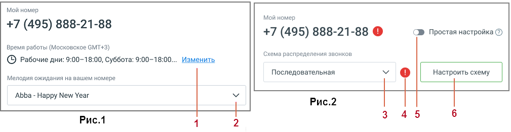

##### 1.8.1.3.1. Блок 1. Расписание и схема распределение звонков

> Трассировка: PDF §1.8.1.3.1 · сквозные стр. 19-20 · источники: ч.1 `kb/sources/mango-lk-manual/LK_manual_v-125-1-280.pdf` с.19-20.

> **Описание иллюстрации LK-§1.8.1.3.1-1** (к §1.8.1.3.1 «Блок 1. Расписание и схема распределение звонков», стр. 19; 1009×262 px). Снимок экрана / схема Личного кабинета.
> Относится к тексту руководства: «…начало раздела».
> Подпись в руководстве: «Рис.1 Схема распределения звонков "Простая настройка".».
> Текст на изображении (OCR, требует сверки): Мой номер; +7 (495) 888-21-88; ® Простая настройка @); Время работы (Московское GMT+3); Схема распределения звонков; © Рабочие дни: 9:00-18:00, Суббота: 9:00-18:00.; Изменить.; Последовательная; Мелодия ожидания на вашем номере; ‘Abba - Happy New Year; Puc.2; Рис.1; 3 45

Рис.1 Схема распределения звонков "Простая настройка".

1. Изменить информацию о времени работы сотрудников;

2. Изменить мелодию ожидания, которую слышит клиент.

В схеме «Простая настройка» пользователю доступны: выбор дня и времени приема звонков (без выбора периода), одно звуковое приветствие, переадресаций на сотрудников не более трех. Переадресация на внешний номер недоступна.

> **Описание иллюстрации LK-§1.8.1.3.1-2** (к §1.8.1.3.1 «Блок 1. Расписание и схема распределение звонков», стр. 19; 24×24 px). Пиктограмма (значок элемента интерфейса).
> Относится к тексту руководства: «…и времени приема звонков (без выбора периода), одно звуковое приветствие, переадресаций на сотрудников не более трех. Переадресация на внешний номер недоступна.».
> Текста на изображении нет; назначение значка — см. текст, к которому он относится.

По клику на пиктограмму открывается информационное сообщение об ошибке.

ВНИМАНИЕ

При первом использовании ВАТС в Блоке 1 по умолчанию используется схема распределения звонков "Простая настройка".

Рис.2 Схема распределения звонков "Сложная настройка".

3. Изменить схему распределения звонков;

> **Описание иллюстрации LK-§1.8.1.3.1-3** (к §1.8.1.3.1 «Блок 1. Расписание и схема распределение звонков», стр. 19; 24×24 px). Пиктограмма (значок элемента интерфейса).
> Относится к тексту руководства: «…3. Изменить схему распределения звонков;».
> Текста на изображении нет; назначение значка — см. текст, к которому он относится.

4. Пиктограмма - сообщение о наличии ошибки;

5. Вернуться к схеме «Простая настройка»

6. Настроить схему – по клику на кнопку пользователь переходит в раздел "Голосовое меню и распределение звонков", настройки для входящих линий.

В схеме «Сложная настройка» пользователю доступны: настройка расписания приема звонков с множеством блоков или с конкретными периодами в расписании, выбор схемы распределения звонков из списка созданных в разделе "Голосовое меню и распределение звонков" схем, переадресация на внешний номер, два и более переадресаций на одного сотрудника, возможность переключения на «простую настройку».

внимание

Чтобы иметь возможность приёма звонков на ВАТС версии Виртуальный номер, установите настройки переадресации хотя бы на один номер (любой, включая внешние) в схеме распределения звонков.
