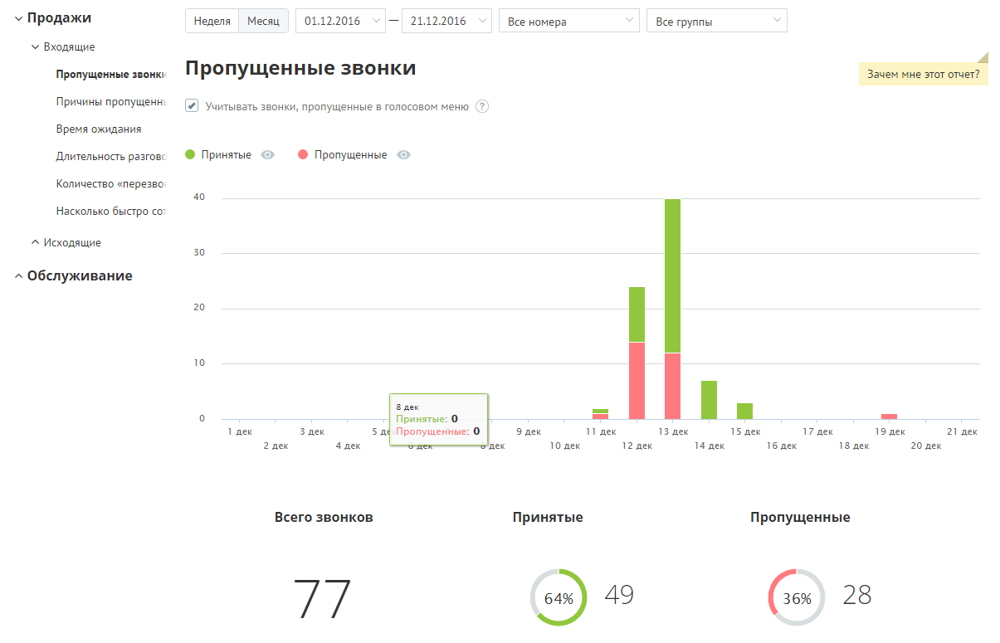
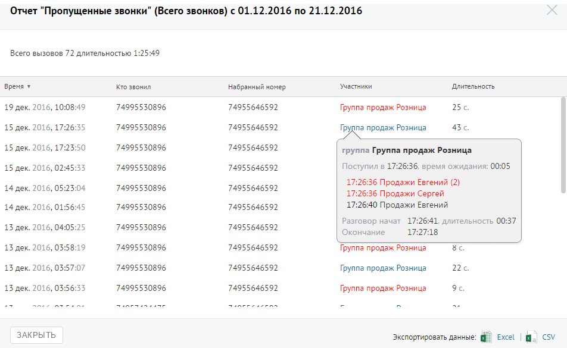

##### Отчет «Пропущенные звонки»

> Трассировка: PDF §4.5.9.1.1 · сквозные стр. 234-235 · источники: ч.1 `kb/sources/mango-lk-manual/LK_manual_v-125-1-280.pdf` с.234-235.

Отчет «Пропущенные звонки» в графическом виде отображает информацию о входящих звонках по датам выбранного диапазона через выбранные линии с участием выбранных групп.

Пример сформированного отчета приведен на рисунке ниже.

> **Описание иллюстрации LK-§4.5.9.1.1-1** (к §4.5.9.1.1 «Отчет «Пропущенные звонки»», стр. 234; 1205×775 px). Снимок экрана / схема Личного кабинета.
> Относится к тексту руководства: «…Пример сформированного отчета приведен на рисунке ниже.».
> Текст на изображении (OCR, требует сверки): У Продажи; 01.12.2016 v —; 21.12.2016; 'Неделя; Месяц; Все номера; Все группы; У Входящие; Пропущенные звонку; Пропущенные звонки; Зачем мне этот отчет?; Причины пропущен:; (4) Учитывать звонки, пропущенные в голосовом меню (2); Время ожидания; Длительность разговс; © Принятые ©; © Пропущенные ©; Количество «перезво; "Насколько быстро co; ^ Исходящие; зо; ^ Обслуживание; 20; 10; Baek; Принятые: 0.; 1 дек; 3 nex; 5 nq Пропущенные: ©; nex; 13 дек; 15 дек; 17 дек; 19 nex; 21 дек.; 2 дек; 4 дек; ‘nex; 10 дек; 12 дек; 14 дек; 16 дек; 18 дек; 20 дек; Всего звонков; Принятые; Пропущенные; 64%; 49; 28…

Если флаг «Учитывать звонки, пропущенные в голосовом меню» не установлен, то из подсчета общего числа пропущенных звонков исключаются вызовы, пропущенные в IVR меню.

Для того, чтобы скрыть/отобразить принятые или пропущенные вызовы на графике, щелкните по кнопкам Принятые и Пропущенные соответственно.

Данные о количестве звонков приведены в нижней части окна в виде инфографики, включающей три диаграммы.

Для получения детальной информации о пропущенных вызовах предусмотрена дополнительная форма «Кто звонил», содержащая данные из отчета «Истории вызовов» согласно установленным значениям фильтра.

Чтобы открыть форму, следует щелкнуть по определенному элементу отчета. Содержание данных зависит от того, по какому элементу было совершено нажатие:

 Столбец диаграммы отчета (принятые вызовы) – количество принятых вызовов за указанный день;

 Столбец диаграммы отчета (пропущенные вызовы) – количество пропущенных вызовов за указанный день;

 Диаграмма «Всего звонков» - общее количество вызовов за установленный период;

 Диаграмма «Принятые» - общее количество принятых вызовов за установленный период;

 Диаграмма «Пропущенные» - общее количество пропущенных вызовов за установленный период.

При щелчке по названию группы в столбце «Участники» или «Кто пропустил» отображается подсказка, содержащая подробную информацию по вызову.

> **Описание иллюстрации LK-§4.5.9.1.1-2** (к §4.5.9.1.1 «Отчет «Пропущенные звонки»», стр. 235; 952×585 px). Снимок экрана / схема Личного кабинета.
> Относится к тексту руководства: «…При щелчке по названию группы в столбце «Участники» или «Кто пропустил» отображается подсказка, содержащая подробную информацию по вызову.».
> Текст на изображении (OCR, требует сверки): Отчет "Пропущенные звонки" (Всего звонков) c 01.12.2016 по 21.12.2016; Всего вызовов 72 длительностью 1:25:49; время ¥; то звонил; набранный номер; Участники; Длительность; 19 дек. 2016, 10:08:49; 74995530896; 74955646592; Группа продаж Розница; 256; 15 дек; 2016, 17:26:35; Tpygna продаж Розница 43; 2016, 17:; 50; группа Группа продаж Розница; 05; 2016, 02:; 33; Поступил в 17:26:36, время ожидания:; 14 дек.; 2016, 05:23:04; 17:26:36 Продажи Евгений (2); 17:26:36 Продажи Сергей; 2016, 01:; 45; 17:26:40 Продажи Евгений; 13 дек.; 2016, 04:05:25; Разговор начат 17:26:41, длительность 00:37; Оконча…
