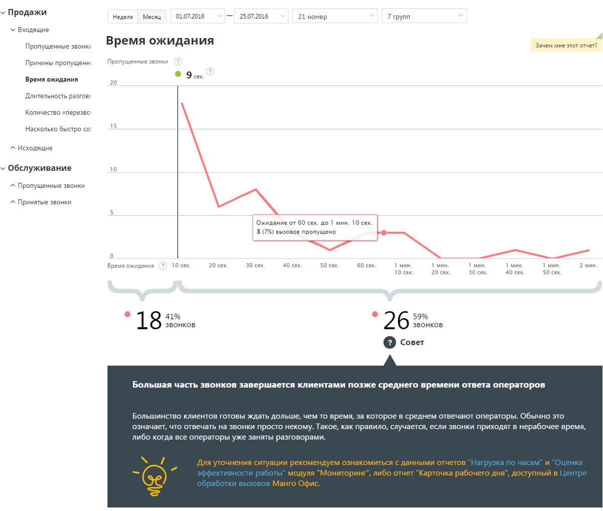

##### Отчет «Время ожидания»

> Трассировка: PDF §4.5.9.1.1 · сквозные стр. 237-239 · источники: ч.1 `kb/sources/mango-lk-manual/LK_manual_v-125-1-280.pdf` с.237-239.

Отчет «Время ожидания» отображает информацию о времени ожидания пропущенного внешнего входящего вызова, поступившего за выбранный временной период через

выбранные линии. Звонки, пропущенные в IVR и не дошедшие до групп, в отчет не включаются.

В верхней части отчета приведены данные о средней продолжительности вызовов в виде инфографики. В зависимости от значения времени ожидания формируется текст совета.

> **Описание иллюстрации LK-§4.5.9.1.1-1** (к §4.5.9.1.1 «Отчет «Время ожидания»», стр. 238; 1202×1020 px). Снимок экрана / схема Личного кабинета.
> Относится к тексту руководства: «…рхней части отчета приведены данные о средней продолжительности вызовов в виде инфографики. В зависимости от значения времени ожидания формируется текст совета.».
> Текст на изображении (OCR, требует сверки): v Продажи; Неделя; Месяц; 7.2016; 25.07.2016; 21 номер; 7 труп; У Входящие; Bpema ожидания; Зачем мне этот отчет?; Пропущенные звоню; Пропу; нные звонки; Причины пропущенн; Время ожидания; 20; Длительность pasros:; Количество «перезво; 15; "Насколько быстро co; ^ Исходящие; Обслуживание; 10; ^ Пропущенные звонки; ^ Принятые звонки; Ожидание от 60 сек. до 1 мин. 10 сек; 3 (79 вызовов пропущено; ee; 10 сек; 20 сек; 30 сек; 40 сек; 50 сек; 60 сек; т мин,; тмин,; 1 мин,; 2 мин.; 50 сек.; 41%; 59%; “18; звонков; “26; © Coser; Большая часть звонков завершается клиентами позже среднего времени ответа…

Диаграмма представляет собой визуализацию динамики изменения количества пропущенных внешних входящих звонков в зависимости от времени ожидания до завершения вызова. Ломаная строится по точкам, соответствующим суммарному числу пропущенных звонков за определенный промежуток времени. При наведении на любую точку участка ломаной отображается всплывающее окно, содержащее дополнительные данные о вызовах.

Также диаграмма содержит маркер, отображающий среднее время ответа операторов на принятые внешние входящие звонки. Маркер представляет собой вертикальную линию, снабженную числовым показателем, который отражает среднее время ответа операторов на принятые внешние входящие звонки.

Таким образом, в левой колонке отчета, расположенной до маркера, приводится информация о количестве вызовов, длительность ожидания по которым меньше или

равна среднему времени ожидания ответа оператора. Здесь же указывается процентная доля таких звонков от всех внешних входящих пропущенных звонков за период с учетом выбранных значений фильтров.

В правой колонке отчета, расположенной после маркера, приводится числовой показатель, отражающий количество вызовов, длительность ожидания по которым больше среднего времени ожидания ответа оператора. Здесь же указывается процентная доля таких звонков от всех внешних входящих пропущенных звонков за период с учетом выбранных значений фильтров.
