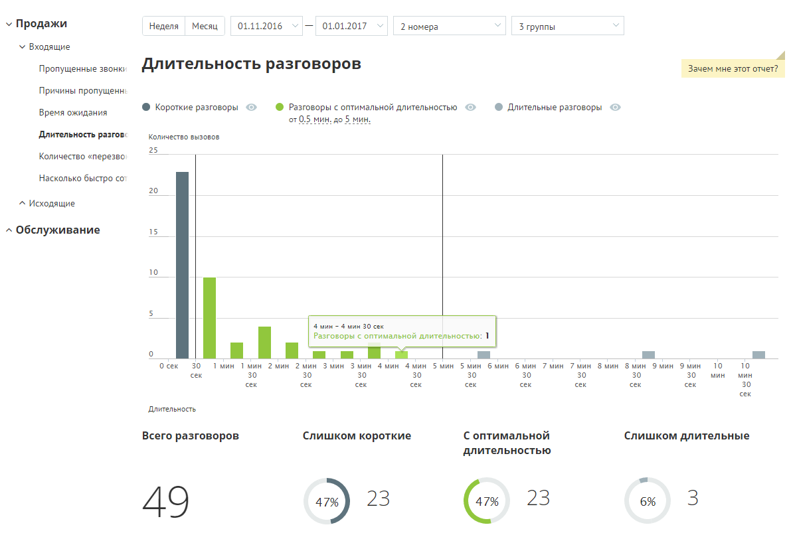
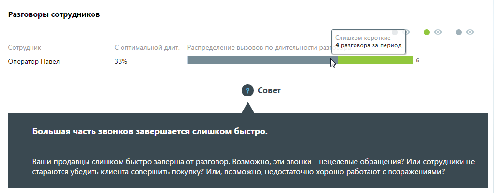
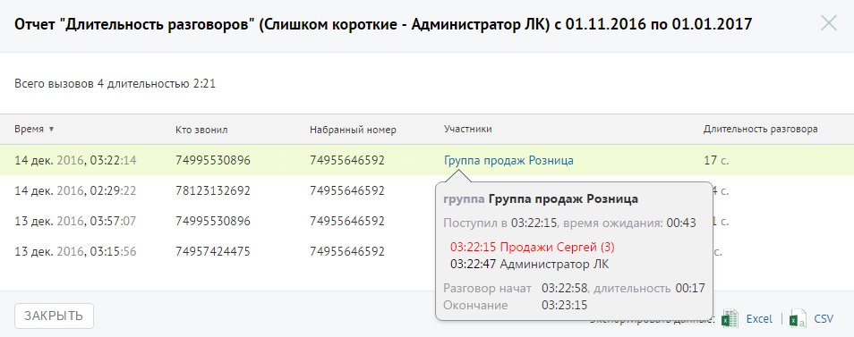

##### Отчет «Длительность разговора»

> Трассировка: PDF §4.5.9.1.1 · сквозные стр. 239-241 · источники: ч.1 `kb/sources/mango-lk-manual/LK_manual_v-125-1-280.pdf` с.239-241.

Отчет «Длительность разговора» отображает информацию о количестве входящих звонков на группу сотрудников, распределенных в зависимости от длительности разговора за определенный период.

По умолчанию оптимальной длительностью разговора с клиентом считается период от 30 секунд до 5 минут. При необходимости измените этот период самостоятельно, установив другое значение в поле «С оптимальной длительностью от… до» после формирования отчета.

Пример сформированного отчета приведен на рисунке ниже.

> **Описание иллюстрации LK-§4.5.9.1.1-1** (к §4.5.9.1.1 «Отчет «Длительность разговора»», стр. 239; 1191×818 px). Снимок экрана / схема Личного кабинета.
> Относится к тексту руководства: «…Пример сформированного отчета приведен на рисунке ниже.».
> Текст на изображении (OCR, требует сверки): У Продажи; 'Неделя; Месяц; 01.11.2016 v —; 01.01.2017; 2 номера; Згруппы; У Входящие; Пропущенные звонку; Длительность разговоров; Зачем мне этот отчет?; Причины пропущен:; Время ожидания; ® Короткие разговоры; @ Разговоры с оптимальной длительностью; © Длительные разговоры:; Длительность pasros:; Количество вызовов,; 25; Количество «перезво; "Насколько; «стро со’; 20; ^ Исходящие; ^ Обслуживание; 15; 10; мин; мин 30 can.; Разговоры с оптимальной длитель; костью: 1; ок; зо; Тин Тмин Эмин 2ммн Эмин Змин 4мин 4мин мин SMU бмин быин 7мин 7мин Змин Зин Эмин Эмин; то; сек; 30; cex; Длительность; С …

Отчет позволяет увидеть детализацию по звонкам не только для группы в целом, но и для каждого сотрудника группы в отдельности.

> **Описание иллюстрации LK-§4.5.9.1.1-2** (к §4.5.9.1.1 «Отчет «Длительность разговора»», стр. 240; 1020×400 px). Снимок экрана / схема Личного кабинета.
> Относится к тексту руководства: «…Отчет позволяет увидеть детализацию по звонкам не только для группы в целом, но и для каждого сотрудника группы в отдельности.».
> Текст на изображении (OCR, требует сверки): Разговоры сотрудников; Слишко; коро; да,; ни; раз; 4 разговора за период; aK; Оператор Павел; 33%; © совет; Большая часть звонков завершается слишком быстро.; Ваши продавцы слишком быстро завершают разговор. Возможно, эти звонки - нецелевые обращения? Или сотрудники не; стараются убедить клиента совершить покупку? Или, возможно, недостаточно хорошо работают с возражениями?

Для того, чтобы скрыть/отобразить различные категории вызовов зависимости от указанной длительности, щелкните по кнопке нужного цвета.

Для получения детальной информации о вызовах предусмотрена дополнительная форма, содержащая данные из отчета «Истории вызовов» согласно установленным значениям фильтра.

Чтобы открыть форму, следует щелкнуть по определенному элементу отчета. Содержание данных зависит от того, по какому элементу было совершено нажатие:

 Столбец "Слишком короткие" основной диаграммы – общее количество «слишком коротких» звонков за указанный день;

 Диаграмма «Слишком короткие» – общее количество «слишком коротких» звонков за установленный период;

 Диаграмма сотрудника, область «слишком коротких» звонков – общее количество принятых выбранным сотрудником «слишком коротких» звонков за установленный период;

 Диаграмма сотрудника, область звонков «с оптимальной длительностью» – общее количество принятых выбранным сотрудником звонков «с оптимальной длительностью» за установленный период;

 Диаграмма сотрудника, область «слишком длительных» звонков – общее количество принятых выбранным сотрудником «слишком длительных» звонков за установленный период.

При щелчке по названию группы в столбце «Участники» отображается подсказка, содержащая подробную информацию по вызову.

> **Описание иллюстрации LK-§4.5.9.1.1-3** (к §4.5.9.1.1 «Отчет «Длительность разговора»», стр. 241; 954×377 px). Снимок экрана / схема Личного кабинета.
> Относится к тексту руководства: «…При щелчке по названию группы в столбце «Участники» отображается подсказка, содержащая подробную информацию по вызову.».
> Текст на изображении (OCR, требует сверки): Отчет "Длительность разговоров" (Слишком короткие - Администратор ЛК) с 01.11.2016 по 01.01.2017; Всего вызовов 4 длительностью 2:21; время ¥; то звонил; набранный номер; Участники; Длительность разговора; 14 дек. 2016, 03:22:14; 74995530896; 74955646592; Группа продаж Розница; 17 с.; 14 дек. 2016, 02:29:22; 78123132692; группа Группа продаж Розница; 13 дек. 2016, 03:57:07; Поступил в 03:22:15, время ожидания: 00:43; 74957424475; 03:22:15 Продажи Сергей (3); 13 дек. 2016, 03:15:56; 03:22:47 Администратор ЛК; Разговор начат 03:22:58, длительность 00:17; Окончание.; 03:23:15; ЗАКРЫТЬ; Excel; cv
