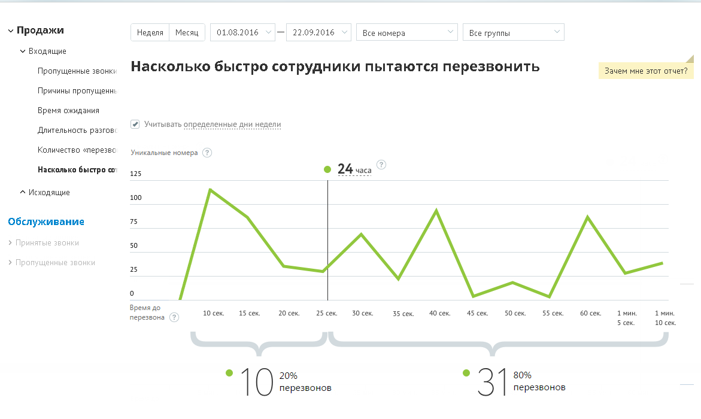
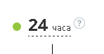

##### Отчет «Насколько быстро сотрудники пытаются перезвонить»

> Трассировка: PDF §4.5.9.1.1 · сквозные стр. 243-245 · источники: ч.1 `kb/sources/mango-lk-manual/LK_manual_v-125-1-280.pdf` с.243-245.

Отчет «Насколько быстро сотрудники пытаются перезвонить» отображает информацию о количестве перезвонов на пропущенные звонки с уникальных номеров в зависимости от времени. Отчет помогает установить, укладываются ли ваши сотрудники в требуемое время, отведенное на перезвон по пропущенному звонку.

Пример сформированного отчета приведен на рисунке ниже.

> **Описание иллюстрации LK-§4.5.9.1.1-1** (к §4.5.9.1.1 «Отчет «Насколько быстро сотрудники пытаются перезвонить»», стр. 244; 1171×700 px). Снимок экрана / схема Личного кабинета.
> Относится к тексту руководства: «…Пример сформированного отчета приведен на рисунке ниже.».
> Текст на изображении (OCR, требует сверки): v Продажи; Неделя; Месяц; 01.08.2016; 22.09.2016; Все номера; Все группы; У Входящие; Пропущенные звонку; Насколько быстро сотрудники пытаются перезвонить; Зачем мне этот отчет?; Причины пропущен; Время ожидания; ) Учитывать определенные дни недели; „Длительность разгов; Количество «перезво; Уникальные номера; Насколько бы; pO co"; 125; е 24; са; ^ Исходящие; 100; 75; Обслуживание; 50; 25; Время до; 10 cex.; 15 сек; 20 сек; 25 сек; З0сек; 35 сек; 40 сек; 45 сек; 50сек; 55 сек; 60 сек; мин,; перезвона; 5 cex.; 20%; 80%; перезвонов; “10; *31

Линейная диаграмма представляет собой визуализацию динамики изменения количества первых попыток перезвонов на уникальные номера клиентов, с которых в течение выбранного промежутка времени при выбранных значениях фильтров поступали и были пропущены звонки.

Чтобы установить время (в часах), в течение которого с момента пропуска звонка ваши сотрудники должны ему перезвонить, щелкните по соответствующему полю и введите нужное количество часов.

> **Описание иллюстрации LK-§4.5.9.1.1-2** (к §4.5.9.1.1 «Отчет «Насколько быстро сотрудники пытаются перезвонить»», стр. 244; 148×77 px). Фрагмент интерфейса (кнопка, переключатель или поле).
> Относится к тексту руководства: «…асах), в течение которого с момента пропуска звонка ваши сотрудники должны ему перезвонить, щелкните по соответствующему полю и введите нужное количество часов.».
> Текст на изображении (OCR, требует сверки): @ 24 uaca

При наведении на любую точку участка ломаной на экране отобразится всплывающее окно, содержащее следующие данные:

 указание временного промежутка, которому соответствует участок ломаной;

 количественная информация по попыткам перезвона за данный временной промежуток.

Под диаграммой отображается два числовых показателя:

 Перезвонили вовремя (слева) – количество уникальных номеров, с которых пропускались входящие звонки, время до первой попытки перезвона по которым с момента пропуска звонка не превышает установленного, а также процентная доля таких звонков от всех уникальных номеров;

 Перезвонили позже (справа) – количество уникальных номеров, с которых пропускались входящие звонки, время до первой попытки перезвона по которым с момента пропуска звонка превышает установленное, а также процентная доля таких звонков от всех уникальных номеров.
