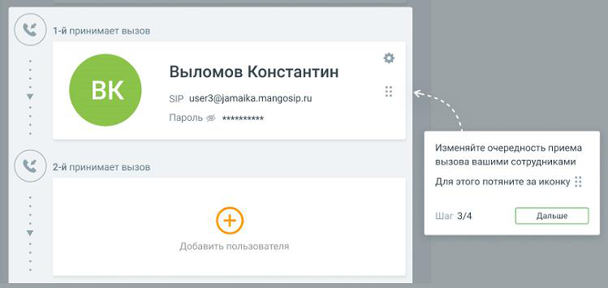

##### 1.8.1.3.2. Блок 2. Сотрудники

> Трассировка: PDF §1.8.1.3.2 · сквозные стр. 20-21 · источники: ч.1 `kb/sources/mango-lk-manual/LK_manual_v-125-1-280.pdf` с.20-21.

Блок «Сотрудники» содержит список пользователей ВАТС, принимающих звонки.

> **Описание иллюстрации LK-§1.8.1.3.2-1** (к §1.8.1.3.2 «Блок 2. Сотрудники», стр. 20; 37×34 px). Пиктограмма (значок элемента интерфейса).
> Относится к тексту руководства: «…Блок «Сотрудники» содержит список пользователей ВАТС, принимающих звонки.».
> Текста на изображении нет; назначение значка — см. текст, к которому он относится.

Клик по пиктограмме открывает карточку добавления нового пользователя.

 Для сценария МИКРО (тариф «Виртуальный номер») можно добавить не более трех сотрудников.

> **Описание иллюстрации LK-§1.8.1.3.2-2** (к §1.8.1.3.2 «Блок 2. Сотрудники», стр. 20; 749×355 px). Снимок экрана / схема Личного кабинета.
> Относится к тексту руководства: «… Для сценария МИКРО (тариф «Виртуальный номер») можно добавить не более трех сотрудников.».
> Текст на изображении (OCR, требует сверки): Выломов Константин; SIP user3@jamaika.mangosip.ru; Пароль 9 зжкжкяжияй; Изменяйте очередность приема; вызова вашими сотрудниками; Для этого потяните за иконку :; © 2-й принимает вызов; Шаг 3/4; Добавить пользователя

Сотрудники принимают звонки в порядке очередности, сверху вниз.

Для изменения порядка очередности переместите карточку сотрудника вверх или вниз

> **Описание иллюстрации LK-§1.8.1.3.2-3** (к §1.8.1.3.2 «Блок 2. Сотрудники», стр. 20; 20×20 px). Пиктограмма (значок элемента интерфейса).
> Относится к тексту руководства: «…Для изменения порядка очередности переместите карточку сотрудника вверх или вниз».
> Текста на изображении нет; назначение значка — см. текст, к которому он относится.

по списку, удерживая левую кнопку мыши на пиктограмме .

ВНИМАНИЕ

Для схемы распределения «сложная настройка» возможность перетаскивать карточки сотрудника отсутствует. Очередность приема звонков указана в заданной в Блоке 1 схеме распределения.
