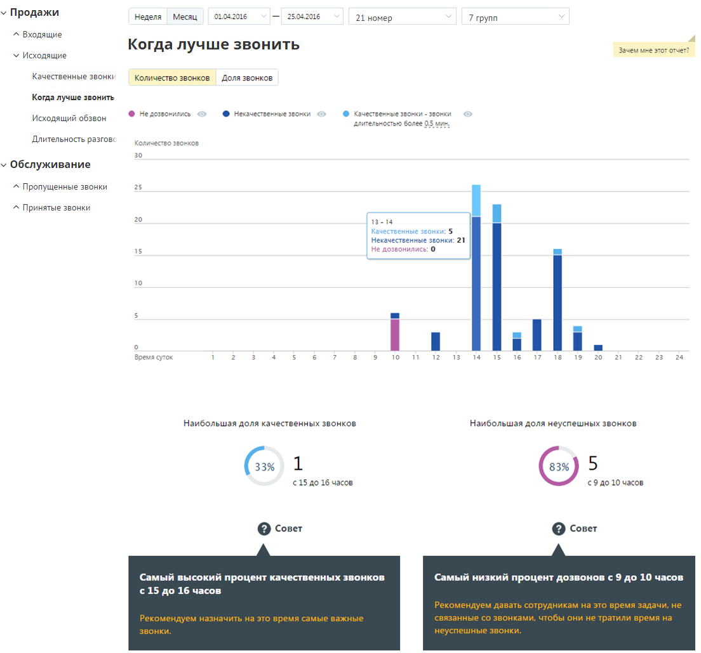
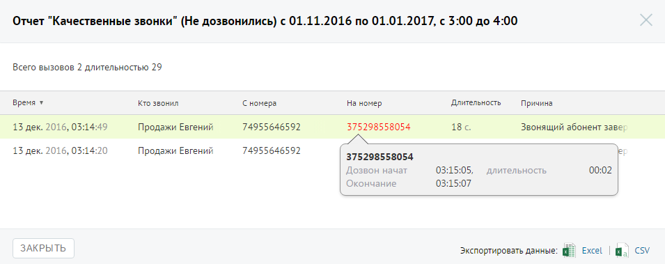

##### Отчет «В какое время лучше совершать звонки»

> Трассировка: PDF §4.5.9.1.2 · сквозные стр. 249-251 · источники: ч.1 `kb/sources/mango-lk-manual/LK_manual_v-125-1-280.pdf` с.249-251.

Отчет «В какое время лучше совершать звонки» отображает информацию о количестве исходящих звонков в течение дня, распределенных в зависимости от качества обслуживания. Качественным вызовом считается принятый вызов с определенной длительностью.

Пример сформированного отчета приведен на рисунке ниже.

Отчет позволяет получить детальную информацию о количестве вызовов за день, а именно:

 отображение динамики изменений количества вызовов определенных типов в течение дня;

 информацию о времени, на которое приходится наибольшая доля качественных и неуспешных звонков соответственно.

> **Описание иллюстрации LK-§4.5.9.1.2-1** (к §4.5.9.1.2 «Отчет «В какое время лучше совершать звонки»», стр. 250; 1104×1030 px). Снимок экрана / схема Личного кабинета.
> Относится к тексту руководства: «… информацию о времени, на которое приходится наибольшая доля качественных и неуспешных звонков соответственно.».
> Текст на изображении (OCR, требует сверки): v Продажи; Неделя; Месяц; 01.08.2016; 25042016; 21 номер; 7 трупа; ^ Входящие; Когда лучше звонить; Зачем мне этот отчет?; У Исходящие; Качественные звонки; Количество звонков; ona звонков; Исходящий обзвон; @ He pose; ee; © Hecavecteenneie звонки; © качественные звонки - звонки; длительностью более 05 мин.; Длительность разговс; 120 звонков; зо; Обслуживание; ^ Пропущенные звонки; 25; ^ Принятые звонки; 20; 13-14; Качественные звонки: 5; Некачественные звонки: 21; Не дозвонились: 0; 10; Lt,; 12; 14; 15; 16; 18; 13; 28; Время суток; Наибольшая доля качественных звонков; Наибольшая доля неуспеш…

В случае, если переключатель "Количество звонков/Доля звонков» установлен в значение "Количество звонков", то на странице отчета отображается диаграмма, содержащая абсолютные значения количества звонков, совершенных в течение того или иного часа.

В случае, если переключатель установлен в значение "Доля звонков", на странице отчета отображается нормированная диаграмма, содержащая распределение долей звонков по категориям за тот или иной час.

Для того, чтобы скрыть/отобразить различные категории вызовов зависимости от указанной длительности, щелкните по кнопке нужного цвета.

При изменении длительности звонка, считающегося качественным, отчет будет сформирован заново автоматически.

Для получения детальной информации о вызовах предусмотрена дополнительная форма, содержащая данные из отчета «Истории вызовов» согласно установленным значениям фильтра.

Чтобы открыть форму, следует щелкнуть по определенному элементу отчета. Содержание данных зависит от того, по какому элементу было совершено нажатие:

 Столбец «Некачественные звонки» основной диаграммы – общее количество исходящих «некачественных» звонков за выбранный интервал;

 Столбец «Не дозвонились» основной диаграммы – общее количество исходящих звонков со статусом «Не дозвонились» за выбранный интервал;

При щелчке по названию группы в столбце «Участники» и «На номер» (для истории вызовов для успешных и неуспешных звонков соответственно) отображается подсказка, содержащая подробную информацию по вызову.

> **Описание иллюстрации LK-§4.5.9.1.2-2** (к §4.5.9.1.2 «Отчет «В какое время лучше совершать звонки»», стр. 251; 955×379 px). Снимок экрана / схема Личного кабинета.
> Относится к тексту руководства: «…частники» и «На номер» (для истории вызовов для успешных и неуспешных звонков соответственно) отображается подсказка, содержащая подробную информацию по вызову.».
> Текст на изображении (OCR, требует сверки): ‘Отчет "Качественные звонки" (Не дозвонились) с 01.11.2016 по 01.01.2017, с 3:00 до 4:00; Всего вызовов 2 длительностью 29; время ¥; то звонил; ‘Сномера; Наномер; Длительность; Причина; 13 дек. 2016, 03:14:49; Продажи Евгений; 74955646592; 375298558054; 18 с.; Звонящий абонент заве.; 13 дек. 2016, 03:14:20; 00:02; Дозвон начат; 03:15:05,; ‘длительность; Окончание.; 03:15:07; ЗАКРЫТЬ; экспортировать данные: Ш Excel
