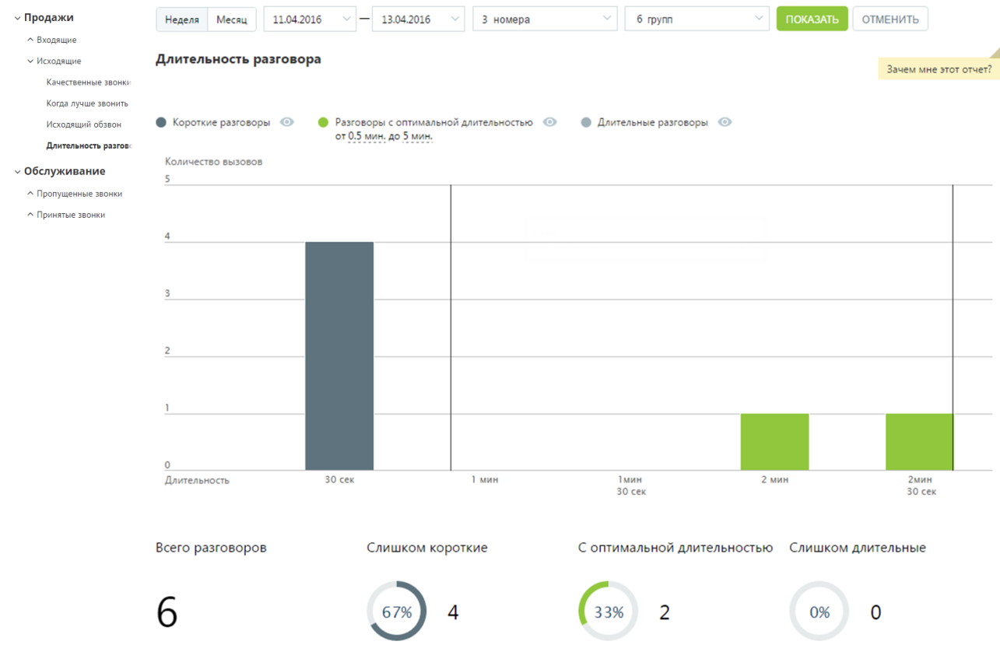
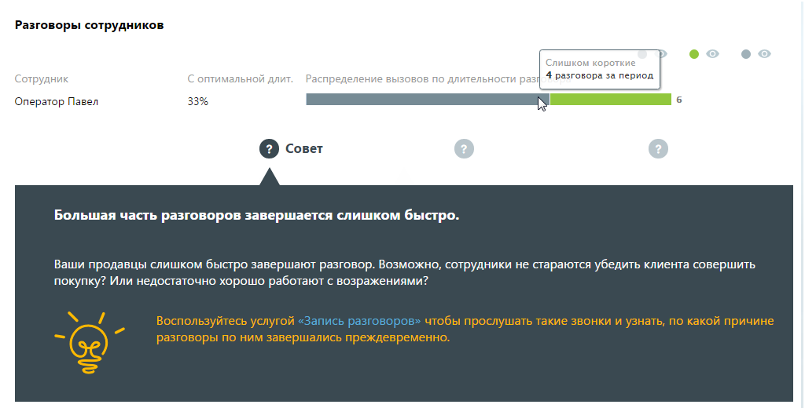
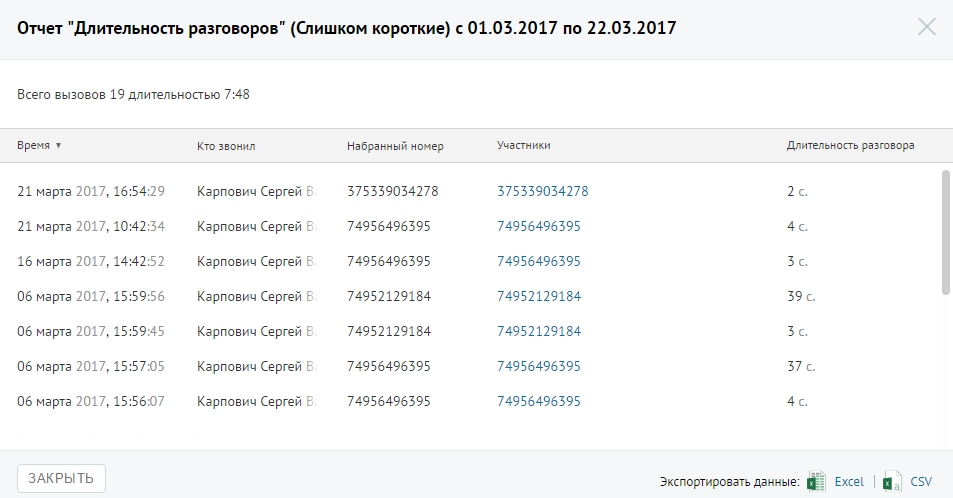

##### Отчет «Длительность разговора»

> Трассировка: PDF §4.5.9.1.2 · сквозные стр. 254-256 · источники: ч.1 `kb/sources/mango-lk-manual/LK_manual_v-125-1-280.pdf` с.254-256.

Отчет «Длительность разговора» отображает информацию о количестве исходящих вызовов, распределенных в зависимости от длительности разговора за определенный период.

По умолчанию оптимальной длительностью разговора считается период от 30 секунд до 5 минут. Для изменения периода установите другое значение в поле «С оптимальной длительностью от… до» после формирования отчета.

> **Описание иллюстрации LK-§4.5.9.1.2-1** (к §4.5.9.1.2 «Отчет «Длительность разговора»», стр. 254; 1285×856 px). Снимок экрана / схема Личного кабинета.
> Относится к тексту руководства: «…читается период от 30 секунд до 5 минут. Для изменения периода установите другое значение в поле «С оптимальной длительностью от… до» после формирования отчета.».
> Текст на изображении (OCR, требует сверки): v Продажи; Неделя; Месяц.; 11.04.2016; 13.04.2016; 3 номера; 6 групп; ОТМЕНИТЬ; > Входящие; У Исодящие; Длительность разговора; Зачем мне этот отчет?; Качественные звонку; Когда лучше звонить; Исходящий обзвон; ® короткие раговоры @; @ Разговоры с оптимальной длительностью @; © Длительные раховоры ©; oF 0.5 мин, до 5 мин.; Длительность разгов.; Количество вызовов; > Обслуживание; ^ Пропущенные звонки; ^ Принятые звонки; 30 сек.; 1 мин; Тмин; 2 мин; 2мин; Длительность.; 30 сек; С оптимальной длительностью Слишком длительные; Всего разговоров; Слишком короткие; 67%

Отчет позволяет увидеть детализацию по звонкам не только для группы в целом, но и для каждого сотрудника группы в отдельности.

> **Описание иллюстрации LK-§4.5.9.1.2-2** (к §4.5.9.1.2 «Отчет «Длительность разговора»», стр. 255; 1024×520 px). Снимок экрана / схема Личного кабинета.
> Относится к тексту руководства: «…Отчет позволяет увидеть детализацию по звонкам не только для группы в целом, но и для каждого сотрудника группы в отдельности.».
> Текст на изображении (OCR, требует сверки): Разговоры сотрудников; Слишко; ork; 4 pasro:; пери; рудник; пимальн; длит.; аспреде; enn; вов пс; о длительности; Оператор Павел; © совет; Большая часть разговоров завершается слишком быстро.; Ваши продавцы слишком быстро завершают разговор. Возможно, сотрудники не стараются убедить клиента совершить; покупку? Или недостаточно хорошо работают с возражениями?; «Запись разговоров»

Для того, чтобы скрыть/отобразить различные категории вызовов зависимости от указанной длительности, щелкните по кнопке нужного цвета.

Для получения детальной информации о вызовах предусмотрена дополнительная форма, содержащая данные из отчета «Истории вызовов» согласно установленным значениям фильтра.

Чтобы открыть форму, следует щелкнуть по определенному элементу отчета. Содержание данных зависит от того, по какому элементу было совершено нажатие:

 Столбец "Короткие разговоры" основной диаграммы – общее количество исходящих звонков категории «Короткие разговоры» определенной длительности за установленный период;

 Столбец "Длительные разговоры" основной диаграммы – общее количество исходящих звонков категории «Длительные разговоры» определенной длительности за установленный период;

 Диаграмма «Слишком короткие» – общее количество исходящих звонков категории «Слишком короткие» за установленный период;

 Диаграмма «Слишком длительные» – общее количество исходящих звонков категории «Слишком длительные» за установленный период;

 Диаграмма сотрудника, область «слишком коротких» звонков – общее количество исходящих звонков категории «Слишком короткие», совершенных выбранным сотрудником за установленный период;

 Диаграмма сотрудника, область звонков «с оптимальной длительностью» – общее количество исходящих звонков категории «С оптимальной

длительностью», совершенных выбранным сотрудником за установленный период;

 Диаграмма сотрудника, область «слишком длительных звонков» – общее количество исходящих звонков категории «Слишком длительные», совершенных выбранным сотрудником за установленный период;

Пример отчета Истории вызовов приведен на рисунке ниже.

> **Описание иллюстрации LK-§4.5.9.1.2-3** (к §4.5.9.1.2 «Отчет «Длительность разговора»», стр. 256; 953×498 px). Снимок экрана / схема Личного кабинета.
> Относится к тексту руководства: «…Пример отчета Истории вызовов приведен на рисунке ниже.».
> Текст на изображении (OCR, требует сверки): Отчет "Длительность разговоров" (Слишком короткие) с 01.03.2017 по 22.03.2017; Всего вызовов 19 длительностью 7:48; время ¥; то звонил; набранный номер; Участники; Длительность разговора; 21 марта 2017, 16:54:29; Карпович Сергей Е; 375339034278; 26; 21 марта 2017, 1; 234; 74956496395; 4c; 16 марта 2017, 1-; 2:52; 3c.; 74952129184; 396,; 06 марта 2017, 15:59:56; 06 марта 2017, 1; 945; 06 марта 2017, 15:57:05; 37.; 06 марта 2017, 15:56:07; ЗАКРЫТЬ; Экспортировать данные:; Excel; al; cv
