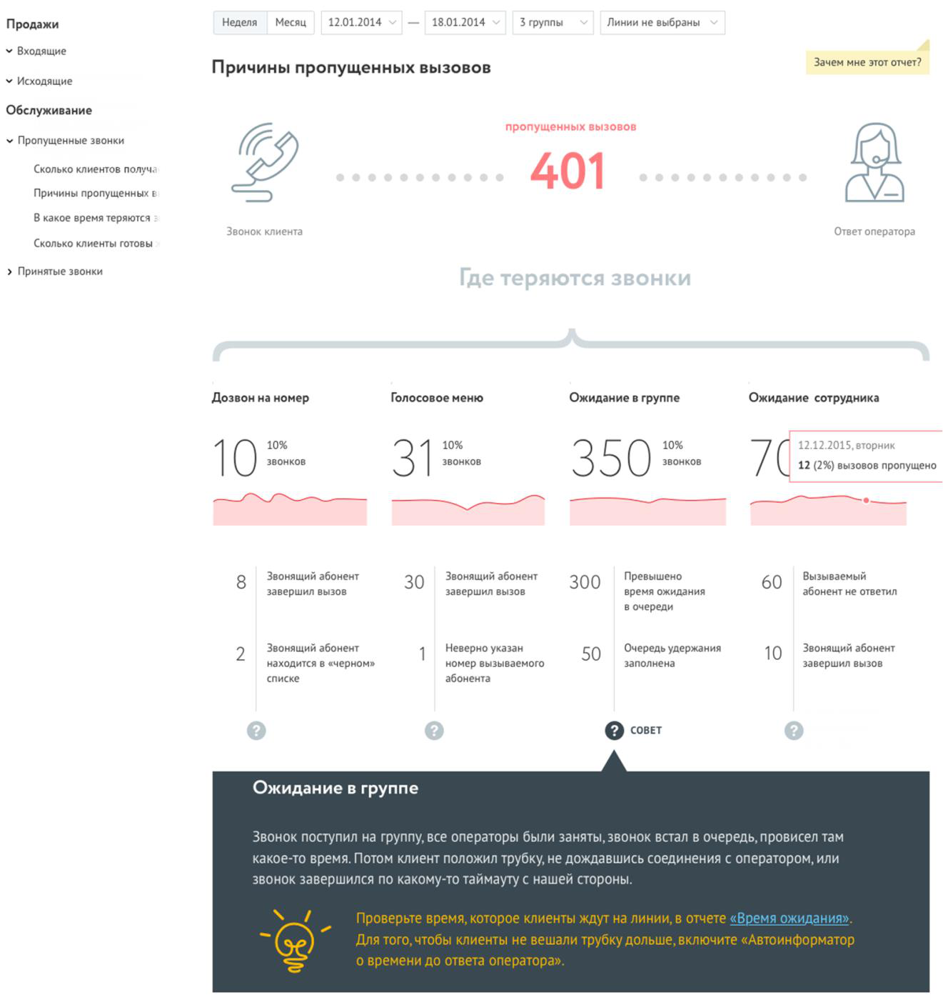
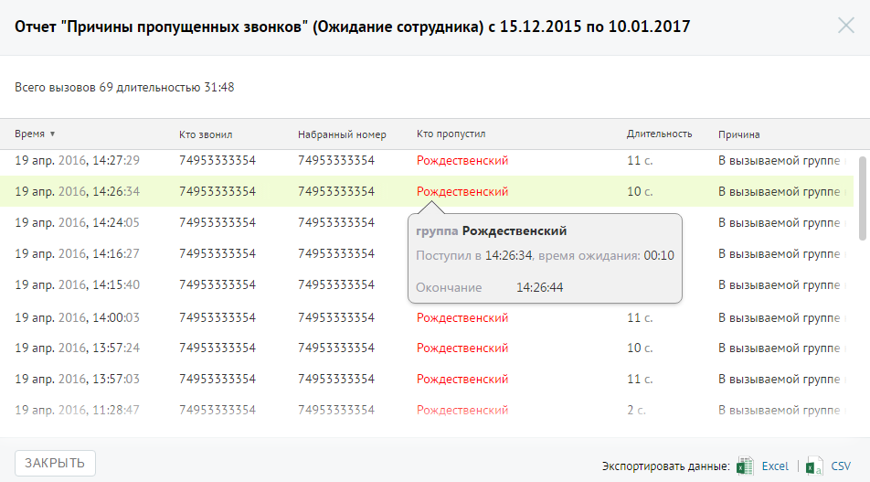

##### Отчет «Причины пропущенных звонков»

> Трассировка: PDF §4.5.9.2.1 · сквозные стр. 258-260 · источники: ч.1 `kb/sources/mango-lk-manual/LK_manual_v-125-1-280.pdf` с.258-260.

Отчет «Причины пропущенных звонков» отображает информацию о количестве и процентном соотношении пропущенных вызовов за определенный период в зависимости от причины, по которой они были пропущены.

Пример сформированного отчета приведен на изображении на следующей странице.

> **Описание иллюстрации LK-§4.5.9.2.1-1** (к §4.5.9.2.1 «Отчет «Причины пропущенных звонков»», стр. 259; 1321×1400 px). Снимок экрана / схема Личного кабинета.
> Относится к тексту руководства: «…Пример сформированного отчета приведен на изображении на следующей странице.».
> Текст на изображении (OCR, требует сверки): Неделя; Месяц; 12.01.2014; 18.01.2014; Згруплы; Линии не выбраны; Продажи; у Входящие; Зачем мне этот отчет?; Причины пропущенных вызовов; У Исходящие; Обслуживание; пропущенных вызовов; ¥ Пропущенные звонки; ‘Сколько клиентов получ.; 401; Причины пропущенных е; В какое время теряются; kane!; топер:; ора; ‘Сколько клиенты готовы; > Принятые звонки; Дозвон на номер.; Голосовое меню; Ожидание в группе; Ожидание сотрудника; 10%; орник; звонков; 10; 31; 350; 12 (2%) вызовов пропущено; Вызываемый; Звонящий абонент; 30; 300; Превышено; 60; завершил вызов; время ожидания; абонент не ответил; в очеред…

Отчет условно состоит из трех частей. В первой части приведено общее количество пропущенных вызовов в соответствии с условиями фильтрации.

Во второй части отчета указывается количество и процентное соотношение пропущенных вызовов в зависимости от стадии вызова. Каждая стадия сопровождается мини-графиком, отражающим распределение пропущенных звонков по дням на протяжении выбранного периода. При наведении курсора на линию графика отображается всплывающее окно, содержащее информацию о дате и количестве пропущенных вызовов в соответствующий день.

Третья часть отражает распределение звонков, пропущенных на каждой стадии дозвона, по причинам пропуска вызова.

Для получения детальной информации о пропущенных вызовах предусмотрена дополнительная форма «Кто звонил», содержащая данные из отчета «Истории вызовов» согласно установленным значениям фильтра.

Чтобы открыть форму, следует щелкнуть по определенному элементу отчета. Содержание данных зависит от того, по какому элементу было совершено нажатие:

 Диаграмма «Пропущенных вызовов» – общее количество вызовов за установленный период ни всех стадиях дозвона;

 Диаграмма «Дозвон на номер» – количество пропущенных вызовов на стадии дозвона «Дозвон на номер» за установленный период;

 Диаграмма «Голосовое меню» – количество пропущенных вызовов на стадии дозвона «Голосовое меню» за установленный период;

 Диаграмма «Ожидание в группе» – количество пропущенных вызовов на стадии дозвона «Ожидание в группе» за установленный период;

 Диаграмма «Ожидание сотрудника» – количество пропущенных вызовов на стадии дозвона «Дозвон на номер» за установленный период;

 Область с описанием причины завершения вызова. В этом случае отчет будет отображать пропущенные звонки, завершившиеся с выбранной причиной на соответствующей стадии дозвона за установленный период.

При щелчке по названию группы в столбце «Кто пропустил» отображается подсказка, содержащая подробную информацию по вызову.

> **Описание иллюстрации LK-§4.5.9.2.1-2** (к §4.5.9.2.1 «Отчет «Причины пропущенных звонков»», стр. 260; 952×527 px). Снимок экрана / схема Личного кабинета.
> Относится к тексту руководства: «…При щелчке по названию группы в столбце «Кто пропустил» отображается подсказка, содержащая подробную информацию по вызову.».
> Текст на изображении (OCR, требует сверки): Отчет "Причины пропущенных звонков" (Ожидание сотрудника) с 15.12.2015 по 10.01.2017; Всего вызовов 69 длительностью 31:48; время ¥; то звонил; набранный номер; Кто пропустил; Длительность; Причина; 19 апр. 2016, 14:27:29; 74953333354; Рождественский; ие; В вызываемой группе; 10.; 19 апр. 2016, 14:26:34; 19 апр. 2016, 14:24:05; группа Рождественский; 19 апр. 2016, 14:16:27; Поступил 14:26:34, время ожидания: 00:10; 19 апр. 2016, 14:15:40; Окончание.; 14:26:44; 19 апр. 2016, 14:00:03; lic.; 19 апр. 2016, 13:57:24; 19 апр. 2016, 13:57:03; 11; 19 апр.; 112847; ЗАКРЫТЬ; Excel; Экспортировать данны…
