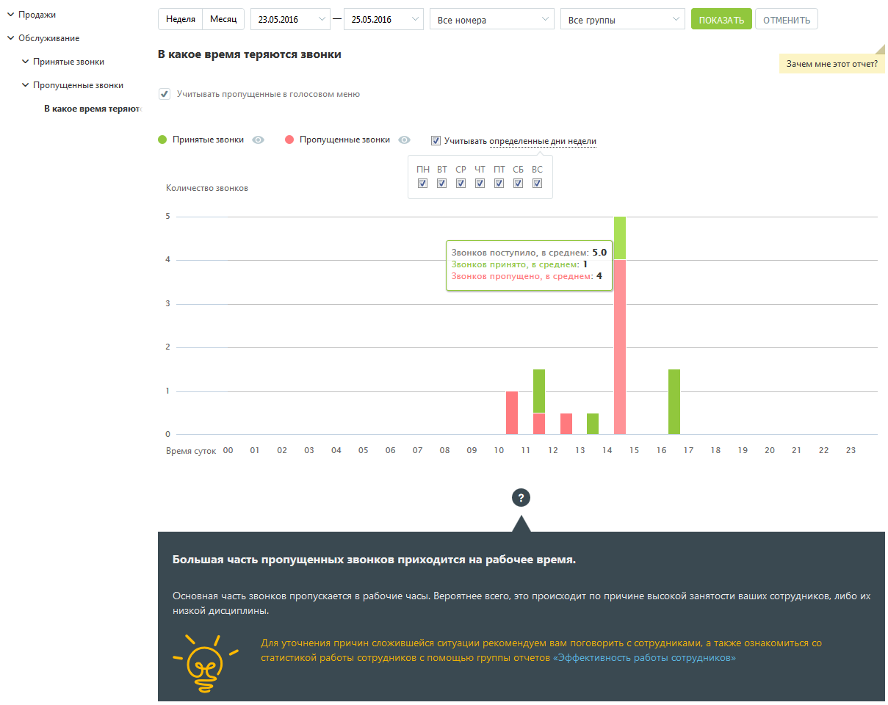
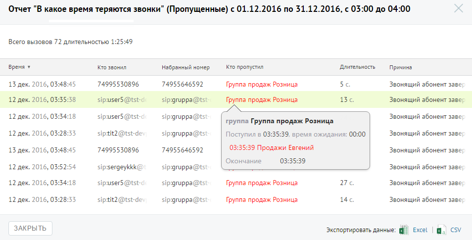

##### Отчет «В какое время теряются звонки»

> Трассировка: PDF §4.5.9.2.1 · сквозные стр. 260-262 · источники: ч.1 `kb/sources/mango-lk-manual/LK_manual_v-125-1-280.pdf` с.260-262.

Отчет «В какое время теряются звонки» в графическом виде отображает информацию о процентном соотношении количества принятых и пропущенных звонков в зависимости

от времени суток. Таким образом, отчет поможет выявить часы, в течение которых пропускается больше всего вызовов, и принять меры по снижению количества пропущенных звонков в эти часы.

Пример сформированного отчета приведен на рисунке ниже. Для получения более детальной информации о количестве вызовов в течение дня наведите курсор на любой столбец графика.

> **Описание иллюстрации LK-§4.5.9.2.1-1** (к §4.5.9.2.1 «Отчет «В какое время теряются звонки»», стр. 261; 1209×960 px). Снимок экрана / схема Личного кабинета.
> Относится к тексту руководства: «…рованного отчета приведен на рисунке ниже. Для получения более детальной информации о количестве вызовов в течение дня наведите курсор на любой столбец графика.».
> Текст на изображении (OCR, требует сверки): У Продажи; Неделя — Месяц; 23052016; 25.05.2016; Все номера; Все группы; ОТМЕНИТЬ; У Обслуживание; У Принятые звонки; В какое время теряются звонки; Зачем мне этот отче"; У Пропущенные звонки; У Учитывать пропущенные в голосовом меню; В какое время теряют; © Принятые звонки; © Пропущенные звонки; Учитывать определенные дни недели; ПН ВТ cP UT ПТ CB BC; Количество звонков.; Звонков поступило, в среднем: 5.0; Звонков принято, в среднем: 1; Звонков пропущено, в среднем: 4; нии; от; 02; 03; 04; 05,; 08; ов; 09; то; 12; 13; 14; 15; 16; 17; 18; 19; 20; 21; 22; 23; Время суток 00; Большая часть пропу…

Если флаг «Учитывать пропущенные в голосовом меню» не установлен, то из подсчета общего числа звонков исключаются вызовы, пропущенные в IVR меню.

Для того, чтобы скрыть/отобразить принятые или пропущенные вызовы на графике, щелкните по кнопкам Принятые звонки и Пропущенные звонки соответственно.

Для того, чтобы исключить из указанного периода определенные дни недели, данные по которым не должны фигурировать в отчете, щелкните по ссылке «Учитывать определенные дни недели» и снимите нужные флаги.

Для получения детальной информации о пропущенных вызовах предусмотрена дополнительная форма, содержащая данные из отчета «Истории вызовов» согласно установленным значениям фильтра.

Чтобы открыть форму, следует щелкнуть по столбцу диаграммы отчета, содержащего пропущенные вызовы за определенное время суток.

> **Описание иллюстрации LK-§4.5.9.2.1-2** (к §4.5.9.2.1 «Отчет «В какое время теряются звонки»», стр. 262; 954×485 px). Снимок экрана / схема Личного кабинета.
> Относится к тексту руководства: «…Чтобы открыть форму, следует щелкнуть по столбцу диаграммы отчета, содержащего пропущенные вызовы за определенное время суток.».
> Текст на изображении (OCR, требует сверки): Отчет "В какое время теряются звонки" (Пропущенны; ) < 01.12.2016 по 31.12.2016, с 03:00 до 04:00; Всего вызовов 72 длительностью; время ¥; то звонил; набранный номер; Кто пропустил; Длительность; Причина; 13 дек. 2016, 03+; 45; 74995530896; 74955646592; Группа продаж Розница; 55; Звонящий абонент заве; 12 дек. 2016, 03:; 38; sipuser5 @tst; sip:gruppa@ts:; 13c.; Звонящий абонент 3386; 12 дек. 2016, 05; 18; sipuserS @tst; sip:gruppa@ts; Звонящий эбонент заве; группа Группа продаж Розница; 12 дек. 2016, 03:28:33; siptit2 @tst-de; sip-gruppa@ts; Поступил в 03:35:39, время ожидания: 00:00; 13 дек.…

При щелчке по названию группы в столбце «Кто пропустил» отображается подсказка, содержащая подробную информацию по вызову.
