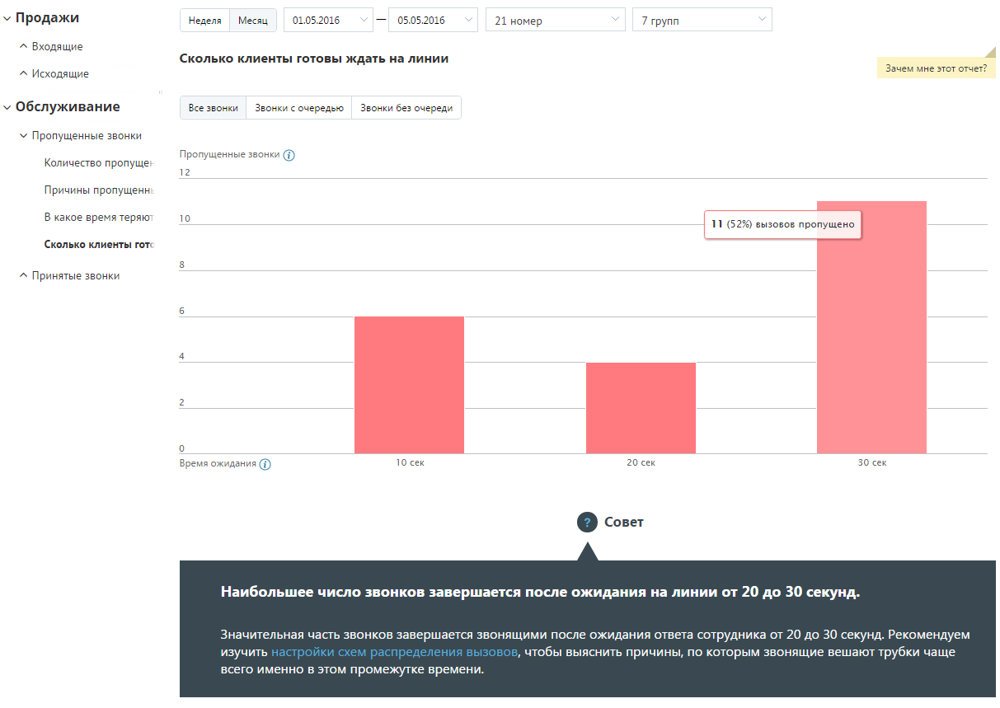

##### Отчет «Сколько клиенты готовы ждать на линии»

> Трассировка: PDF §4.5.9.2.1 · сквозные стр. 262-263 · источники: ч.1 `kb/sources/mango-lk-manual/LK_manual_v-125-1-280.pdf` с.262-263.

Отчет «Сколько клиенты готовы ждать на линии» отображает информацию о количестве входящих пропущенных звонков на группу, которые в соответствии с заданными параметрами фильтрации распределены в зависимости от времени ожидания на линии.

Пример сформированного отчета приведен на рисунке ниже. Отчет представляет собой диаграмму, отображающую количество внешних пропущенных звонков, прекращенных по инициативе звонящего, распределенное по промежуткам времени ожидания на линии.

> **Описание иллюстрации LK-§4.5.9.2.1-1** (к §4.5.9.2.1 «Отчет «Сколько клиенты готовы ждать на линии»», стр. 263; 1213×859 px). Снимок экрана / схема Личного кабинета.
> Относится к тексту руководства: «…й диаграмму, отображающую количество внешних пропущенных звонков, прекращенных по инициативе звонящего, распределенное по промежуткам времени ожидания на линии.».
> Текст на изображении (OCR, требует сверки): У Продажи; "Неделя; Месяц; 01.05.2016; 05.05.2016; 21 номер; 7 трупа; ^ Входящие; Сколько клиенты готовы ждать на линии; Зачем мне этот отчет?; ^ Исходящие; v Обслуживание; Все звонки; Звонки с очередью; Звонки без очереди; У Пропущенные звонки; Пропущенные звонки (); Количество пропуще:; 12; Причины пропущен:; В какое время теряют; 10; Сколько клиенты ror:; ^ Принятые звонки; Время ожидания (Ф); 10 сек; 20 сек; 30 сек; © совет; Наибольшее число звонков завершается после ожидания на линии от 20 до 30 секунд.; Значительная часть 3!; DHKOB 3; вершается звонящими после ожидания ответа сотрудника …

Для более детального формирования отчета предусмотрены следующие переключатели:

 Все звонки – отчет содержит информацию обо всех внешних пропущенных звонках;

 Звонки с очередью – отчет учитывает только звонки, которые находились в очереди вызовов одной или более групп;

 Звонки без очереди – отчет учитывает только звонки, которые в процессе прохождения не попали в очередь вызовов ни одной группы.
