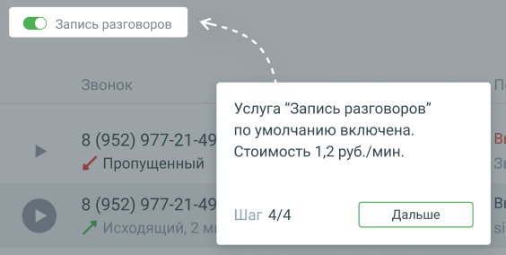

##### 1.8.1.3.3. Блок 3. Звонки

> Трассировка: PDF §1.8.1.3.3 · сквозные стр. 21-22 · источники: ч.1 `kb/sources/mango-lk-manual/LK_manual_v-125-1-280.pdf` с.21-22.

Блок «Звонки» содержит следующие элементы:

 Время - дата и время (Московское) звонка;

> **Описание иллюстрации LK-§1.8.1.3.3-1** (к §1.8.1.3.3 «Блок 3. Звонки», стр. 21; 19×24 px). Пиктограмма (значок элемента интерфейса).
> Относится к тексту руководства: «… Время - дата и время (Московское) звонка;».
> Текста на изображении нет; назначение значка — см. текст, к которому он относится.

 Статус записи разговора – записанный разговор отмечен иконкой ;

> **Описание иллюстрации LK-§1.8.1.3.3-2** (к §1.8.1.3.3 «Блок 3. Звонки», стр. 21; 16×16 px). Пиктограмма (значок элемента интерфейса).
> Относится к тексту руководства: «… Статус записи разговора – записанный разговор отмечен иконкой ;».
> Текста на изображении нет; назначение значка — см. текст, к которому он относится.

> **Описание иллюстрации LK-§1.8.1.3.3-3** (к §1.8.1.3.3 «Блок 3. Звонки», стр. 21; 16×16 px). Пиктограмма (значок элемента интерфейса).
> Относится к тексту руководства: «…ства: «… Статус записи разговора – записанный разговор отмечен иконкой ;». > Текста на изображении нет; назначение значка — см. текст, к которому он относится.».
> Текста на изображении нет; назначение значка — см. текст, к которому он относится.

 Звонок – номер телефона, тип вызова (входящий , исходящий ,

> **Описание иллюстрации LK-§1.8.1.3.3-4** (к §1.8.1.3.3 «Блок 3. Звонки», стр. 21; 16×16 px). Пиктограмма (значок элемента интерфейса).
> Относится к тексту руководства: «… Звонок – номер телефона, тип вызова (входящий , исходящий ,».
> Текста на изображении нет; назначение значка — см. текст, к которому он относится.

> **Описание иллюстрации LK-§1.8.1.3.3-5** (к §1.8.1.3.3 «Блок 3. Звонки», стр. 21; 16×16 px). Пиктограмма (значок элемента интерфейса).
> Относится к тексту руководства: «…оводства: «… Звонок – номер телефона, тип вызова (входящий , исходящий ,». > Текста на изображении нет; назначение значка — см. текст, к которому он относится.».
> Текста на изображении нет; назначение значка — см. текст, к которому он относится.

пропущенный , не дозвонились ), длительность вызова;  Пользователь – пользователи или список пользователей, которые совершили/приняли вызов;  Все звонки – переход в раздел История вызовов;  Фильтр Пропущенные – по клику на кнопку отображаются звонки с типом

> **Описание иллюстрации LK-§1.8.1.3.3-6** (к §1.8.1.3.3 «Блок 3. Звонки», стр. 21; 16×16 px). Пиктограмма (значок элемента интерфейса).
> Относится к тексту руководства: «…вателей, которые совершили/приняли вызов;  Все звонки – переход в раздел История вызовов;  Фильтр Пропущенные – по клику на кнопку отображаются звонки с типом».
> Текста на изображении нет; назначение значка — см. текст, к которому он относится.

Пропущенный , пропущенные с момента последнего просмотра данной страницы администратором.  Тумблер Запись разговоров – отвечает за включение/отключение записи разговоров.

> **Описание иллюстрации LK-§1.8.1.3.3-7** (к §1.8.1.3.3 «Блок 3. Звонки», стр. 21; 564×284 px). Снимок экрана / схема Личного кабинета.
> Относится к тексту руководства: «… , пропущенные с момента последнего просмотра данной страницы администратором.  Тумблер Запись разговоров – отвечает за включение/отключение записи разговоров.».
> Текст на изображении (OCR, требует сверки): Услуга “Запись разговоров”; по умолчанию включена.; Стоимость 1,2 руб./мин.; Шаг 4/4

Нажатие кнопки Дальше завершает знакомство с интерфейсом Главной страницы ВАТС (сценарий МИКРО).

Если модуль Онбординг не завершен, в любой момент работы с Личным кабинетом

> **Описание иллюстрации LK-§1.8.1.3.3-8** (к §1.8.1.3.3 «Блок 3. Звонки», стр. 22; 20×20 px). Пиктограмма (значок элемента интерфейса).
> Относится к тексту руководства: «…Если модуль Онбординг не завершен, в любой момент работы с Личным кабинетом».
> Текста на изображении нет; назначение значка — см. текст, к которому он относится.

пользователь может нажать на иконку в шапке ЛК и продолжить обучение.
