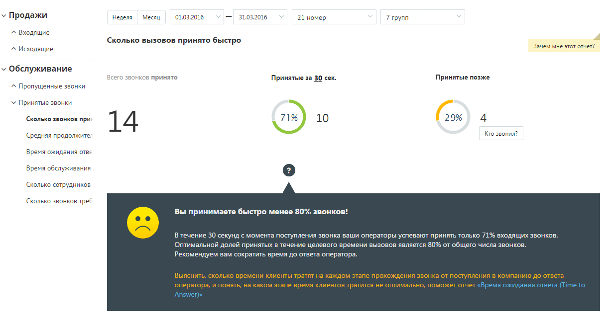
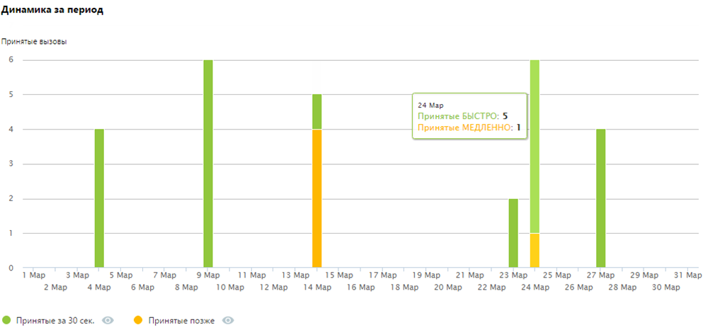
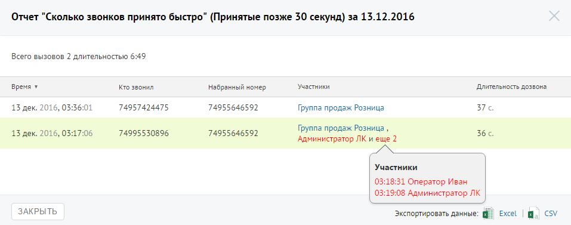

##### Отчет «Сколько звонков принято быстро»

> Трассировка: PDF §4.5.9.2.2 · сквозные стр. 263-265 · источники: ч.1 `kb/sources/mango-lk-manual/LK_manual_v-125-1-280.pdf` с.263-265.

Отчет «Сколько звонков принято быстро» содержит информацию о количестве входящих вызовов, принятых «быстро», то есть за определенное время.

По умолчанию быстро принятым вызовом считается вызов, принятый в течение 30 секунд. При необходимости измените это время самостоятельно, установив другое значение в поле «Принятые за n секунд» после формирования отчета.

В верхней части отчета приведены данные о принятых звонках в виде инфографики.

> **Описание иллюстрации LK-§4.5.9.2.2-1** (к §4.5.9.2.2 «Отчет «Сколько звонков принято быстро»», стр. 264; 1225×654 px). Снимок экрана / схема Личного кабинета.
> Относится к тексту руководства: «…В верхней части отчета приведены данные о принятых звонках в виде инфографики.».
> Текст на изображении (OCR, требует сверки): v Продажи; Неделя; Месяц; 01.03.2016; 31.03.2016; 21 номер; 7 групп; ^ Входящие; Сколько вызовов принято быстро; Зачем мне этот отчет?; ^ Исходящие; v Обслуживание; Все; принято; Принятые за 30 сек.; Принятые позже; ^ Пропущенные звонки; У Принятые звонки; 71%; 29%; Сколько звонков при; 10; 14; Kro звонил; Средняя продолжите; Время ожидания отве; Время обслуживания; Сколько сотрудников; Сколько звонков трее; Вы принимаете быстро менее 80% звонков!; В течение 30 секунд с момента поступления звонка ваши операторы успевают принять только 71% входящих звонков.; Оптимальной долей принятых в течение…

В нижней части окна отображается детальная информация по заданному периоду.

Щелкните по кнопкам Принятые за n сек и Принятые позже для того, чтобы скрыть/отобразить соответствующие показатели на графике.

> **Описание иллюстрации LK-§4.5.9.2.2-2** (к §4.5.9.2.2 «Отчет «Сколько звонков принято быстро»», стр. 264; 993×466 px). Снимок экрана / схема Личного кабинета.
> Относится к тексту руководства: «…Щелкните по кнопкам Принятые за n сек и Принятые позже для того, чтобы скрыть/отобразить соответствующие показатели на графике.».
> Текст на изображении (OCR, требует сверки): Динамика за период.; Принятые вызовы; 24 Map; Принятые БЫСТРО: 5; Принятые МЕДЛЕННО: 1; 1 Map; 3 Map; 5 Мар; 7 Map; 9 Map; 11 Map,; 13 Map; 15 Map; 17 Map; 19 Map; 21 Мар; 23 Map; 25 Map; 27 Map; 29 Map; 31 Map; 2 Map; 4 мар; 6 Map; ‘8 Map; 10 Map; 12 мар.; 14 Map; 16 Map; 18 Map; 20 Map; 22 Map; 24 мар; 26 Мар; 28 Мар; 30 Map; ® Принятые за30сек. © © Принятые позже @

Для получения детальной информации о пропущенных вызовах предусмотрена дополнительная форма «Кто звонил», содержащая данные из отчета «Истории вызовов» согласно установленным значениям фильтра.

Чтобы открыть форму, следует щелкнуть по определенному элементу отчета. Содержание данных зависит от того, по какому элементу было совершено нажатие:

 принятых звонков за Диаграмма «Принятые позже» – количество установленный период, время ожидания по которым превышает заданное пользователем значение пороговой длительности;

Столбец диаграммы отчета (Принятые позже) – количество принятых звонков  за данный день, время ожидания по которым превышает заданное пользователем значение пороговой длительности.

При щелчке по названию группы в столбце «Кто пропустил» отображается подсказка, содержащая подробную информацию по вызову.

> **Описание иллюстрации LK-§4.5.9.2.2-3** (к §4.5.9.2.2 «Отчет «Сколько звонков принято быстро»», стр. 265; 957×377 px). Снимок экрана / схема Личного кабинета.
> Относится к тексту руководства: «…При щелчке по названию группы в столбце «Кто пропустил» отображается подсказка, содержащая подробную информацию по вызову.».
> Текст на изображении (OCR, требует сверки): Отчет "Сколько звонков принято быстро" (Принятые позже 30 секунд) за 13.12.2016; Всего вызовов 2 длительностью 6:49; время ¥; то звонил; набранный номер; Участники; Длительность дозвона; 13 дек. 2016, 03:36:01; 74957424475; 74955646592; Группа продаж Розница; 376.; 13 дек. 2016, 03:; 06; 74995530896; Группа продаж Розница ,; 366.; Администратор ЛК и еще 2; S\N; `Участники; 03:18:31 Оператор Иван; 03:19:08 Администратор ЛК; ЗАКРЫТЬ; Экспортировать данные: Excel
